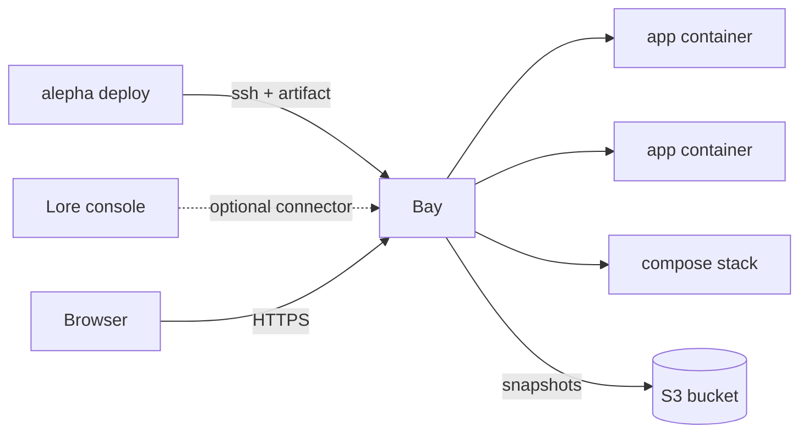

# Introduction

Bay is a self-hosted application server for Alepha apps: one static Go binary
that is the reverse proxy, the deployer, the supervisor and the backup schedule
for every app on a machine you own.

Where Cloudflare gives you someone else's serverless platform, Bay runs your
apps as ordinary long-lived processes, each in its own container, with HTTPS
and health-gated rollback handled for you, and nightly backups once you point it
at a bucket. An artifact goes in over SSH, an HTTPS URL comes out.

## When to use it

- You want a long-lived runtime: background work between requests, in-process
  caches, a local SQLite file.
- You would rather pay for one VPS than per request.
- The data has to stay on hardware you control.
- You run a few apps and their services (Postgres, Redis, an MQTT broker) and
  want one tool to deploy, route, back up and watch all of them.

Bay is not a cluster scheduler. It runs on one host and hosts what fits there;
two hosts are two Bays.

## The shape of it

| Concern            | What Bay does                                                                                         |
| ------------------ | ----------------------------------------------------------------------------------------------------- |
| **Artifact**       | the `tar.zst` that `alepha build` already produces. No Bay-specific format, no manifest to hand-write |
| **Deployment**     | unpack under guard, provision, switch the release atomically, watch it and roll back if it dies      |
| **Supervision**    | one Docker container per app instance, in the runtime image its manifest names                        |
| **Reverse proxy**  | routing by `Host`, static files first, then the app; `.br` and `.gz` served when present             |
| **Static headers** | the release's `_headers` file applied to every static file, the way Cloudflare does                   |
| **TLS**            | certificates from Let's Encrypt (ACME), HTTP redirected to HTTPS                                      |
| **Provisioning**   | a SQLite database, a stable `APP_SECRET` and a per-instance `.env`, written at `0600`                 |
| **Backups**        | a scheduled, verified, compressed snapshot of each database, uploaded to S3 and pruned                |
| **Stacks**         | a Compose file of services beside your apps, each service optionally backed up                       |
| **Control**        | an HTTP API on a unix socket, reached over SSH only. No open port, no token                           |

Apart from `bay serve` and a few host-side commands, every `bay` command is a
thin client of that control API, so a command means the same from a terminal and
from `alepha deploy`. Lore's verbs run inside `bay serve`, on the same functions.

## How the pieces fit

- **The framework** builds the artifact and drives Bay over SSH: the `bay()`
  target of `alepha deploy` and `alepha infra`. Its side is documented in
  [Bay Deployment](/docs/guides-deployment-bay), and services next to an app
  in [Postgres and Redis on a Bay Stack](/docs/guides-deployment-bay-stack).
- **Bay** runs on the host. These pages document installing and operating it.
- **Lore** can optionally hold a connection to the host, to queue deploys and
  restarts from its console and to show what the machine runs. See
  [Connecting to Lore](/bay/docs/guides-lore-connector).

## Where to go next

1. [Installation](/bay/docs/guides-installation): put Bay on a Linux host and
   grant a user the right to deploy.
2. [Deploying apps](/bay/docs/guides-deploying): what a deploy does, domains,
   HTTPS, static files and rollback.
3. [Operating](/bay/docs/guides-operating): status, logs, environment
   variables, stopping, runtimes and troubleshooting.
4. [Backups and storage](/bay/docs/guides-backups): what is backed up, where,
   and how to restore.
5. [Stacks](/bay/docs/guides-stacks): Compose services next to your apps.
6. [Connecting to Lore](/bay/docs/guides-lore-connector): the optional console.
7. [Security model](/bay/docs/guides-security): why there is no admin port,
   and how apps are isolated.
8. [CLI reference](/bay/docs/guides-cli-reference): every command on one page.
