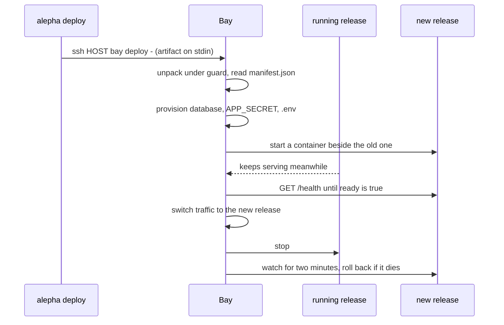

# Deploying apps

What happens on the host when an artifact reaches Bay: how an app is named and
routed, what Bay provisions for it, how a new release replaces the old one, and
when Bay rolls it back on its own.

Most deploys come from `alepha deploy --env <env>`, which builds the artifact
and streams it to the host over SSH. That side is documented in
[Bay Deployment](/docs/guides-deployment-bay). This page is what Bay does with
it, and what you can do by hand on the host.

## A deploy, step by step



1. **Unpack.** The archive is checked as it is read: absolute paths, `..`,
   links and device files are refused, mode bits are ignored and each entry
   has a size cap. A refused artifact moves nothing.
2. **Provision.** From `manifest.json`: a SQLite database when the app declares
   a repository, a stable `APP_SECRET`, the instance `.env` at mode `0600`, and
   the secrets the deploy carried.
3. **Start beside the old one.** When the app is already running, the new
   release starts in its own container while the old one keeps serving
   (blue/green). On a first deploy, requests wait, held rather than answered
   with a `502`, for up to 90 seconds.
4. **Wait until ready.** Bay polls `GET /health` and switches only on
   `{"ready": true}`: an Alepha app binds its port before its migrations have
   run, so "the port answers" is not "the app works". An app without a
   `/health` route (a `404`) is judged by its port instead. The wait lasts 60
   seconds.
5. **Switch and watch.** Traffic moves to the new release and the old process
   stops. For the next **two minutes**, Bay checks the release every 10
   seconds; three failures in a row put the previous release back. That
   catches the release that boots, answers once and dies on its first real
   traffic, which no check at deploy time can see. A stop, a restore or a
   storage migration ends the watch: after one of them, nothing puts the
   previous release back on its own.
6. **Prune.** As soon as the new release is up, without waiting for the watch,
   old releases are removed. Bay keeps **two** per app, the serving one and its
   predecessor (`--keep-releases` raises it): the rollback needs one, and the
   proxy serves static files from every kept release, so a browser holding the
   previous page can still fetch its hashed chunks during a deploy.

When a deploy fails, the answer says whether the app is still serving: a
refused artifact leaves the previous release up, and a release that would not
boot is replaced by the previous one, with both named in the message.

An app has no `bay rollback`. The watch goes back one release on its own; to go
back by hand, deploy the earlier artifact again. Either way only the code moves:
migrations already applied stay applied.

## Names, environments and domains

An app instance is the pair `name/env`, such as `myapp/production`. `--name`
defaults to the project name in the artifact's manifest, and `--env` to
`production`.

| Deploy                                       | Served at                       |
| -------------------------------------------- | ------------------------------- |
| `myapp`, `production`, no domain             | `myapp.<base-domain>`           |
| `myapp`, `staging`, no domain                | `myapp-staging.<base-domain>`   |
| `--domain myapp.com --domain www.myapp.com`  | both; the first is canonical    |

`--domain` repeats and accepts a comma-separated list, since an apex and its
`www` are one site. With `--tls`, Bay obtains a certificate for every domain
on the first deploy that names it.

By hand, on the host. Every `bay` command on this page needs the socket, which
`BAY_SOCKET` names once for the session:

```bash
export BAY_SOCKET=/run/bay/control.sock
bay deploy myapp.tar.zst --name myapp --env staging --domain staging.myapp.com
```

Over SSH the variable goes in the remote command, with the artifact on stdin:

```bash
ssh HOST 'BAY_SOCKET=/run/bay/control.sock bay deploy - --name myapp' < myapp.tar.zst
```

## The artifact

Bay reads the `tar.zst` that `alepha build` produces; `.tar.gz` is accepted too,
detected from the stream's first bytes rather than the file name.

```
myapp.tar.zst
├── manifest.json      ← written by alepha build
├── index.node.js      ← one entry per server slice
├── server/node/
├── public/
└── migrations/
```

`manifest.json` is the contract. Its `runtimes` list names each **slice** the
build produced (its runtime, entry file and major version), and Bay runs the
**first slice it can run, in declared order**. A `node` + `workerd` build runs
its node slice; a workerd-only build is refused at deploy and the message says
why, rather than deploying something that never boots. A static site is one
`static` slice with no process: Bay serves its files and nothing else.

The runtime image comes from the slice: `node:<major>-slim` or
`oven/bun:<major>-slim`, pinned by digest. See
[Runtimes](/bay/docs/guides-operating#runtimes) to list or update them.

### Image apps

Bay also runs an app that is a container image rather than an Alepha artifact,
by digest only:

```bash
bay deploy --image ghcr.io/acme/tool@sha256:... --port 8080 --name tool --health /healthz
```

It is ready when `--health` answers `2xx`, else by the image's own
`HEALTHCHECK`, else when the port accepts a connection. It runs as its image
defines it, including its user, with Docker's default capabilities and a
writable root filesystem; `no-new-privileges` and the memory ceiling still
apply. Bay mounts no host path for it, so what it writes is lost with its
container. The two-minute watch does not cover it: a redeploy that fails its
readiness check never switches, and nothing rolls it back after that.

Bay sends registry credentials only for a stack member, so a standalone image
has to be public. A private image runs in a stack, with
[`bay stack registry add`](/bay/docs/guides-stacks#private-registries).

## Environment and secrets

Bay writes some keys itself and refuses to let anything overwrite them:
`NODE_ENV`, `APP_SECRET`, `DATABASE_URL`, `SERVER_PORT`, `SERVER_HOST`,
`APP_NAME`, `DATA_DIR`, `STORAGE_PATH` and the `S3_*` keys. `APP_SECRET` is
generated once per instance and never regenerated: a new one would sign every
user out.

Your own variables arrive two ways:

- **With the deploy.** `alepha deploy` stages the app's declared secrets in a
  `0600` file and passes `--secrets-file`. Bay merges them into `.env` before the
  new release starts, so there is no moment the app runs without them, then
  deletes the file whether the deploy succeeds or not. See
  [Secrets](/docs/guides-deployment-bay#secrets).
- **Afterwards**, with `bay env set`: see
  [Environment variables](/bay/docs/guides-operating#environment-variables).

## Static files and their headers

Bay serves every file it finds under the release's `public` directory itself,
without waking the app: a page pulls tens of them. So the app's own headers
never reach those files, and Bay applies `public/_headers` instead, the file
`alepha build` writes and Cloudflare applies to the same build:

- the security headers the app's `helmetOptions` produce, on every file;
- a year of immutable caching on content-hashed chunks and assets;
- your own rules from `public/_headers`;
- `public, max-age=0, must-revalidate` for a file no rule caches.

Rules match the path the browser asked for, never the file Bay found:
`/changelog` served from `changelog.html` matches `/changelog`. A request the
app answers is left alone, as on Cloudflare.

A release whose `_headers` does not parse is refused at deploy, naming the
line, and the running release keeps serving. `/_headers`, `/_redirects` and
`/.assetsignore` are never served. See
[Static File Headers](/docs/guides-deployment-headers) for the file's syntax.

## HTTPS

Started with `--tls`, Bay obtains and renews a certificate for every app's
domain, and answers plain HTTP with a `308` to the same address over HTTPS.
Port 80 still answers the ACME challenge first, and a host no app is
registered for keeps its `404`.

Try a new setup against Let's Encrypt's **staging** directory first
(`--acme-ca https://acme-staging-v02.api.letsencrypt.org/directory`):
production quotas are shared and burn fast.

⚠️ Behind a Cloudflare proxy, set its SSL mode to **Full (strict)**, never
**Flexible**, or every request loops between HTTP and HTTPS.

## Removing an app

```bash
bay remove myapp/staging           # unregister; data is kept
bay remove myapp/staging --purge   # and delete its data
```

To take an app down without forgetting it, use `bay stop`: see
[Operating](/bay/docs/guides-operating#stopping-and-starting).
