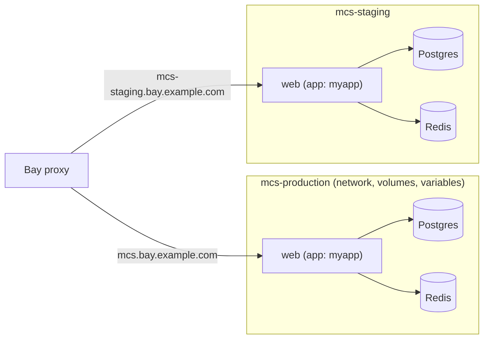

# Stacks

A stack is a Compose file Bay runs as one unit: an Alepha app plus the services
it needs (Postgres, Redis, Keycloak, a queue), each environment isolated from
the others, with routes, variables and backups managed by Bay.

Use a stack when an app needs more than the SQLite database Bay provisions for
a lone app. For the end-to-end walkthrough of a Postgres and Redis stack from
the project's side, read
[Postgres and Redis on a Bay Stack](/docs/guides-deployment-bay-stack); this
page is the Bay reference.



## The compose file

A standard Compose file, plus an `x-lore` field on the services Bay should
treat specially. It is named for Lore, not Bay, because the field means the
same on every target a stack can run on.

```yaml
services:
  db:
    image: postgres:17-alpine
    environment:
      POSTGRES_USER: app
      POSTGRES_PASSWORD: ${POSTGRES_PASSWORD}
      POSTGRES_DB: app
    volumes: [pgdata:/var/lib/postgresql/data]
    healthcheck:
      test: ["CMD-SHELL", "pg_isready -h 127.0.0.1 -U app -d app"]
      interval: 2s
      retries: 30
    x-lore:
      backup:
        postgres: { user: app, db: app }
  redis:
    image: redis:7-alpine
    volumes: [redisdata:/data]
  web:
    depends_on: [db, redis]
    x-lore:
      app: myapp
      routes: ["@"]
volumes:
  pgdata:
  redisdata:
```

| `x-lore` key | Meaning                                                                                                  |
| ------------ | -------------------------------------------------------------------------------------------------------- |
| `app`        | the service is an **app service**: Bay runs it itself (blue/green, hardened) from the artifact deployed under this name, instead of Compose running an image |
| `routes`     | labels under the environment's base domain: `"@"` is the base domain itself, `"auth"` is `auth.<base>`  |
| `port`       | the container port routes reach, when the service publishes several or none                              |
| `runtime`    | an app service's runtime image, instead of the one Bay picks                                             |
| `tcp`        | open this port on every host interface and forward it raw to the same container port. A Compose service only; no TLS and no `Host` routing, so the service guards it itself (MQTT over TLS, for example) |
| `tls`        | with `tcp`: Bay terminates TLS on that port with the certificate of the name the client asks for, and forwards plain TCP to the same container port. A client that names none gets the environment's first route. Renewals are Bay's, so the service holds no certificate |
| `backup`     | how to dump the service: `{postgres: {user, db}}`, or `{command, restore}`                               |

Unknown keys and malformed values are refused at deploy, naming the service,
so a typo is never silently ignored. Full domains never appear in the file,
since production and staging need different ones: they are
[routes](#routes-and-domains).

Bay reads the file through `docker compose config`, then refuses, naming what
it refuses:

- `build`, `container_name` and `privileged`;
- `host` as `network_mode`, `pid`, `ipc` or `userns_mode`;
- `container:` as `network_mode`, `pid`, `ipc` or `volumes_from`, which would
  reach any container on the host. `service:<name>`, or a plain service name
  under `volumes_from`, names one of the stack's own;
- a service with neither `image` nor `x-lore.app`;
- the Docker socket as a mount;
- a bind mount, an `env_file`, or a `file:` under `secrets` or `configs`, outside
  the bundle or of a path the bundle does not carry. A stack's variables are a
  plain file on the host, so an `env_file` could otherwise read another
  environment's passwords, and for the same reason its path cannot hold a
  variable;
- `include` and `extends` from another file: a stack is one compose file;
- a named volume with `driver_opts`, which are mount options: a bind through
  them would reach any host path;
- a named volume or a network marked `external`, or with a `name` of its own:
  Bay names both after the environment, and either one would reach whatever
  already carries that name, another environment's included;
- a Compose service that `depends_on` an app service;
- a `${VAR}` with no value and no default;
- a variable named `COMPOSE_*`: variables reach Compose's own environment, where
  such a name configures Compose itself.

`ports` are rewritten to a loopback port Bay allocates, so the host port in the
file is ignored. Nothing else is checked: `devices`, `cap_add`, `security_opt`,
`cgroup` and `uts` reach Docker as written, so whoever deploys a stack can reach
the host.

## Environments

A stack is deployed per environment, addressed as `<stack>/<env>`. Each one is
its own Compose project (`mcs-production`, `mcs-staging`), with its own network,
volumes, variables and containers: a file cannot name production's Postgres, its
volumes or its variables from staging, and destroying staging leaves production
alone. That stops a mistake, not a hostile file: what the list above leaves
unchecked still reaches the host.

## Deploying

These commands, and every other `bay` command on this page, run on the host with
`BAY_SOCKET` set, as in [Operating](/bay/docs/guides-operating).

```bash
export BAY_SOCKET=/run/bay/control.sock
bay stack deploy mcs/production compose.yml     # or a directory, an archive, or - for stdin
bay stack deploy mcs/production compose.yml --dry-run
bay stack deploy mcs/production                 # reapply the current revision
```

⚠️ **A bundle is a whole directory, never one file.** `compose.yml` as the
argument packs the directory it sits in, leaving out only `.git`, `node_modules`
and symlinks. So `scp compose.yml host:`, then
`bay stack deploy mcs/production compose.yml` from your home directory, bundles
all of `$HOME`, `.ssh` included, into the revision. Give each stack a directory
of its own. A bundle is capped at 16 MiB, uploaded and unpacked alike.

Each deploy is a numbered **revision** that pins the image digests it ran. An
image that no registry serves, loaded on the host with `docker load`, is
declared `pull_policy: never` on its service: Bay pulls nothing and pins the
host's image id, and refuses the deploy when the host does not hold it.
Only the services whose definition changed are recreated, and app services are
restarted with the new network and variables. A bad revision is undone by
reapplying an earlier one, with the same digests:

```bash
bay stack rollback mcs/production --to 3
```

`--keep-releases` bounds revisions too: by default Bay keeps the current one and
its predecessor, and deletes the older ones with the images only they pinned, so
`--to` cannot reach further back.

An app service waits for its first artifact. It comes from the project
(`alepha deploy` with `bay({ stack: "mcs" })`), or by hand into one service:

```bash
bay deploy mcs/production/web myapp.tar.zst
```

Either way only that service is replaced, blue/green; Postgres and Redis keep
running.

## Variables

```bash
ssh HOST 'BAY_SOCKET=/run/bay/control.sock bay stack env set mcs/production -' < .env.stack.production
bay stack env list mcs/production          # names only
bay stack env unset mcs/production KEY...
```

Variables fill `${VAR}` in the compose file and reach app services, from the
next `bay stack deploy`. As for an app, values come from stdin or a file, never
from the command line.

## Routes and domains

Each environment gets a base domain: `<stack>.<base-domain>` for production,
`<stack>-<env>.<base-domain>` otherwise. `routes` labels resolve against it. A
real domain is a route of the stack, so it survives every app deploy:

```bash
bay stack route mcs/production web myapp.com
bay stack route list mcs/production
bay stack route remove mcs/production myapp.com
```

The `domain` option of `bay()` is not used for an app in a stack.

## Private registries

```bash
ssh HOST 'BAY_SOCKET=/run/bay/control.sock bay stack registry add mcs/production ghcr.io --username bot' < token.txt
bay stack registry list mcs/production      # hosts only
bay stack registry remove mcs/production ghcr.io
```

The password is read from stdin, and stored base64-encoded, not encrypted, in the
environment's Docker config at mode `0600`. Docker Hub pulls go through the
host's [registry mirror](/bay/docs/guides-operating#runtimes) when one is set.

## Observing and operating

```bash
bay stack list                              # every stack environment
bay stack ps mcs/production                 # services, kind, state, domains
bay stack logs mcs/production db -n 500
bay stack restart mcs/production web        # an app service blue/green, others in place
bay stack exec mcs/production db psql -U app app
```

`bay stack exec` is no control API call: it runs `docker exec -it` on the host,
so it needs a terminal (`ssh -t HOST`) and Docker access, which `bay-control`
alone does not give. It is never a verb the
[Lore connector](/bay/docs/guides-lore-connector) can send.

## Backups and volumes

A service is data too, so it declares how to dump itself in `x-lore.backup`:

- `{postgres: {user, db}}` runs `pg_dump` in the service's container and checks
  the dump with `pg_restore --list`.
- `{command, restore}` takes the command's stdout as the dump, and restores by
  running `restore` with the dump on stdin.

Dumps ride the same schedule, upload and pruning as app
[backups](/bay/docs/guides-backups); an empty or failing hook is a failed backup.

```bash
bay backup list mcs/production db
bay backup restore mcs/production db <backup>
bay backup restore mcs/staging db <backup> --from mcs/production   # production data into staging
```

A restore overwrites the service's data, so it asks you to type the target
(`mcs/production/db`) to confirm; `--yes` skips the question in a script.

A volume no hook covers is **named** in every backup response, in `bay status`
and in `bay stack volumes` (with its size): "not backed up: volume
redisdata". Redis holding caches and sessions is fine to leave so; anything
else deserves a hook.

```bash
bay stack volumes mcs/production
```

## Stopping and destroying

```bash
bay stack stop mcs/staging       # durably out of service, apps included
bay stack start mcs/staging      # back, from the current revision
bay stack destroy mcs/staging    # remove containers, routes and revisions; volumes, variables, registries kept
bay stack destroy mcs/staging --purge   # and delete the volumes, variables and registries (asks; --yes to skip)
```

Either way an app service's directory under `apps/`, its `.env` included, stays
on disk.

`alepha infra down` refuses for an app in a stack: remove the service from the
compose file and redeploy the stack, or destroy the environment here.
