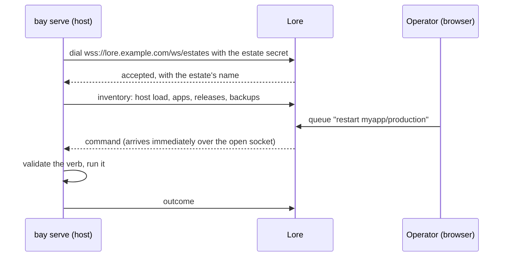

# Lore connector

Enrol a Bay host as an **estate** of a Lore instance, so Lore can show what the
machine runs and send it a small, fixed set of commands, without opening any
port on the host.

The connector is optional. A Bay that never enrols is fully operable over SSH,
and an enrolled one still is: the console is a second door, never the only one.

## How it works



The machine dials **out** and holds a websocket open, so a command queued in
Lore arrives the instant it is queued. Nothing listens for it: there is no
inbound port, and the secret authenticates the machine to Lore without granting
anything on the host.

## Enrolling

1. In Lore, create an estate under `/account/estates`. The secret is shown
   **once**.
2. On the host, as root:

```bash
sudo bay connector set https://lore.example.com est_... --root /opt/bay/data --control-socket /run/bay/control.sock
sudo bay connector show --root /opt/bay/data --control-socket /run/bay/control.sock
```

`set` stores the Lore URL and the secret at mode `0600` beside Bay's
`state.json`, then tells the running `bay serve` over the control socket to
re-read them: nothing restarts. The connector commands edit that file directly
and the data root is `0700`, so they need root and `--root` (or `BAY_ROOT`); a
member of `bay-control` cannot run them. They need `--control-socket` (or
`BAY_SOCKET`) too: without it `bay serve` is not told, and a host enrolling for
the first time dials nothing until its next restart.

The secret is a command-line argument, so `ps` shows it while `set` runs and the
shell history keeps it: clear that entry.

| Command                 | Effect                                                                  |
| ----------------------- | ----------------------------------------------------------------------- |
| `bay connector set URL SECRET` | enrol, or re-enrol with a rotated secret                         |
| `bay connector show`    | the Lore URL, the estate name and whether the connection is up; never the secret |
| `bay connector clear`   | forget both: the machine dials nobody                                    |

`http://` is accepted for a loopback Lore only, so a secret never crosses a
network in clear.

## What Lore can make the machine do

A **closed vocabulary of seven verbs**, each naming one app instance or stack
environment. `deploy` and `stack-deploy` create what they name; the others
refuse an instance this Bay does not run:

| Verb           | What it does                                                                                     |
| -------------- | ------------------------------------------------------------------------------------------------ |
| `restart`      | blue/green, as a deploy replaces a running app; a Compose service restarts in place. Refused for an app that is not running: use `start` |
| `deploy`       | an artifact named by **digest**, which the machine pulls and verifies before anything touches disk |
| `stop`         | out of service, durably: it stays down through a reboot and a Bay upgrade                        |
| `start`        | back into service. A no-op on an app already running, never a restart                            |
| `backup`       | the snapshot the schedule takes, now. Refused for an app with no database Bay owns               |
| `logs`         | a tail, uploaded back to Lore. A read, so it answers during a deploy rather than queueing behind it |
| `stack-deploy` | a stack bundle named by digest, pulled and verified, then applied as a revision                  |

⚠️ **This list is a security boundary, not a menu.** It is all that Lore, or
whoever controls Lore, can ask of this machine. No verb takes a path, a shell
command or an argument list; `logs` carries a line count, a time window and a
pattern, all bounded and validated. **Exec into a container is not a verb and
never will be**: it takes SSH.

The secret points the other way. It sits on the host in clear, and it is the
bearer the machine shows Lore when it dials, so whoever holds it can pose as
this machine to Lore, down to pulling the artifacts and secret sets of the
commands queued for it. It sends no command to the host.

**Deploys are refused until the estate's owner allows them** on the estate, and
the machine enforces that switch on its own side too. `stack-deploy` is held to
the same switch: it runs containers of the bundle's choosing, so allowing
deploys on an estate is trusting Lore with the host. A bundle goes through the
checks of any [compose file](/bay/docs/guides-stacks#the-compose-file), and only
those: no bind mount outside its own directory and no Docker socket, but
`devices`, `cap_add` and `security_opt` pass, and `x-lore.tcp: N` opens public
port N.

Stack members are addressed by the same verbs, as the instance
`<stack>.<service>`. A Lore `stack-deploy` also carries the environment's routes
and base domain, which replace those set with `bay stack route`.

## The console

Once the machine has said hello, `/account/estates/<estate>` in Lore shows:

- the host's memory, disk and load;
- every instance with its state, release, memory, restarts and backup freshness;
- the commands anyone queued, and what came back.

Its apps table also answers what the host cannot answer alone: an instance Lore
expects that the machine did not report is a failed deploy or a removed unit.

## Rotating and revoking

Rotating the secret in Lore refuses the machine on its next dial; run
`bay connector set` again with the new one. Deleting the estate refuses it for
good. Neither touches what runs on the host.

For the Lore side (creating estates, allowing deploys, `lore deploy`), see the
[Lore documentation](/lore/docs/guides-introduction).
