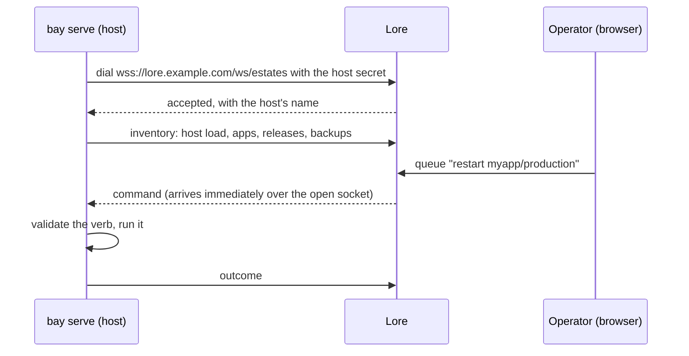

# Lore connector

Enrol a Bay host as a **host** of a Lore instance, so Lore can show what the
machine runs and send it a small, fixed set of commands, without opening any
port on the host.

The connector is optional. A Bay that never enrols is fully operable over SSH,
and an enrolled one still is: the console is a second door, never the only one.

## How it works



The machine dials **out** and holds a websocket open, so a command queued in
Lore arrives the instant it is queued. Nothing listens for it: there is no
inbound port, and the secret authenticates the machine to Lore without granting
anything on the host.

## Enrolling

A fresh server installs Bay, starts it under systemd and enrols it in one line,
when `install.sh` is given the Lore URL and the host's secret:

```bash
curl -sSL https://alepha.dev/bay/install.sh \
  | sudo LORE_URL=https://lore.alepha.app LORE_ESTATE_SECRET=est_... sh
```

The installer writes the unit from the installation guide unless one exists,
waits for `bay serve`, runs `bay connector set`, and never prints the secret.
On a host already running Bay:

1. In Lore, create a host in a project with Apps on: from its
   **Settings ▸ Apps ▸ Hosts**, or with `lore host add <slug>`. The
   host belongs to that project. The secret is shown **once**.
2. On the host, as root:

```bash
sudo bay connector set https://lore.example.com est_...
sudo bay connector show
```

`set` stores the Lore URL and the secret at mode `0600` beside Bay's
`state.json`, then tells the running `bay serve` over the control socket to
re-read them: nothing restarts. The connector commands edit that file directly
and the data root is `0700`, so they need root; a member of `bay-control`
cannot run them. On a host installed with `install.sh` and its unit they find
`/opt/bay/data` and `/run/bay/control.sock` on their own; elsewhere pass
`--root` (or `BAY_ROOT`) and `--control-socket` (or `BAY_SOCKET`). Without the
socket `bay serve` is not told, and a host enrolling for the first time dials
nothing until its next restart.

The secret is a command-line argument, so `ps` shows it while `set` runs and the
shell history keeps it: clear that entry.

| Command                        | Effect                                                                           |
| ------------------------------ | ------------------------------------------------------------------------------ |
| `bay connector set URL SECRET` | enrol, or re-enrol with a rotated secret                                         |
| `bay connector show`           | the Lore URL, the host name and whether the connection is up; never the secret |
| `bay connector clear`          | forget both: the machine dials nobody                                            |

`http://` is accepted for a loopback Lore only, so a secret never crosses a
network in clear.

## What Lore can make the machine do

A **closed vocabulary of seventeen verbs**, each naming one app instance or stack
environment, or, for `upgrade`, the machine's own Bay, or, for `job-run` and
`job-cancel`, a one-shot job (see [Jobs](#jobs)). `deploy` and `stack-deploy` create what they name, `remove` and
`stack-remove` answer done for one that is already gone, and the others refuse
an instance this Bay does not run:

| Verb            | What it does                                                                                                                                                                            |
| --------------- | --------------------------------------------------------------------------------------------------------------------------------------------------------------------------------------- |
| `restart`       | blue/green, as a deploy replaces a running app; a Compose service restarts in place. Refused for an app that is not running: use `start`                                                |
| `deploy`        | an artifact named by **digest**, which the machine pulls and verifies before anything touches disk                                                                                      |
| `stop`          | out of service, durably: it stays down through a reboot and a Bay upgrade                                                                                                               |
| `start`         | back into service. A no-op on an app already running, never a restart                                                                                                                   |
| `backup`        | the snapshot the schedule takes, now. Refused for an app with no database Bay owns                                                                                                      |
| `logs`          | a tail, uploaded back to Lore. A read, so it answers during a deploy rather than queueing behind it                                                                                     |
| `stack-deploy`  | a stack bundle named by digest, pulled and verified, then applied as a revision                                                                                                         |
| `backups-list`  | the instance's backups in the bucket, newest first, uploaded back to Lore                                                                                                               |
| `backup-verify` | downloads a backup (the newest by default) and checks it as a restore would, without touching the app                                                                                   |
| `target-probe`  | checks the S3 bucket now and reports whether it answers                                                                                                                                 |
| `backup-policy` | sets or clears the instance's operator backup policy, which wins over the app's and the host's                                                                                          |
| `restore`       | brings a backup back (by key, by time, or from another instance); needs a reason unless it is a dry run                                                                                 |
| `remove`        | unregisters an app and stops serving it, as `bay remove` without `--purge`: its database, uploads and `.env` stay on the machine. Refused for a stack member, which goes with its stack |
| `stack-remove`  | takes a stack environment down and forgets it, as `bay stack destroy` without `--purge`: its volumes, variables and registry credentials stay                                           |
| `job-run`       | runs one one-shot job to its end, its output streamed back to Lore as it happens. See [Jobs](#jobs)                                                                                    |
| `job-cancel`    | stops the running job it names                                                                                                                                                          |
| `upgrade`       | replaces Bay's own binary with a newer release, named by its version, and hands over to it without closing a port. See [Upgrading Bay](/bay/docs/guides-installation#upgrading-bay)     |

⚠️ **This list is a security boundary, not a menu.** It is all that Lore, or
whoever controls Lore, can ask of this machine. No verb takes a path, a shell
command or an argument list; `logs` carries a line count, a time window and a
pattern, all bounded and validated; `backup-policy` carries a policy checked
like `bay backup config`'s, and `restore` a backup key or a time, the instance
to restore from and a reason. Both are held to the same switch as `deploy`,
and Lore refuses them while the machine is offline rather than queueing them.
`upgrade` is held to that switch as well, and it is the verb that replaces a
binary running as root, so it is told as little as possible: a version, as
`x.y.z`, and nothing else. No address, no path and no checksum come from
Lore; the release is fetched from the repository the installer uses and
checked against its `SHA256SUMS`. **A version older than the one running is
refused**, so a Lore that was taken over cannot put a host back on a release
with a known flaw: going back is the installer, run on the machine. And Bay
takes it only when it can hand its sockets over (under systemd, with the
handoff drop-in), answering with the command to run by hand otherwise.
`remove` and `stack-remove` are held to that switch too, and ⚠️ **neither can
delete data**: there is no purge on the wire. Deleting a copy's data is
`bay remove --purge` or `bay stack destroy --purge`, run on the machine, and it
has to come instead of a removal through Lore, since a machine that has
forgotten the copy no longer knows where its data is.
**Exec into a container is not a verb and
never will be**: it takes SSH.

The secret points the other way. It sits on the host in clear, and it is the
bearer the machine shows Lore when it dials, so whoever holds it can pose as
this machine to Lore, down to pulling the artifacts and secret sets of the
commands queued for it. That includes an app's `APP_SECRET`, which Lore hands
to a deploy whose instance has none, and the copy Lore holds of it, which the
holder can replace: Lore says so on that deploy's log. It sends no command to
the host.

**Deploys are refused until somebody who manages the host allows them** (a
member of its project whose rank grants `host:update`), and
the machine enforces that switch on its own side too. `stack-deploy` is held to
the same switch: it runs containers of the bundle's choosing, so allowing
deploys on a host is trusting Lore with the host. A bundle goes through the
checks of any [compose file](/bay/docs/guides-stacks#the-compose-file), and only
those: no bind mount outside its own directory and no Docker socket, but
`devices`, `cap_add` and `security_opt` pass, and `x-lore.tcp: N` opens public
port N.

Stack members are addressed by the same verbs, as the instance
`<stack>.<service>`. A Lore `stack-deploy` also carries the environment's routes
and base domain, which replace those set with `bay stack route`.

## Jobs

A job is not an app: it runs once, to an exit, under a deadline. The first kind
is an **agent job**, Claude Code run with `claude -p` against a fresh clone of a
Lore repository, which Lore starts from its own pages.

A `job-run` carries nothing but its id. The machine pulls the job's spec over
HTTPS by that id and checks every field before anything runs: the kind, the
permission profile, the clone URL and the Lore MCP URL (both must be on the Lore
this machine is connected to), the ref, the turn budget, the timeout, and each
Claude Code tool name one by one. Bay builds the command line itself from those
fields, so nothing Lore sends is run as written. A field Bay does not know
refuses the job.

The output goes back up the connection as it is printed. If the link drops
mid-job, the job keeps running and its output waits on disk until Lore is back.
A timeout kills the job's whole process group; so does `job-cancel`.

**Jobs are refused until somebody who manages the host allows them**, with a
switch of their own, separate from deploys. One job runs at a time, and a job
never makes a deploy wait.

### The jobs user

Bay runs a job as a **dedicated Unix user**, never root and never the user Bay
runs as, in a fresh directory under that user's home, removed when the job ends.
Create the user, install Claude Code for it and log in as it by hand: Lore never
configures Claude Code and never sees its credential.

```bash
sudo useradd --create-home bay-agent
sudo -iu bay-agent claude login        # or: claude setup-token
sudo bay config jobs --user bay-agent
```

`claude` must be on that user's `PATH` (`~/.local/bin`, `~/.npm-global/bin`,
`/usr/local/bin` or `/usr/bin`). The host reports the CLI's version to Lore.
`bay config jobs --clear` makes the host refuse every job again.

⚠️ **A host that runs jobs this way does nothing else.** A job has that user's
shell on the machine, its network and its Claude credential: Claude Code's tool
flags narrow what the agent is told it may do, and nothing more. So the host
serves no production app and holds no other project's secrets, and use a
Claude credential you can rotate (an API key with a spend limit, or a token from
`claude setup-token`). The host tells Lore it runs jobs as a process, and Lore
refuses to give such a host a job whose input came from outside the project.

### The container runner

`bay config jobs --runner container` runs each job in the agent image instead,
a container per step (the clone, then Claude Code), with no host mount but the
job's own workspace volume and its repository's dependency cache, no Docker
socket, every capability dropped, a read-only root filesystem, memory and
process limits, and a network with no route out but Bay's egress proxy. Add
`--gvisor` to run them under gVisor (`runsc`), which Bay refuses when the
daemon has no such runtime.

The Claude credential is a **host-local secret**: set it from stdin and name it
in the config.

```bash
sudo bay secret set CLAUDE_CODE_OAUTH_TOKEN - < token.txt
sudo bay config jobs --runner container --credential CLAUDE_CODE_OAUTH_TOKEN
```

The value stays on the machine, `0600` under Bay's root, and goes into the
Claude Code step's environment only. Lore sees the secret's name in the host's
report, never its value. A host on the container runner is the one Lore lets
read feedback written outside the project's team, with read rights only.

### The model

Claude Code runs every job, and Lore's daily check, with its own default
model. `--model` picks another for the whole host, with either runner: an
alias such as `opus` or `sonnet`, or a full model id. `--model ""` goes back to
the default. The host's card in Lore shows the model its last check ran with.

```bash
sudo bay config jobs --model opus
```

## The console

Once the machine has said hello, `/<project>/hosts/<host>` in Lore shows,
to every member of the host's project (acting on it takes `host:update`
there):

- the host's memory, disk and load;
- every instance with its state, release, memory, restarts and backup freshness;
- the commands anyone queued, and what came back.

Its apps table also answers what the host cannot answer alone: an instance Lore
expects that the machine did not report is a failed deploy or a removed unit.

## Monitor only

`bay agent` runs the connector and nothing else, for a machine Bay does not run
apps on: it reports the host's CPU, memory, disk and load to Lore, and Lore's
host page shows them. It opens no port (no proxy, no TLS, no ACME, no control
socket), needs no Docker, and runs as a plain user, with its data under the
user's home (`~/.local/state/bay`, or `--root`).

Every command Lore sends it is refused on the machine, whatever its kind: a
deploy, a restart, a backup, an upgrade. Lore shows the host as **Monitor
only** and queues no command for it.

The installer sets it up for the user who runs it, with no `sudo`:

```bash
curl -sSL https://alepha.dev/bay/install.sh \
  | BAY_MONITOR_ONLY=1 LORE_URL=https://lore.alepha.app LORE_ESTATE_SECRET=est_... sh
```

It installs Bay under `~/.local/share/bay`, writes a systemd user unit
(`~/.config/systemd/user/bay-agent.service`) running `bay agent`, starts it and
enrols it. To keep it running after the user logs out, an administrator runs
`loginctl enable-linger <user>` once. By hand, without the installer:

```bash
bay agent --root ~/.local/state/bay &
bay connector set --root ~/.local/state/bay <lore-url> <secret>
```

The agent reads the connector file before each dial, so it connects at its
next attempt whichever runs first. Upgrade it by running the installer again.

## Rotating and revoking

Rotating the secret in Lore refuses the machine on its next dial; run
`bay connector set` again with the new one. Deleting the host refuses it for
good. Neither touches what runs on the host.

For the Lore side (creating hosts, allowing deploys, `lore deploy`), see the
[Lore documentation](/lore/docs/start-introduction).
