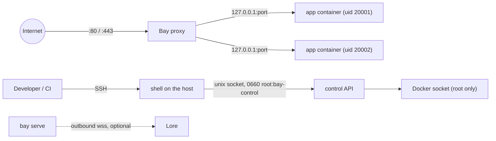

# Security model

What can reach a Bay host, who may drive it, and how one hosted app is kept from
another and from the machine. Read it before granting deploy rights or
enrolling a host in Lore.

## Surfaces

| Surface                 | Exposed to          | Notes                                                                            |
| ----------------------- | ------------------- | -------------------------------------------------------------------------------- |
| ports 80 and 443        | the internet        | Bay's reverse proxy                                                              |
| `x-lore.tcp` ports      | the internet        | a raw listener per port a stack declares, on every interface: no TLS, no `Host` routing, nothing from the proxy |
| app ports               | loopback only       | bound to `127.0.0.1`, never to every interface                                   |
| control socket          | root, `bay-control` | a unix socket; no TCP port, no token                                             |
| SSH                     | whoever you allow   | the only remote way to drive Bay                                                 |
| Lore connector          | nothing inbound     | the host dials out; twelve fixed verbs                                           |

Apps bind to loopback deliberately. Docker publishes on every interface by
default, and its iptables rules run before the host firewall's, so a default
binding would put each app on the internet past UFW, beside the proxy rather
than behind it.

## The control socket is root

The control API deploys code, and a stack it deploys runs containers with the
devices and capabilities they ask for. It is root-equivalent, so it gets root's
kind of protection: a **unix socket whose file mode is the authorization**
(`0660`, owned by root and the `bay-control` group), enforced by the kernel.

A loopback TCP port with a shared secret would be weaker in every way: any
process on the host can reach the port, the secret ends up in shell histories
and environment variables, and one bind-address typo publishes it.

So treat **membership of `bay-control` as root on the host**: grant it to the
people and CI keys that deploy, and nobody else. Revoking it is
`gpasswd -d USER bay-control`.

## The Docker socket

Bay drives Docker as root, over its unix socket only. A `tcp://` `DOCKER_HOST`
is refused: the Docker API is root-equivalent too, and Bay never reaches it
over a network or exposes it.

## What a deploy can carry

An artifact is untrusted input until it is unpacked. Bay refuses an archive
entry that is an absolute path, climbs out with `..`, or is a link or a device
file; it ignores the archive's mode bits and caps every entry's size. A
`_headers` file that does not parse is refused too. A refused artifact changes
nothing on the host. Artifacts are not signed: Bay checks their shape, and on a
Lore deploy their digest, not who built them.

Secrets travel in a file at mode `0600`, never on a command line, and Bay
deletes it after the deploy. A symlink, a group- or world-readable file and a
file that does not read as `KEY=VALUE` lines are refused and left where they
are: Bay runs as root, so it removes only what it read as secrets. Keys Bay owns, such as `APP_SECRET` and `DATABASE_URL`, cannot
be overwritten by a deploy or by `bay env set`.

## Isolating apps

Every archive app runs in its own container, locked down by default:

- **its own uid** (20000 and up), which owns its data directory, so one
  compromised app cannot read another's files or database on disk;
- **no Linux capabilities**, and `no-new-privileges`, so a setuid binary gains
  nothing;
- a **read-only root filesystem**, with a 64 MB `noexec` `/tmp`;
- a **512 MB memory ceiling**, so a leak kills the app and not the host.

That isolation stops at the disk. Every app that declares a bucket holds the same
S3 key, with only its prefix differing, so one app can read another's uploads.
Standalone apps share Docker's default bridge network, so one can reach another's
port without going through the proxy.

`bay harden` relaxes one of these for one app when it truly needs it, and
`bay status` flags the relaxation for as long as it lasts: see
[Isolation and memory](/bay/docs/guides-operating#isolation-and-memory). An
image app runs as its image defines, including its user, with Docker's default
capabilities and a writable root filesystem; of the list above it gets
`no-new-privileges` and the memory ceiling.

Runtime images are pinned by digest. A host changes them with
`bay runtimes update`, or with a Bay upgrade, which ships new pins and restarts
apps on them.

## Keys for object storage

Backups and app uploads use **two different S3 credentials**
(`bay config s3:backups` and `bay config s3:apps`). Every app that declares a
bucket is handed an apps key; if it were also the backups key, any compromised
app could delete every backup. `bay config s3` uses one key for both, warns, and
is flagged by `bay status`. See [Backups](/bay/docs/guides-backups#where-backups-go).

The host-wide apps key is shared by every app that has no key of its own, so
each of them can read and delete the others' uploads. `bay config s3:apps
<name/env>` gives an instance its own key, stored only after S3 proves it is
refused, for list, get, put and delete, outside `apps/<name>-<env>/blobs/`,
its own backups under `apps/<name>-<env>/db/` included; a key already held by the backups, the
host-wide target or another app is refused, and the host-wide `s3:apps`
refuses a key an app already holds on its own.

Every key sits in clear in `state.json`, at mode `0600`, and an app's key in
its `.env` too.

**The backups hold the apps' signing keys.** Each snapshot carries the
instance's `APP_SECRET` beside its databases, compressed and not encrypted.
So an upload key that can read the backups prefix (one key for both targets,
or an apps key not scoped away from `apps/*/db/`) can read every instance's
signing key, not only delete its backups: whoever holds it can sign sessions
for those apps. Keep the backups in a bucket of their own, or give each app
its own key with `bay config s3:apps <name/env>`, and run
`bay doctor --probe-keys` to prove the apps key is refused there.

## The signing key

An app's `APP_SECRET` signs its sessions and links and seals its MFA secrets.
It lives in three places:

- **the host**, in the instance's `.env` at mode `0600`;
- **the backups bucket**, in every snapshot of the instance (see above);
- **Lore**, sealed, for a host connected to it: Bay sends Lore the key each
  instance runs on, so a rebuilt host gets it back.

The key follows its app from one machine to another through Lore. So a machine
an app has left, and that machine's backups bucket, still hold the key the app
runs on now, and whoever controls them can sign sessions for it. After moving
an app off a machine you do not control, change its key on the Bay it runs on
now with
[`bay secret replace`](/bay/docs/guides-operating#replacing-the-signing-key):
every session is signed out, and what the old key sealed (MFA enrolled under
it) is lost.

## The Lore connector

An enrolled host keeps an outbound websocket to Lore, and nothing listens for
it. The estate secret is stored at mode `0600` and authenticates the machine;
what Lore can ask is a closed list of twelve verbs, none of which takes a path,
a command or an argument list, and deploys stay refused until the estate's
owner allows them. Exec is never a verb. See
[Lore connector](/bay/docs/guides-lore-connector).

## A checklist for a new host

- Only ports 22, 80 and 443 open in the firewall, plus each `x-lore.tcp` port a
  stack declares.
- SSH by key only; `bay-control` holds the deploying users and nobody else.
- `--tls` on, and Cloudflare (if any) in Full (strict) mode.
- Two S3 credentials, the backup one scoped to the backups bucket.
- `bay status` without a `⚠`, and
  `sudo bay doctor` passing.
