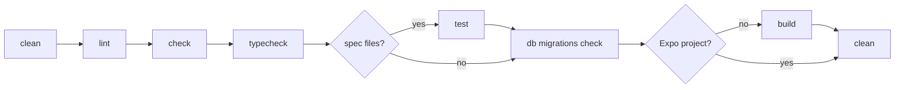

# Before Commit

Every code change must pass linting, type checking, and tests before being committed.

A project created by `alepha init` has a script for each check in its `package.json`: `lint`, `typecheck`, `test`, `build` and `verify` each run the `alepha` command of the same name. The toolchain (oxlint, oxfmt, TypeScript, Vitest) ships inside `alepha`, so there is nothing else to install or configure.

## Required Checks

Run these three commands after every modification:

```bash
npm run lint       # Lint with oxlint, then format with oxfmt (auto-fixes)
npm run typecheck  # TypeScript type checking (tsc --noEmit)
npm run test       # Run Vitest test suite
```

If any command fails, fix the issue before committing. Do not skip these steps.

## Full Verification

`alepha verify` runs the full pipeline:



Each step is the `alepha` command of the same name, and the first one to fail stops the pipeline.

`check` is `alepha check`: it refuses the constructs that break what the framework promises, such as a `Date.now()` a test cannot move or a `vi.mock()` that bypasses the container. See [Conventions](/docs/guides-testing-conventions). `check: false` in `alepha.config.ts` removes the step.

The `test` step is skipped when the project has no tests, and `build` is skipped for Expo projects. `db migrations check` always runs: it returns cleanly when the app has no database, so a project with entities and no migrations fails here instead of in production - that is deliberate. This is the same pipeline you should use in CI. Run it before opening a pull request:

```bash
npm run verify
```

## What Each Command Does

### lint

Uses [oxlint](https://oxc.rs/docs/guide/usage/linter.html) with `--fix`, then [oxfmt](https://oxc.rs/docs/guide/usage/formatter.html). Automatically formats code, sorts imports, and applies lint rules; correctness findings it cannot fix stop the run. No configuration needed.

### typecheck

Runs `tsc --noEmit`. Catches type errors without producing output files.

### test

Runs [Vitest](https://vitest.dev/). Specs live in `test/` or co-located as `*.spec.ts`; browser tests use the `*.browser.spec.ts(x)` extension with a jsdom project in `vite.config.ts` (see [React Tests](/docs/guides-testing-react-tests)).

### build

Part of `alepha verify` rather than the per-commit trio. Builds the project for production; build failures are verification failures - if it can't build, it can't ship.

## Verbose Output

For detailed output from any Alepha CLI command, pass `--verbose`:

```bash
npx alepha build --verbose
```

It raises the log level to `trace` (framework internals included), switches to the `pretty` format, and streams the output of each step (oxlint, tsc, Vitest, Vite) live instead of capturing it. Failures keep their stack trace. It is opt-in: nothing turns it on for you, an agent session included. See [Logging](/docs/guides-core-logging) for the formats and levels.
