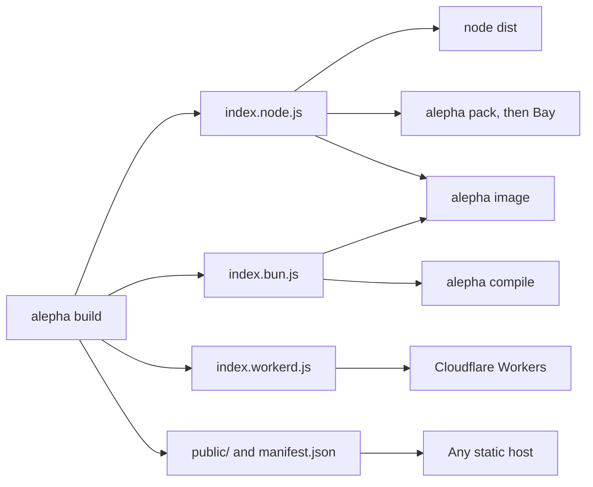

# Bare Deployment

The default deployment. `alepha build` produces a self-contained `dist/` folder that runs on any machine with Node.js or Bun installed.

## One artifact, several runtimes

`alepha build` writes one `dist/` per app. It holds one server **slice** for each runtime the build declares, the client's `public/` files, and a `manifest.json` describing it all. Every deployment in this section starts from that folder; only what consumes it changes:



| Runtime   | Slice                                  | Deployed with                                                                                                                                                                    |
| --------- | -------------------------------------- | -------------------------------------------------------------------------------------------------------------------------------------------------------------------------------- |
| `node`    | `index.node.js`, `server/node/`        | `node dist` (this page), [Bay](/docs/guides-deployment-bay), [Docker](/docs/guides-deployment-docker)                                                                            |
| `bun`     | `index.bun.js`, `server/bun/`          | `bun dist`, [`alepha compile`](#single-binary), [Docker](/docs/guides-deployment-docker), [macOS app](/docs/guides-deployment-desktop)                                           |
| `workerd` | `index.workerd.js`, `server/workerd/`  | [Cloudflare Workers](/docs/guides-deployment-cloudflare)                                                                                                                         |
| `static`  | none: `public/` only, no server at all | [Any static host](/docs/guides-deployment-static), [Bay](/docs/guides-deployment-bay), [iOS and Android](/docs/guides-deployment-capacitor) (`@alepha/capacitor` builds its own) |

## Build

```bash
alepha build
```

This bundles both server and client code into a single optimized output. The server bundle includes all dependencies - no `npm install` is needed in production.

| Flag              | Effect                                                                                                                                           |
| ----------------- | ------------------------------------------------------------------------------------------------------------------------------------------------ |
| `--runtime`, `-r` | Comma-separated runtimes, in order (`node,workerd`). Replaces `build.runtime` rather than adding to it                                           |
| `--mode`, `-m`    | Which `.env.<mode>` file to load (default `production`)                                                                                          |
| `--stats`         | Write a bundle size report; `--stats=json` for machine-readable output                                                                           |
| `--inspect`       | Bundle [the inspector](/docs/guides-core-inspector) into the server. It stays off until the process runs with `ALEPHA_INSPECT=1`. Not on workerd |
| `--if-stale`      | Build only when `dist/` is missing or older than the sources it was built from. A pipeline that builds then runs skips the second build          |
| `--prebuilt`      | Skip the bundle steps and only regenerate deploy config such as `wrangler.jsonc`, for a `dist/` built upstream. Refused for a static build       |

## Run

```bash
node dist        # Node.js
bun dist         # Bun
```

The server starts on `http://localhost:3000` by default. Configure the host and port with environment variables:

```bash
SERVER_HOST=0.0.0.0 SERVER_PORT=8080 node dist
```

`PORT` is read as a fallback when `SERVER_PORT` is not set, so a host that allocates the port
itself (Heroku, Cloud Run, Railway, Fly) needs no configuration at all. Setting `SERVER_PORT`
always wins over `PORT`.

## Output Structure

```txt
dist/
  index.node.js    # Server entry wrapper of the node slice
  server/node/     # The slice's chunks
  public/          # Client assets (if React frontend exists)
  manifest.json    # What the build declared
  package.json     # `main` points at the primary slice
```

A build with several runtimes has one `index.<runtime>.js` and one `server/<runtime>/` per slice, beside the same `public/`.

If no React frontend is present, only the server slice is built.

Database migrations stay in your project's `migrations/` directory, outside `dist/`. In production the app applies them itself at boot, reading `migrations/<provider>/` relative to the directory it starts in, so run `node dist` from the project root, or copy `migrations/` next to wherever it starts ([`alepha image`](/docs/guides-deployment-docker) copies them into the image for you). An app that declares entities but finds no migrations refuses to boot rather than fail on its first query; set `DATABASE_SYNC=false` if the schema is managed outside the app. `alepha db migrations apply` applies them ahead of a deploy instead. See [Migrations](/docs/guides-persistence-migrations).

## Static File Headers

The server answers the files of `dist/public` itself, and applies `dist/public/_headers` to every one
of them, the file `alepha build` writes for Cloudflare and Bay: a content-hashed chunk is cached for a
year, a file no rule caches gets `public, max-age=0, must-revalidate`, and your own rules apply on top
of the security headers. `/_headers` itself is never served. The same holds for a binary from `alepha compile`,
which reads the file from inside itself. See [Static File Headers](/docs/guides-deployment-headers).

## Choosing runtimes

`node` is the default. Declare others in `alepha.config.ts` so the build needs no flag:

```typescript check
import { defineConfig } from "alepha/cli/config";

export default defineConfig({
  build: {
    runtime: ["node", "workerd"],
  },
});
```

- **The first runtime is the primary**: what `manifest.json` names, what `dist/package.json` points at, and what `node dist` and `alepha image` start. A duplicate is dropped.
- **Each slice is bundled with its own export conditions**: the `bun` slice resolves dependencies for Bun, the `workerd` one for Cloudflare. Run each under the runtime it was built for.
- **`static` makes the whole build static**, wherever it appears in the list: no server slice is built. See [Static Deployment](/docs/guides-deployment-static).
- **`--runtime` replaces the list**: `alepha build --runtime=bun` builds only the bun slice, whatever the config says.

## Single Binary

`alepha compile` turns a built `dist/` into one executable, with the client's `public/` files inside it:

```bash
alepha build --runtime=bun
alepha compile              # dist/app
alepha compile --output myapp  # dist/myapp
```

The compiler is `bun build --compile`, so the build needs a **bun slice** (`--runtime=bun`, or `bun` in `build.runtime`) and Bun on the build machine. A `dist/` with no `index.bun.js` is refused by name rather than compiled from whichever slice is there: the node slice runs under Bun, so that fallback would produce a working binary built from the generic bundle, with every Bun-native API and every dependency the bun conditions exist to drop still inside it.

| Flag             | Default      | Effect                                                                              |
| ---------------- | ------------ | ----------------------------------------------------------------------------------- |
| `--output`, `-o` | `app`        | File name of the binary inside `dist/`: lowercase letters, digits, `.`, `_` and `-` |
| `--target`       | this machine | Bun target triple, such as `bun-linux-x64` or `bun-linux-arm64-musl`                |
| `--no-minify`    | minified     | Keep the compiled output readable                                                   |
| `--desktop`      | off          | Build a [macOS app](/docs/guides-deployment-desktop) instead of a plain binary      |

The binary carries its own runtime: nothing has to be installed where it runs. `dist/` then holds the binary, `manifest.json` and, when the app has a database, `migrations/`.

```bash
cd dist && APP_SECRET=... SERVER_HOST=127.0.0.1 ./myapp
```

- Run it from the directory that holds `migrations/`: the app reads them relative to where it starts. An app without a database can run from anywhere.
- A compiled app runs in production mode, which refuses to boot without `APP_SECRET` as soon as the app signs anything: sessions, tokens, signed cookies. An app that signs nothing boots without one.
- Set `SERVER_HOST`: under Bun, `localhost` listens on IPv6 `::1` only.
- The binary serves its assets from inside itself, ETag and precompressed brotli included, and ignores any `public/` directory next to it.
- It targets the machine that builds it (`bun-darwin-arm64` on an Apple Silicon Mac). Cross-compile with `--target`, for example `alepha compile --target bun-linux-x64` for a Linux server built on a Mac. A Bun binary is not fully static: the triple also picks the libc, so a binary for an Alpine (musl) machine needs a `-musl` triple.
- Expect about 60 MB, almost all of it the Bun runtime. Windows is untested.
- `alepha compile --desktop` builds a [native macOS app](/docs/guides-deployment-desktop) instead, `dist/<Name>.app`, from a top-level `desktop: { name, identifier }` in `alepha.config.ts` and the `@alepha/desktop` package. Declaring `desktop` changes nothing else: only the flag reads it. Like an ordinary compile, it consumes `dist/`, but only once the app is complete; a failure leaves `dist/` as the build wrote it.

Declare the slice in `alepha.config.ts` so the build needs no flag:

```typescript check
import { defineConfig } from "alepha/cli/config";

export default defineConfig({
  build: {
    runtime: "bun",
  },
});
```

⚠️ **Compiling has no config key**, on purpose. Its three settings are the binary name, the Bun triple and minification, and all three are flags: a key nobody sets is worse than three flags. `alepha image --compile` drives the triple itself, from the base image. See the [Docker guide](/docs/guides-deployment-docker).

## Deployment

Copy the `dist/` folder to any server and run it. No build tools, no package managers, no configuration files required on the target machine.

Works on:

- VPS (DigitalOcean, Hetzner, Linode)
- Bare metal servers
- Any container runtime
- systemd, PM2, or any process manager

## More than one instance: set `REDIS_URL`

No `REDIS_URL` means one instance. Cache, queue jobs, topics, locks, actors and rate limits all live in the process, which is right for an app that runs once.

Set `REDIS_URL` and every instance shares them, with nothing to register:

```bash
REDIS_URL=redis://:password@redis.internal:6379 node dist/index.node.js
```

| Module         | Without `REDIS_URL`   | With `REDIS_URL`                                                   |
| -------------- | --------------------- | ------------------------------------------------------------------ |
| `alepha/cache` | `MemoryCacheProvider` | `RedisCacheProvider`: one cache for every instance                 |
| `alepha/queue` | `MemoryQueueProvider` | `RedisQueueProvider`: a job pushed by one instance runs on any     |
| `alepha/topic` | `MemoryTopicProvider` | `RedisTopicProvider`: WebSocket broadcasts reach every instance    |
| `alepha/lock`  | `MemoryLockProvider`  | `RedisLockProvider`: each `$job` cron tick runs on one instance    |
| `alepha/actor` | `MemoryActorProvider` | `RedisActorProvider`: one count for every `$rateLimit` and lockout |

The choice is made once, when each module registers, from the environment at boot (`process.env`, a `.env` file, or `Alepha.create({ env })`). Every key lives under `<APP_NAME>:<module>:`, so two apps, or two environments of one app, can share a Redis as long as their `APP_NAME`s differ.

- **Redis down is an error, not a fallback.** With `REDIS_URL` set and Redis unreachable the app fails as any Redis client does; it never falls back to memory, which would split your instances without telling anyone.
- **One module stays local if you say so.** An explicit substitution wins over `REDIS_URL`, which keeps one module in memory (or on another provider) while the others share Redis:

```ts
import { Alepha } from "alepha";
import { CacheProvider, MemoryCacheProvider } from "alepha/cache";

const app = Alepha.create().with({
  provide: CacheProvider,
  use: MemoryCacheProvider, // this cache stays per instance
});
```

- **Without `REDIS_URL`, the Redis client is never loaded.** `@redis/client` sits in a chunk of its own in `dist/` and is imported only on connect.

### Multi-replica `$job` cron jobs

When you run more than one replica (e.g. 10 Docker instances behind a load balancer), `$job({ cron, ... })` acquires a per-job lock by default so the handler runs **once per tick across the fleet**, not once per replica. That lock is fleet-wide once `REDIS_URL` is set; without it each replica holds its own lock and every replica runs the tick.

Set `lock: false` on a `$job` if you genuinely want every replica to fire the handler.

### One Redis for every role

One `REDIS_URL` puts data Redis may drop beside data it must keep:

| Data                | Expiry               | If Redis evicts it                                                     |
| ------------------- | -------------------- | ---------------------------------------------------------------------- |
| Cache entries       | their TTL            | a cache miss, recomputed: harmless                                     |
| Queue jobs          | none                 | the job is lost and never runs                                         |
| Locks               | the lock's duration  | a second holder takes the lock early: a cron tick or a migration twice |
| Actor state         | none, or `expiresAt` | the state resets to its default                                        |
| Rate-limit counters | the window           | the limit resets, and a locked-out attacker gets a fresh five tries    |

Run that Redis with `maxmemory-policy noeviction`, and size its memory for the cache plus everything else:

```
maxmemory 1gb
maxmemory-policy noeviction
```

With `noeviction` a full Redis refuses writes instead of dropping keys, so you see the error. Every other policy fails silently:

- `allkeys-lru`, `allkeys-lfu`, `allkeys-random` may evict anything: queue jobs and actor state included.
- `volatile-lru`, `volatile-lfu`, `volatile-random`, `volatile-ttl` evict only keys with an expiry, which still includes locks, expiring actors and rate-limit counters.

Alepha does not check the policy at startup: managed Redis services often refuse `CONFIG GET`. If you want the cache evictable, give it a Redis of its own and keep `noeviction` on the one holding queue, locks and actors.

## Job retries

A failed `$job` attempt is retried with exponential backoff and full jitter: attempt _n_ waits a random time between zero and `retryBackoffBase × 2^(n-1)` (5 seconds for the first retry), capped at `retryBackoffMax` (30 minutes). A job can set its own curve with `retry.backoff`.

On a long-running Node or Bun process the retry runs on a local timer, at its backoff. The outbox row's `scheduledAt` stays the truth, and the sweep (`jobConfig.sweepCron`, default `*/15 * * * *`) is the backstop: a process that restarts before the timer fires loses no retry, it only waits for the next tick. See [Retries](/docs/guides-features-background-jobs#retries), and [Retry granularity](/docs/guides-deployment-cloudflare#retry-granularity) for how Workers differ.
