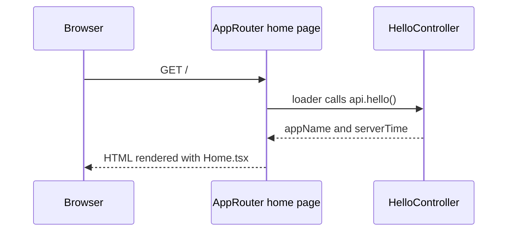

# Getting Started

Create a full-stack app with an explicit Cloudflare production environment, then deploy it:

```bash
npx alepha init my-app --infra cf
cd my-app
npx alepha deploy
```

Initialization installs dependencies and writes configuration without cloud credentials. Deployment authenticates with Cloudflare and runs the full lifecycle.

For local development only, omit `--infra` and start the dev server instead:

```bash
npx alepha init my-app
cd my-app
npm run dev
```

## Prerequisites

You need one of the following:

- [Node.js 24+](https://nodejs.org/) (recommended for beginners)
- [Bun 1.3+](https://bun.sh/)

## Create a Project

```bash
npx alepha init my-app --infra cf
```

This creates a `my-app` directory with:

- `package.json` with `alepha`, `react` and `react-dom` as dependencies, and the
  `dev`, `build`, `test`, `lint`, `typecheck` and `verify` scripts
- `tsconfig.json` configured for TypeScript
- `alepha.config.ts` with documented build options (with `--infra cf`, the
  Cloudflare `infra()` plugin is already enabled)
- `.oxlintrc.json` and `.oxfmtrc.json` for linting and formatting
- `src/api/` with an example controller
- `src/web/` with a React router and page
- `src/main.server.ts` and `src/main.browser.ts` as the entry files, plus `src/main.css`
- `vite.config.ts` with the Tailwind plugin
- `AGENTS.md` and `CLAUDE.md` so AI assistants know the project's conventions
- the supporting files: `.gitignore`, `.editorconfig`, `.env.example`,
  `.vscode/` settings, `public/favicon.svg`, and a starter `test/dummy.spec.ts`

Init then installs the dependencies, runs the linter once, and initializes a git
repository with every generated file staged (nothing is committed). A target
directory you name must be empty, dotfiles and a lone `package.json` aside,
unless you pass `--force`.

Every Alepha project has this same shape. One layout means anyone opening the
project, human or AI, already knows where things live. If you don't need the
frontend, delete `src/web/`. A [preset](#presets) can add more on top of this
base, but never moves it around.

`--preset` adds features, and `--infra cf` (also `--infra cloudflare`) adds the Cloudflare production environment. `--pm` (`npm`, `yarn`, `pnpm` or `bun`) selects the package manager, which is otherwise detected from how you ran the command; `--force` replaces scaffolded files. For example, a Bun project:

```bash
npx alepha@latest init my-app --pm=bun
```

`npm create alepha` is the alternative entry point. It takes the same `--preset`,
`--infra` and `--pm` flags (after `--`, so npm forwards them) and asks for anything
no flag has answered: the project name and the preset. To run it with no
prompts at all (a CI, a Dockerfile, any script with no stdin), pass `--yes`,
which answers every remaining question with its default:

```bash
npm create alepha my-app -- --yes --infra cloudflare    # or -y
```

Flags still win over `--yes`, so `--yes --preset saas` is promptless too. The
project name is the one thing it cannot supply, since it has no default.
`alepha init` never prompts and needs none of this.

## Run the Generated App

Enter the project and start the development server:

```bash
cd my-app
npm run dev
```

You should see something like this (`my-app` is the app name, taken from the folder):

```txt
14:32:59 I Created .env from .env.example. It is gitignored: put your local values there.
[14:33:00.173] INFO my-app <alepha.core.Alepha>: Starting App...
[14:33:00.174] INFO my-app <alepha.react.router.ReactServerProvider>: SSR OK
[14:33:00.192] INFO my-app <alepha.core.Alepha>: App is now ready [19ms]
14:33:00 I Listening on http://localhost:5173/
```

The first line appears on the first run only. Open
[http://localhost:5173](http://localhost:5173): the welcome page is a React page
rendered on the server, and the data it shows (app name, server time) comes from
the generated API endpoint, also reachable at
[http://localhost:5173/api/hello](http://localhost:5173/api/hello).



`AppRouter` declares the page with `$page` and calls the controller through
`$client<HelloController>()`, a typed client: on the server the call is a direct
method call, in the browser it becomes an HTTP request to `/api/hello`.

Development mode gives you:

1. **Hot Module Replacement (HMR)**: change code, server updates instantly.
2. **TypeScript support**: no build step required.
3. **Pretty logs**: readable, structured output.

The port is `SERVER_PORT` (in `.env`), else `dev.port` in `alepha.config.ts`, else Vite's `server.port`, else 5173.

## Your First Server

Open the entry file. It wires up the two generated modules:

```typescript filename="src/main.server.ts"
import { Alepha, run } from "alepha";

import { ApiModule } from "./api/index.ts";
import { WebModule } from "./web/index.ts";

const alepha = Alepha.create();

alepha.with(ApiModule);
alepha.with(WebModule);

run(alepha);
```

To see the smallest thing Alepha can do, strip it back to a single route. Replace the file contents with:

```typescript filename="src/main.server.ts"
import { run } from "alepha";
import { $route } from "alepha/server";

class App {
  hello = $route({
    path: "/",
    handler: () => "Hello, Alepha!",
  });
}

run(App);
```

That `$route` call is a **Primitive** - a factory function that registers an HTTP endpoint
directly on your class. No separate router file, no middleware chain.

`run(App)` creates an Alepha container, registers `App`, starts the server, and handles
signal trapping (SIGINT, SIGTERM) for graceful shutdown.

Save the file. HMR reloads the server, and
[http://localhost:5173](http://localhost:5173) now shows "Hello, Alepha!".

> Init staged every generated file, so `git checkout -- src/main.server.ts`
> brings the original entry file back when you are done experimenting.

## Add a Typed API Endpoint

`$route` is low-level. For real APIs, use `$action`: it adds schema validation,
type-safe client calls (the `$client` above), and an OpenAPI description once you
add the [OpenAPI module](/docs/guides-server-openapi).

```typescript filename="src/main.server.ts"
import { z, run, $inject } from "alepha";
import { DateTimeProvider } from "alepha/datetime";
import { $action } from "alepha/server";

class App {
  dateTimeProvider = $inject(DateTimeProvider);

  hello = $action({
    method: "GET",
    path: "/hello",
    schema: {
      response: z.object({
        message: z.text(),
        serverTime: z.datetime(),
      }),
    },
    handler: () => ({
      message: "Hello from Alepha",
      serverTime: this.dateTimeProvider.nowISOString(),
    }),
  });
}

run(App);
```

Time comes from the injected `DateTimeProvider` rather than `new Date()` so
tests can freeze or travel the clock.

Key differences from `$route`:

- All `$action` paths are automatically prefixed with `/api`. This endpoint serves at `GET /api/hello`.
- An object `schema.response` validates the return value, and is what the OpenAPI document describes.
- `method` and `path` are required: a read says `GET`, and the URL never depends on the property name.
- The response is type-checked at compile time.

Save the file. HMR reloads the server. Visit [http://localhost:5173/api/hello](http://localhost:5173/api/hello).

## Build for Production

When you are ready to deploy:

```bash
npm run build
```

This produces a `dist/` folder with an optimized, self-contained bundle.

Run it locally to verify:

```bash
node dist
```

Or with Bun:

```bash
bun dist
```

The app starts up just like in development mode, but without HMR, and logs
"Server listening on http://localhost:3000/".

> In production the default port is 3000 instead of 5173, to avoid conflicts with
> development servers, and the host is `localhost`. `SERVER_PORT` (or `PORT`) and
> `SERVER_HOST` override them. Logs are JSON lines rather than the pretty dev
> format; `LOG_FORMAT` changes that.

### Runtime Slices

Alepha adapts the build output based on where you deploy:

```bash
npx alepha build --runtime=workerd     # Adapts output for Cloudflare Workers
npx alepha build --runtime=bun         # Optimizes for Bun runtime
npx alepha build --runtime=node,bun    # Several slices; the first is primary
```

Runtime slices can also be set in `alepha.config.ts`:

```typescript filename="alepha.config.ts"
import { defineConfig } from "alepha/cli/config";

export default defineConfig({
  build: {
    runtime: ["workerd"],
  },
});
```

## Deploy to the Cloud

Once your app builds, you can deploy it to Cloudflare Workers in one command.

`init --infra cf` already adds this configuration. For an existing project, register the infra plugin:

```typescript filename="alepha.config.ts"
import { defineConfig } from "alepha/cli/config";
import { cloudflare, infra } from "alepha/cli/infra";

export default defineConfig({
  plugins: [
    infra({
      environments: {
        production: cloudflare(),
      },
    }),
  ],
});
```

Then deploy:

```bash
npx alepha deploy
```

Alepha scans your code for primitives (`$entity`, `$storage`, `$job`, etc.), provisions the matching Cloudflare resources (D1, R2, Queue), builds for Workers, runs migrations, and deploys - all in one step.

Preview what will be created before deploying:

```bash
npx alepha infra plan
```

The default environment is `production`. Names are arbitrary explicit keys: add `staging`, `prod`, or another name under `environments`, and select it with `--env` (`-e`). Set `default: "prod"` if that key should be the default. An undeclared name fails before deployment.

Operations read `.env.<env>` and its `.local` override, with process variables supplying missing values. The config helper only defaults `PUBLIC_URL` from `environments.production.options.domain` when `NODE_ENV` (or `MODE`) is `production` and no URL is set. It does not select a staging domain on import; set the staging URL explicitly.

Plain `alepha build --runtime workerd` creates a Worker artifact without cloud credentials. `alepha infra build` uses the configured adapter and may look up existing bindings. `alepha infra deploy` authenticates and deploys an existing suitable artifact; use `alepha deploy` for the full pipeline.

See the [Infra Plugin](/docs/cli-plugins-infra) guide for full configuration, secrets, monorepo support, and teardown.

## Project Structure

`alepha init` scaffolds this structure, whichever preset you pick:

```txt
my-app/
  alepha.config.ts          # Build and entry point configuration
  package.json
  tsconfig.json
  .oxlintrc.json
  .oxfmtrc.json
  .editorconfig
  .env.example              # Documented env vars, copied to .env on the first `dev`
  .gitignore
  .vscode/                  # Recommended extensions and settings
  AGENTS.md                 # Conventions for AI assistants
  CLAUDE.md                 # Points to AGENTS.md
  vite.config.ts            # Tailwind plugin + Vitest config
  public/
    favicon.svg
  test/
    dummy.spec.ts           # Starter test, run by `npm run test`
  src/
    main.server.ts          # Server entry point
    main.browser.ts         # Browser entry point
    main.css                # Global styles (@import "tailwindcss")
    api/
      index.ts              # API module definition
      controllers/
        HelloController.ts  # Example $action endpoint
      schemas/
        helloResponseSchema.ts
    web/
      index.ts              # Web module definition
      AppRouter.ts          # $page routes
      components/
        Home.tsx            # Example React component
```

### Presets

The layout above is fixed. A preset only decides what is mounted on top of it:

```bash
npx alepha init my-app --preset=saas
```

`saas` adds `@alepha/ui` and three routers (sign-in at `/auth/*`, an account
area at `/account/*`, an admin console at `/admin/*`), plus the `$realm` in
`src/api/Realm.ts` that configures them. Nothing moves; you get that one extra source file,
longer `src/api/index.ts` and `src/web/index.ts` modules (the API one adds the ORM and
the user API), an initial database migration under `migrations/`, and a gitignored
`.env` carrying `ADMIN_EMAIL` (your `git config user.email`).

Full details in the [init command reference](/docs/cli-commands-init).

Building an API-only service? Delete `src/web/`, `src/main.browser.ts` and
`src/main.css`, and drop the `WebModule` line from `main.server.ts`. Expo
projects skip the web scaffolding automatically.

### Entry Points

| File              | Purpose             |
| ----------------- | ------------------- |
| `main.server.ts`  | Server entry point  |
| `main.browser.ts` | Browser entry point |

### Scaling with Modules

As your project grows, group features into modules:

```txt
src/
  api/
    users/
      controllers/
      services/
      entities/
      index.ts           # UsersModule
    payments/
      controllers/
      services/
      entities/
      index.ts           # PaymentsModule
  web/
    app/
      AppRouter.ts
    components/
  main.server.ts
  main.browser.ts
```

### Naming Conventions

| Directory      | Contains                        | Example files        |
| -------------- | ------------------------------- | -------------------- |
| `controllers/` | API endpoints with `$action`    | `UserController.ts`  |
| `services/`    | Business logic                  | `UserService.ts`     |
| `entities/`    | Database schemas with `$entity` | `userEntity.ts`      |
| `providers/`   | External service wrappers       | `StripeProvider.ts`  |
| `schemas/`     | Shared Zod schemas              | `userSchema.ts`      |
| `atoms/`       | State definitions with `$atom`  | `currentUserAtom.ts` |
| `components/`  | React components                | `UserCard.tsx`       |

## Configuration validation

Export `defineConfig({ ... })` from `alepha.config.ts`. It validates the CLI atom schemas when imported, before applying any setting. Unknown keys are refused at every declared object level with their full path, and retired keys name their replacements. Arbitrary Cloudflare config and environment maps keep their open keys. `plugins` is an array of services or plugin factories; a custom function default export opts out of `defineConfig` validation. A plain object default export is refused.
