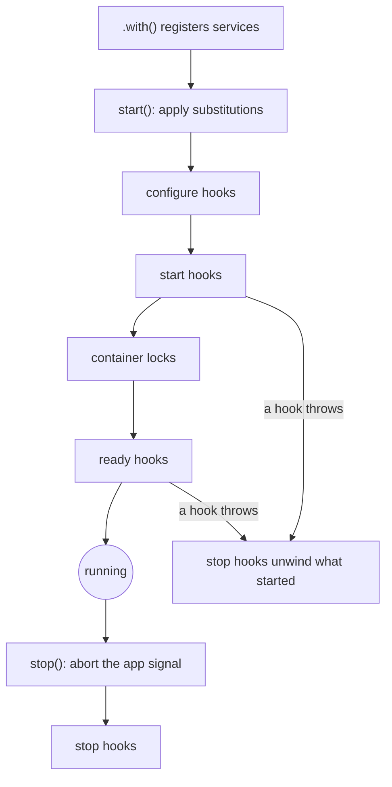

# The Alepha Instance

The `Alepha` class is the central container of your application. It holds configuration, manages state, controls lifecycle, and wires dependencies together.

Unlike tools that rely on global side-effects, Alepha keeps everything contained within this instance. This makes your application portable, testable, and predictable.

## Creating the Instance

Use the static factory method to initialize your app:

```typescript check
import { Alepha } from "alepha";

const alepha = Alepha.create();
```

`create()` automatically merges `process.env` with any custom configuration you provide. In test environments (Vitest with `globals: true`), it binds the app to the test hooks: `beforeAll` starts it, `afterAll` stops it, and an app created inside a test is also stopped by `onTestFinished`. `afterEach` is kept for the logger, which prints the logs of a failed test.

### Configuration

Pass a configuration object to `create`. The most important property is `env`:

```typescript
const alepha = Alepha.create({
  env: {
    APP_NAME: "My SaaS",
    // Secrets from process.env are merged automatically
  },
});

alepha.env.APP_NAME; // "My SaaS"
```

> **Typed Environment Variables**
>
> While `alepha.env` gives raw access, use the `$env` primitive inside services for type-safe, validated environment variables.

### The App Name

`alepha.name` is the app's namespace: the one identity modules key a shared resource with (a Redis, a KV namespace, a bucket), so two apps, or two environments of one app, on the same backend never read each other's keys.

```typescript check
import { Alepha } from "alepha";

Alepha.create().name; // "app"
Alepha.create({ env: { APP_NAME: "hello" } }).name; // "hello"
```

The first hit wins:

1. `APP_NAME`: in code, then `process.env`, then a Worker binding lifted by `loadEnv()`.
2. The name `alepha build` and `alepha dev` bake into the bundles: the slugified app directory, or `meta.name` in `alepha.config.ts`. The same string as `/version`'s `name` and the Worker name.
3. `"app"`, when no build produced the code (Vitest, a `tsx` script).

It is read on every call and never written into `env`, so `env.APP_NAME` keeps meaning "set explicitly". A deploy usually sets `APP_NAME` to `<name>-<env>`, which keeps staging and production apart on one Redis.

> In the browser only the baked name exists, and it can differ from the server's `APP_NAME`. Never use `alepha.name` for anything the browser and the server must agree on.

## Dependency Injection

Alepha is built on a dependency injection container. You register classes and Alepha wires them together.

### Registering Services (.with)

Use `.with()` to add services, modules, or providers:

```typescript
import { Alepha, run } from "alepha";
import { AlephaServer } from "alepha/server";

const alepha = Alepha.create();
alepha.with(AlephaServer);
alepha.with(MyService);
```

> **Auto-Registration**
>
> You rarely need to register core modules manually. If you use a primitive like `$route` or `$repository` in your class, Alepha detects the dependency and registers the necessary modules for you.

### Injecting Services (.inject)

Access a service instance from outside a class (e.g., in a script or test):

```typescript
const myService = alepha.inject(MyService);
myService.doSomething();
```

`.inject(MyService)` is like `new MyService()` but with all dependencies automatically resolved.

### Swapping Implementations

Replace a service with a different implementation. This is the core of Alepha's testing and environment strategy:

```typescript
// In production: real emails via SMTP
// In development: kept in memory
alepha.with({
  provide: EmailProvider,
  use: alepha.isProduction() ? NodemailerEmailProvider : MemoryEmailProvider,
});
```

Any service that injects `EmailProvider` will receive the substituted implementation. Your business logic doesn't change.

A substitution must come before anything builds the original: once `EmailProvider` has been instantiated, `alepha.with({ provide: EmailProvider, use: ... })` throws `TooLateSubstitutionError`, unless it says `optional: true`, which keeps the existing one silently. Once the app has started the container is locked: registering a new service, or injecting a singleton nobody built during boot, throws `ContainerLockedError`.

The lock refuses a class nobody registered, not a registered one. In a production build, a pure controller that a module lists in `services` or passes to `alepha.with` is declared at boot and created on first use, after start; so is everything it alone creates while it is being created. `alepha.inject(X)` in a module's `register` returns the instance, so it always creates at once. A class created that late may hold no `$hook` and no other primitive that acts at boot: it is refused with an error naming the class and the primitive. In dev and tests every class is still created at boot.

### Service Lifetimes

| Lifetime    | Behavior                                             |
| ----------- | ---------------------------------------------------- |
| `singleton` | One instance per Alepha runtime (default)            |
| `transient` | New instance every time                              |
| `scoped`    | One instance per request context (AsyncLocalStorage) |

```typescript
alepha.inject(Logger, { lifetime: "transient" });
```

## Lifecycle

Alepha has a strict lifecycle to ensure resources are opened and closed correctly:



| Phase       | What happens                                                    |
| ----------- | --------------------------------------------------------------- |
| `configure` | Services register configuration. Primitives read their schemas. |
| `start`     | Providers connect to I/O (database, HTTP server).               |
| `ready`     | App is live. Background jobs and schedulers start.              |
| `stop`      | Graceful shutdown. Connections close, buffers flush.            |

A few guarantees hold around it:

- **`start()` runs once.** A second call on a started app returns at once, and concurrent calls share the same boot.
- **A failed boot unwinds.** If a `start` or `ready` hook throws, `stop` hooks run before `start()` rejects, so a database that already connected is closed. A `configure` hook that throws stops the boot before anything opened.
- **`stop()` aborts first.** The app's AbortSignal (see [Cancellation](/docs/guides-core-cancellation)) fires before any `stop` hook runs.
- **Every `stop` hook runs.** One that throws does not skip the others; `stop()` then rejects naming the failed hooks. The whole stop is bounded to 8 seconds: past that, it rejects naming the hooks still pending.

### Running the App

Use the `run` helper. It starts the app on the next tick and, on Node, traps `SIGTERM`, `SIGINT` and `SIGUSR2` for a graceful stop. An uncaught exception also stops the app, then exits with code 1; a boot that fails exits with code 1 too.

```typescript
import { run } from "alepha";

run(alepha);
```

`run` takes an Alepha instance, a service or module, or an array of them (it then creates the instance), and returns the instance. Its options:

| Option      | Effect                                                    |
| ----------- | --------------------------------------------------------- |
| `env`       | Merged over `process.env` when `run` creates the instance |
| `configure` | `(alepha) => ...`, called before `start()`                |
| `ready`     | `(alepha) => ...`, called once the app is ready           |
| `once`      | Stop the app right after `ready`, for a one-shot script   |

On serverless runtimes, under the Vite dev server and when the CLI imports the entry, `run` does not start anything: the host owns startup. The Workers and React Native builds of `run` accept only `{ env }`, which there also applies to an existing instance. On Workers, `run` also stores the instance in `globalThis.__alepha` for the generated entry: that handshake is internal, so application code keeps its own reference. In the browser, a boot that fails on a blank page shows a "The app could not start." box with a Reload button instead of an empty screen.

### Manual Control (Tests)

In tests, you often want manual lifecycle control:

```typescript
describe("MyService", () => {
  it("MyService", async () => {
    const app = Alepha.create().with(MyService);
    await app.start();

    const service = app.inject(MyService);
    expect(service.isReady).toBe(true);

    // await app.stop(); ← automatically called by Vitest hooks
  });
});
```

## Providers

Providers separate infrastructure logic (the "how") from business logic (the "what"). A provider wraps external systems - databases, email services, storage - behind a clean API.

```typescript
import { $env, $hook, z } from "alepha";
import { $logger } from "alepha/logger";

export class EmailProvider {
  log = $logger();

  env = $env(
    z.object({
      SMTP_HOST: z.text(),
      SMTP_USER: z.text(),
      SMTP_PASS: z.text(),
    }),
  );

  protected transporter = createTransport({
    host: this.env.SMTP_HOST,
    auth: { user: this.env.SMTP_USER, pass: this.env.SMTP_PASS },
  });

  onStart = $hook({
    on: "start",
    handler: async () => {
      await this.transporter.verify();
      this.log.info("Connected to SMTP");
    },
  });

  async send(to: string, subject: string) {
    return this.transporter.sendMail({ from: "me@app.com", to, subject });
  }
}
```

Injecting a provider is no different from injecting any other service:

```typescript
class UserService {
  email = $inject(EmailProvider);

  register = $action({
    method: "POST",
    path: "/register",
    handler: async ({ body }) => {
      await this.email.send(body.email, "Welcome!");
    },
  });
}
```

### The Swap Strategy

Define an abstract provider, then swap implementations by environment:

```typescript
// Abstract contract
export abstract class QueueProvider {
  abstract push(job: object): Promise<void>;
}

// Production: Redis
export class RedisQueueProvider extends QueueProvider {
  async push(job: object) {
    /* redis logic */
  }
}

// Dev/Test: in-memory
export class MemoryQueueProvider extends QueueProvider {
  queue: object[] = [];
  async push(job: object) {
    this.queue.push(job);
  }
}
```

Wire it up:

```typescript
alepha.with({
  provide: QueueProvider,
  use: alepha.isProduction() ? RedisQueueProvider : MemoryQueueProvider,
});
```

Alepha ships with standard providers for common needs: file storage (`alepha/bucket`), job queues (`alepha/queue`), logging (`alepha/logger`), caching (`alepha/cache`), and more. Each has memory implementations for testing.

## Writing Your Own Primitive with $context

A primitive is a plain function that reads the container it is being built in. `$context()` returns that container (`alepha`), the class declaring the property (`service`, the class itself, not the instance) and its `$module` (`module`, if any). `$env`, `$mode` and `createMiddleware` are built on it.

```typescript check
import { $context } from "alepha";

const $flag = (name: string): boolean => {
  const { alepha } = $context();
  return alepha.isEnvEnabled(name);
};

class Checkout {
  beta = $flag("CHECKOUT_BETA"); // true for CHECKOUT_BETA=1, false for CHECKOUT_BETA=false
}
```

`$context()` only answers while the container is instantiating a class, synchronously, which is exactly when a property initializer runs. Called anywhere else (in a method, after an `await`, at module top level) it throws `MissingContextError`.

Build custom primitives on `$context()`. The symbols and the mutable cursor exported by `alepha/internal` are implementation details with no semver guarantee.

## Portable dates and files

`DateTimeProvider` creates immutable `DateTime` and `Duration` values. Unit types
are Alepha-owned `DateTimeUnit` and `DurationUnit`; no date engine is part of the
public contract. Pass a string, timestamp, `Date` or `DateTime` to `of()` or
`utc()`. A provider owns its locale: `setLocale("en")` affects only that
container, and `date.locale("en")` returns a per-call override. Existing values
keep their locale. A paused clock applies the provider's current locale when
read. `of(existingDateTime)` preserves identity when its locale already matches.

`FileSystemProvider.readFile()` returns `Uint8Array`. Use `readTextFile()` for
text, or decode bytes with `TextDecoder`. `MemoryFileSystemProvider` works in a
browser without `Buffer`; its `files` map stores byte arrays. A `FileLike` and
`readFileStream()` return Web `ReadableStream<Uint8Array>`. Node integrations
convert native streams at the boundary with `Readable.toWeb()` and
`Readable.fromWeb()`.

## Stable service IDs

Ordinary application code injects a class: `alepha.inject(MyService)`. Tooling
that loads a separately bundled application can use a stable string ID instead.
Declare `static readonly id: string = "myApp.MyService"` on the service and call
`alepha.inject<MyService>(MyService.id)`. Class names are never matched, so
minification and renaming do not change the contract. Subclasses inherit the ID,
and `provide`/`use` substitutions resolve through the same ID. An unknown ID
throws an error naming it.
