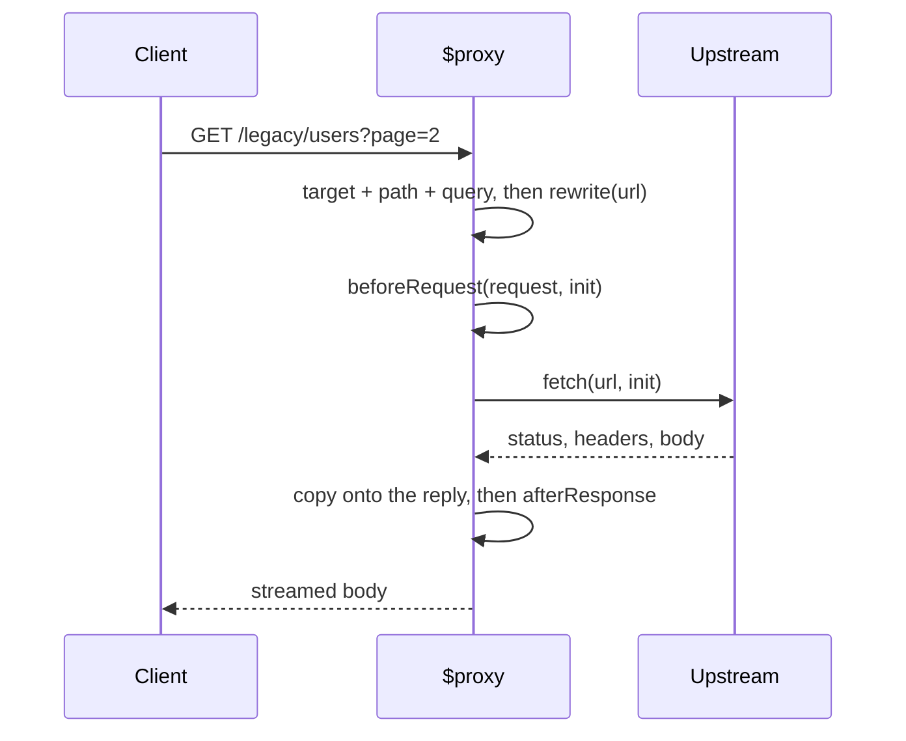

# Static Files and Proxying

Two primitives for the requests an `$action` should not be handling: files that
exist on disk, and requests that belong to somebody else's server.

## `$serve`

`$serve` mounts a directory on a path prefix. Declaring one registers the
`AlephaServerStatic` module (and the HTTP server with it), so the
`alepha.with()` below is only needed when you call `ServerStaticProvider`
yourself without any `$serve`.

```typescript check
import { $serve } from "alepha/server/static";

class Assets {
  public = $serve({
    path: "/static",
    root: "./public",
  });
}
```

```typescript
import { AlephaServerStatic } from "alepha/server/static";

alepha.with(AlephaServerStatic);
```

`path` defaults to `/` and `root` to the working directory (a relative `root`
is resolved against it too), so `$serve({})` in a container that starts in the
right place already does something useful.

| Option               | Default         | Effect                                          |
| -------------------- | --------------- | ----------------------------------------------- |
| `path`               | `"/"`           | URL prefix the directory is mounted at          |
| `root`               | `process.cwd()` | Directory on disk                               |
| `indexFallback`      | `true`          | Serve `index.html` when the path is a directory |
| `historyApiFallback` | `false`         | Serve `index.html` for extensionless misses     |
| `ignoreDotEnvFiles`  | `true`          | Skip dot files and dot directories              |
| `cacheControl`       | off             | `Cache-Control` headers, see below              |
| `headersFile`        | `false`         | Apply the root `_headers` file, see below       |
| `disabled`           | `false`         | Declared, but not read yet: it has no effect    |
| `name`               | the field name  | Name for logging and debugging                  |
| `silent`             | `false`         | Leave its requests out of the request log       |

### What a served file gets

The directory is walked **once, at boot**, and every file becomes its own
route. A file added to `root` after the server started is not served until the
next start; this is a server for build output, not for uploads (see
[Storage](/docs/guides-persistence-storage) for those).

Each file answers with:

- `Content-Type` from its extension, `Last-Modified`, `Accept-Ranges` and an
  `ETag`; a matching `If-None-Match` (or, without one, `If-Modified-Since`)
  gets a `304`.
- The precompressed sibling when one exists and the client accepts it:
  `app.js.br` for `br`, else `app.js.gz` for `gzip`, with `Vary:
  accept-encoding` and an `ETag` per encoding.
- Under `indexFallback`, `/docs/index.html` also answers `/docs/`; and a
  request for the prefix itself without its trailing slash (`/static`) is
  redirected with a `301` to `/static/`.

### Single-page apps want `historyApiFallback`

A client-side router owns routes the server has no file for. Without
`historyApiFallback`, a visitor who reloads on `/settings/profile` gets a 404,
because there is no `settings/profile.html` on disk. With it, every miss under
`path` is answered by `index.html` and the router takes over. A miss whose path
contains a dot (`/missing.css`) still gets a plain `404`, so a broken asset URL
does not come back as HTML.

Do not turn it on for a directory that also serves an API, since it converts
every genuine 404 into a page.

### `ignoreDotEnvFiles` defaults to on, and should stay on

The default skips every file and directory whose name starts with a dot, which
is the difference between serving your build output and serving your `.env`.
The one case that seems to need it off, a `.well-known` directory, does not:
only names _below_ `root` are checked, so give it its own narrow `$serve`
rather than opening the whole root.

```typescript check
import { $serve } from "alepha/server/static";

class Assets {
  wellKnown = $serve({
    path: "/.well-known",
    root: "./public/.well-known",
  });
}
```

### Cache headers

`cacheControl` is off unless you ask for it. Pass `{}` for the defaults:

```typescript check
import { $serve } from "alepha/server/static";

class Assets {
  public = $serve({
    path: "/static",
    root: "./dist/client",
    cacheControl: {
      maxAge: [1, "year"],
      immutable: true,
    },
  });
}
```

| Option      | Default                                                       | Effect                                         |
| ----------- | ------------------------------------------------------------- | ---------------------------------------------- |
| `fileTypes` | js, css, woff, woff2, ttf, eot, otf, jpg, jpeg, png, svg, gif | Extensions that get the header                 |
| `maxAge`    | `[30, "days"]`                                                | Freshness lifetime                             |
| `immutable` | `true`                                                        | Adds `immutable`, so browsers never revalidate |

⚠️ **`maxAge` is a duration, and a bare number is milliseconds.** `maxAge: 3600`
means 3.6 seconds, not an hour; the provider logs a warning for any bare number.
Write `[1, "hours"]`.

`immutable` is only safe for content-hashed filenames. A build that emits
`app.js` rather than `app.4f2a1c.js` and marks it immutable for a year has just
made that file unfixable in every browser that saw it.

### `_headers` files

`headersFile: true` applies the Cloudflare-style `_headers` file at the root of
the served directory to every response, so one build sends the same headers on
every host. `alepha build` writes that file into `dist/public`, and the app's
own public server turns this on; any other `$serve` leaves it off.

The file is read once at boot, and a line that does not parse fails the boot.
Its matching rules are applied after every other response hook; a response no
rule caches gets `public, max-age=0, must-revalidate`, and `cacheControl` is
ignored. With the option on, `/_headers`, `/_redirects` and `/.assetsignore`
are never served; with it off, `/_headers` and `/_redirects` are files like any
other.

## `$proxy`

`$proxy` forwards a path family to another origin: an API gateway in front of
services, a legacy backend you are strangling, a dev-time bridge to something
running elsewhere.

```typescript check
import { $proxy } from "alepha/server/proxy";

class Gateway {
  api = $proxy({
    path: "/legacy/*",
    target: "https://legacy.example.com",
  });
}
```

As with `$serve`, declaring a `$proxy` registers its module
(`AlephaServerProxy`); registering it by hand is only for calling
`ServerProxyProvider.createProxy()` yourself.

```typescript
import { AlephaServerProxy } from "alepha/server/proxy";

alepha.with(AlephaServerProxy);
```

**`path` must end in `/*`.** A `path` without the wildcard throws
`Proxy path should end with '/*'` when the server configures, rather than
quietly matching one URL. The proxy answers every method on that path family.

The upstream URL is `target` plus the **full** request path, prefix included,
plus the query string: `/legacy/users?page=2` goes to
`https://legacy.example.com/legacy/users?page=2`. Strip the prefix with
`rewrite` when the upstream does not know it is mounted under one.

`target` takes a string or a function, and the function is re-read per request,
so it can resolve from configuration rather than being frozen at boot.

What travels upstream, and back:



- Every incoming header is forwarded as is, `Cookie` and `Authorization`
  included, except `Accept-Encoding`, forced to `identity` so the body comes
  back uncompressed.
- The request body is streamed upstream for every method but `GET`, `HEAD`
  and `OPTIONS`, and the response body is streamed back without buffering.
- The upstream call carries the request's abort signal: a client that
  disconnects cancels it.

### Rewriting, and the two hooks

```typescript check
import { $proxy } from "alepha/server/proxy";

class Gateway {
  secure = $proxy({
    path: "/secure/*",
    target: "https://internal.example.com",
    rewrite: (url) => {
      url.pathname = url.pathname.replace("/secure", "");
    },
    beforeRequest: async (request, proxyRequest) => {
      proxyRequest.headers = {
        ...proxyRequest.headers,
        "X-Forwarded-Host": String(request.headers.host ?? ""),
      };
    },
    afterResponse: async (request, proxyResponse) => {
      if (!proxyResponse.ok) {
        // report it
      }
    },
  });
}
```

- `rewrite(url)` mutates the outgoing URL in place. The usual job is stripping
  the prefix that routed the request here, since the upstream service does not
  know it is mounted under `/secure`.
- `beforeRequest(request, proxyRequest)` mutates the outgoing `RequestInit`.
  This is where a service token or a forwarding header goes. On workerd it may
  also set `fetcher` to a service binding, which routes the subrequest through
  that Worker.
- `afterResponse(request, proxyResponse)` observes the response, after its
  status, headers (minus hop-by-hop ones, with every `set-cookie` kept) and
  body have been copied onto the reply.

`disabled` takes a boolean, read once when the server configures, which makes a
proxy a feature flag: point `/v2/*` at a new service and turn it off without
removing the declaration.

### It is a proxy, so it is a hole

Everything matching `path` leaves your process for another origin, carrying
the client's headers (its cookies and bearer token included) unless
`beforeRequest` removes them. Two habits are worth keeping:
make `target` something you control rather than something derived from request
input, and mount the proxy under a prefix narrow enough that you can say out
loud what it covers.

## See also

- [Static Deployment](/docs/guides-deployment-static) for shipping a client
  build without a server at all
- [Middlewares](/docs/guides-server-middlewares) for `$middleware`, which
  applies behaviour to a path family the way `$proxy` forwards one
