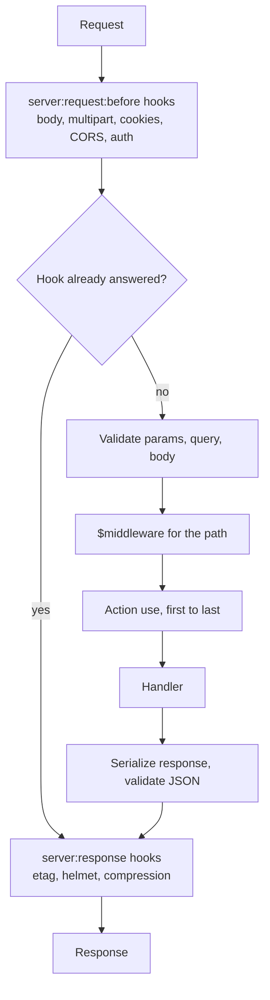

# Middlewares

Alepha provides built-in middleware modules for common server needs.

## Built-in (AlephaServer)

The following are built into `AlephaServer` and active by default. Configure via atoms or disable globally.

### Compression

Response compression (gzip, brotli, zstd) based on the client's `Accept-Encoding` header. Active by default for JSON, HTML, JavaScript, CSS, and plain text responses.

The encoding with the highest `q` wins, and a tie goes to zstd, then br, then gzip (zstd only on a runtime that has it). A response that already carries `Content-Encoding` is left alone, and nothing is compressed on a serverless runtime, whose edge compresses for you.

A buffered body under 1 KiB is sent as it is: below that size the encoded form saves a few bytes at best, and each compression costs more than the bytes it saves. A stream is always compressed, since its size is not known in advance. Brotli runs at quality 4, the level CDNs use for dynamic content; zlib's default of 11 is meant for assets compressed once at build time, and per response it was the slowest step of the request.

A buffered body up to 64 KiB is compressed synchronously, on the request's own turn: zlib's asynchronous call costs about twice the CPU on a body that small, its thread-pool round trip outweighing the compression. That blocks the event loop for at most about 0.2 ms. A larger body is compressed asynchronously, so a big response never stalls the other requests.

Configure via the `compressOptions` atom:

```typescript
import { compressOptions } from "alepha/server";

alepha.store.mut(compressOptions, (old) => ({
  ...old,
  disabled: true, // disable compression entirely
}));
```

| Option                | Default                                                                                 | Description                                                                    |
| --------------------- | --------------------------------------------------------------------------------------- | ------------------------------------------------------------------------------ |
| `disabled`            | `false`                                                                                 | Disable compression entirely                                                   |
| `allowedContentTypes` | `["application/json", "text/html", "application/javascript", "text/plain", "text/css"]` | Content types eligible for compression                                         |
| `threshold`           | `1024`                                                                                  | Smallest buffered body, in bytes, worth compressing; `0` compresses every body |

### Security Headers (Helmet)

HTTP security headers on every response. Active by default.

Configure via the `helmetOptions` atom:

```typescript
import { helmetOptions } from "alepha/server";

alepha.store.mut(helmetOptions, (old) => ({
  ...old,
  xFrameOptions: "DENY",
  contentSecurityPolicy: {
    directives: {
      defaultSrc: ["'self'"],
      scriptSrc: ["'self'", "https://cdn.example.com"],
    },
  },
}));
```

| Option                    | Default                                         | Description                       |
| ------------------------- | ----------------------------------------------- | --------------------------------- |
| `disabled`                | `false`                                         | Disable security headers entirely |
| `isSecure`                | -                                               | Force secure context (HSTS)       |
| `strictTransportSecurity` | `{ maxAge: 15552000, includeSubDomains: true }` | HSTS configuration                |
| `xContentTypeOptions`     | `true` (`nosniff`)                              | X-Content-Type-Options header     |
| `xFrameOptions`           | `"SAMEORIGIN"`                                  | X-Frame-Options header            |
| `xXssProtection`          | `false`                                         | X-XSS-Protection header           |
| `referrerPolicy`          | `"strict-origin-when-cross-origin"`             | Referrer-Policy header            |
| `contentSecurityPolicy`   | -                                               | CSP directives                    |

A header the handler already set is never overwritten. `Strict-Transport-Security` goes out only on a secure request (`https`, or `X-Forwarded-Proto: https` from your proxy), in production, or when `isSecure` is `true`.

`contentSecurityPolicy` has three states. Omit it and no CSP header is sent. Pass `{}` (no `directives`) to send the built-in policy: `'self'` for scripts, forms, frames and images, `'none'` for objects, plus `upgrade-insecure-requests`. Pass `{ directives: {} }` to send no CSP header while leaving every other security header in place - an empty directive map is not a permissive policy, so it is dropped rather than sent empty.

#### Content Security Policy

The built-in policy is strict on scripts: `script-src 'self'`, with no `'unsafe-inline'` and no `'unsafe-eval'`. `style-src` keeps `'unsafe-inline'`, because React renders `style=""` attributes that no hash or nonce can cover.

The framework writes a few inline scripts of its own, and adds what they need to the policy itself, so an app that turns the CSP on adds nothing for them:

- **A hash for what is constant.** The colour scheme boot of `alepha/react/ui`, the boot signal of a streamed page, and every inline script of a global `$head` given a literal object are allowed by their SHA-256 in `script-src`. The hashes are computed once, at `configure`, and work everywhere the header goes: a cached page, a prerendered file, the `_headers` file a host applies to the files it serves ahead of the app.
- A `$head` that sets a `type` other than JavaScript (`application/ld+json`, `application/json`) is a data block, which the CSP does not govern: it is not hashed.
- **A nonce for what is not.** On a page it renders, the server adds a fresh `'nonce-...'` to `script-src` and writes it on every inline script no hash covers: React's own streaming scripts, the script delivering a deferred value, and the inline scripts of a `$head` function or a page `head` (their content is known only per render). A client navigation gives the head scripts it inserts the same nonce.

Which to use for your own inline script: a global `$head` given a literal object is hashed for you and costs nothing. Anything built per request gets the nonce, and that has a price: **a nonce never enters the page cache.** A page whose markup carries one (a streamed page that suspended, an unhashed inline head script) is rendered on every request, and in development its `x-alepha-cache` header says `reason=csp-nonce`. A page answered from the cache carries no nonce, and its header is the static policy. A prerendered page has no request, so no nonce: an inline script there that no hash covers is blocked, so keep the scripts of a prerendered page in a literal `$head`.

The nonce goes into `script-src` only. `style-src` keeps `'unsafe-inline'`, which a browser ignores as soon as a nonce or a hash sits beside it. An API response or a file never asks for a nonce, and keeps the cached header. Your own code reads the current request's nonce with `ServerHelmetProvider.cspNonce()`, which creates it on first use.

`alepha dev` enforces the same policy, so a violation shows while you write the code rather than in the production build. The dev head is inline scripts (the build metadata, your `define` constants, the reload handler, the stylesheet import, the plugins' preambles such as React Refresh); each is constant for the dev session and allowed by its hash. The HMR websocket is same-origin and passes `'self'`, and the `<style>` tags Vite injects pass `'unsafe-inline'`. One directive is left out in dev: `upgrade-insecure-requests`, since the dev server is plain `http` on localhost and some browsers upgrade localhost too.

To add a source without restating the whole policy, register it with `ServerHelmetProvider`. It is appended to the effective policy, the built-in one or your own `directives`, and a directive the policy does not have is created from `default-src` first, so `frame-src` keeps the `'self'` it inherited:

```typescript
import { $hook, $inject } from "alepha";
import { ServerHelmetProvider } from "alepha/server";

class Analytics {
  protected readonly helmet = $inject(ServerHelmetProvider);

  protected readonly onConfigure = $hook({
    on: "configure",
    handler: () => {
      this.helmet.addCspSource("script-src", "https://cdn.example.com");
      this.helmet.addCspSource("connect-src", "https://api.example.com");
      // One constant inline script of your own, by its hash:
      this.helmet.addCspScriptHash("window.dataLayer=[]");
    },
  });
}
```

Two framework modules load a third-party script, and add their hosts the same way, only when they are the provider in use:

- **Turnstile** (`alepha/captcha`), when `TurnstileCaptchaProvider` is the captcha: `https://challenges.cloudflare.com` in `script-src` and `frame-src`.
- **Stripe** (`@alepha/payments-stripe`), when it is the payment provider: `https://js.stripe.com` and `https://*.js.stripe.com` in `script-src` and `frame-src`, `https://hooks.stripe.com` in `frame-src` (3-D Secure), `https://api.stripe.com` in `connect-src`.

The lists are `TurnstileCaptchaProvider.CSP_SOURCES` and `StripePaymentProvider.CSP_SOURCES`, taken from each provider's CSP documentation. An app on the in-memory payment provider, or with no captcha configured, gets none of them. Any other third-party host (analytics, a tag manager, a font CDN for `connect-src`) is yours to declare with `addCspSource`, as above.

A directive is matched in kebab-case or camelCase (`scriptSrc` and `script-src` are one directive). Nothing registered is sent while the CSP is off. Register at `configure`: the header is built once and cached, and `alepha build` writes the same policy into `dist/public/_headers` when it configures the app (a prerendered page or a static site). One line of that file holds 2000 characters, about 30 script hashes beside the built-in policy; the build says how many sources a policy over the limit holds.

#### Trusted Types

Opt in with `trustedTypes`, on top of the CSP:

```typescript
import { helmetOptions } from "alepha/server";

alepha.store.mut(helmetOptions, (old) => ({
  ...old,
  contentSecurityPolicy: { trustedTypes: true },
}));
```

The policy then gains `require-trusted-types-for 'script'` and `trusted-types alepha`: a DOM sink that runs code (`innerHTML`, a `<script>`'s text or `src`, React's `dangerouslySetInnerHTML`) takes only a value a Trusted Types policy made, and a plain string is refused. That is a browser-enforced defence against DOM XSS, available in every current browser.

The framework's own sinks go through one policy, `alepha` (`TrustedTypes` in `alepha/react`): the head scripts a client navigation inserts, the deferred-value script, the chart styles and the MFA QR code of `@alepha/ui`, and the Turnstile and Stripe loaders. It passes its input through, because each of those values is built by the framework itself; it is not a sanitizer.

Your own sinks need a policy of your own: create it with `trustedTypes.createPolicy("mine", { createHTML: sanitize })` and allow its name with `trustedTypes: ["mine"]`. Never reuse `alepha` for content a visitor controls.

#### Subresource Integrity

`alepha build` computes a SHA-384 of every JS and CSS file it emits, and the server writes it as `integrity` on what the document has a tag for: the entry script, the entry stylesheets, and every `modulepreload` (the entry's own graph and the first page's chunks), plus the matching `Link` header preloads. A browser refuses any of those files whose bytes changed between the build and the visitor. A `$head` link given an `integrity` gets the attribute too. Nothing to turn on, and it works with or without the CSP.

What it does not cover: a chunk loaded later by an `import()` (a client navigation to another page, a lazy component) and a page stylesheet Vite inserts itself have no tag in the document, so no integrity. They are authorised by `script-src 'self'` (and `style-src`) only; no import map with an `integrity` section is built, since it would be an inline script of tens of kilobytes on every page of a large app. For a payment page under PCI DSS 4.0.1 requirement 6.4.3, that means the method for a lazily loaded chunk is the CSP, not SRI: keep the checkout's code in the page's static imports if you want every byte of it integrity-checked. `alepha dev` serves no hashed files and writes no integrity.

### Body Parser

JSON, plain text and URL-encoded bodies are parsed for any route with a `body` schema, and a body over the limit answers 413 before the handler runs. Multipart has its own limits, below.

Configure via the `bodyParserOptions` atom:

```typescript
import { bodyParserOptions } from "alepha/server";

alepha.store.mut(bodyParserOptions, (old) => ({
  ...old,
  limit: 1_000_000, // 1MB
}));
```

| Option    | Default          | Description                                                                         |
| --------- | ---------------- | ----------------------------------------------------------------------------------- |
| `limit`   | `100000` (100KB) | Maximum request body size in bytes, and ten times that once decompressed            |
| `inflate` | `true`           | Decompress `gzip`, `deflate` and `br` bodies; off, a `Content-Encoding` answers 415 |

### Multipart

Multipart form-data parsing for file uploads. Runs for any route with a `body` schema when the request's content type is `multipart/form-data`, and handles `z.file()` and `z.stream()` parts.

Configure via the `multipartOptions` atom:

```typescript
import { multipartOptions } from "alepha/server";

alepha.store.mut(multipartOptions, (old) => ({
  ...old,
  limit: 50_000_000, // 50MB total
  fileLimit: 10_000_000, // 10MB per file
  fileCount: 20,
}));
```

| Option      | Default           | Description                                               |
| ----------- | ----------------- | --------------------------------------------------------- |
| `limit`     | `10000000` (10MB) | Maximum total multipart request size in bytes             |
| `fileLimit` | `5000000` (5MB)   | Maximum single file size in bytes                         |
| `fileCount` | `10`              | Maximum number of parts per request, text fields included |

## Optional Modules

Each section says what it takes: some are registered with `alepha.with()`, the others come with `AlephaServer` or with their primitive.

### CORS

Cross-Origin Resource Sharing comes from the `AlephaServerCors` module. Register it and configure the `corsOptions` atom for global behavior:

```typescript check
import { Alepha } from "alepha";
import { AlephaServerCors, corsOptions } from "alepha/server/cors";

const alepha = Alepha.create().with(AlephaServerCors);
alepha.store.mut(corsOptions, (o) => ({
  ...o,
  origin: "https://app.example.com",
  credentials: true,
}));
```

For per-action CORS, attach the `$cors` middleware instead: `use: [$cors({ origin: "..." })]`.

| Option        | Default                                                | Description                                              |
| ------------- | ------------------------------------------------------ | -------------------------------------------------------- |
| `origin`      | `"*"`                                                  | Allowed origins. `"*"` for all, or comma-separated list. |
| `methods`     | `["GET", "POST", "PUT", "PATCH", "DELETE", "OPTIONS"]` | Allowed HTTP methods                                     |
| `headers`     | `["Content-Type", "Authorization"]`                    | Allowed request headers                                  |
| `credentials` | `false`                                                | Allow credentials (cookies, auth headers)                |
| `maxAge`      | -                                                      | Preflight cache duration in seconds                      |

Alepha automatically creates an `OPTIONS` preflight route for every path when the CORS module is active - including `GET`-only paths, which browsers preflight as soon as the request carries a non-simple header such as `Authorization`.

Responses always carry `Vary: Origin`, since the allowed origin is reflected from the request.

A Capacitor app calls the API from its WebView's origin. `CAPACITOR_ORIGINS` (from `alepha/server/cors`) is the two of them, `capacitor://localhost` (iOS) and `https://localhost` (Android), in the comma-separated form `origin` takes: `origin: CAPACITOR_ORIGINS`.

**`credentials` requires an explicit origin.** With `origin: "*"` the allowed origin is reflected back, so pairing it with `credentials: true` would let _any_ site read authenticated responses - the exact thing the browser's own ban on `Access-Control-Allow-Origin: *` plus credentials prevents. Alepha refuses that combination: `Access-Control-Allow-Credentials` is omitted and a warning is logged at startup. List the origins you trust to enable credentials.

### Rate Limiting

Rate limiting is not part of `AlephaServer`: it comes from `alepha/rate-limit`, whose
limiters work on any call, HTTP or not. Declare a `$rateLimit` as a class field above
the actions that use it, and put its `middleware()` in their `use`:

```typescript check
import { $rateLimit } from "alepha/rate-limit";
import { $action } from "alepha/server";

class App {
  loginLimit = $rateLimit({ name: "login", limit: 5, window: [1, "minutes"] });

  login = $action({
    method: "POST",
    path: "/auth/login",
    use: [this.loginLimit.middleware({ skipSuccessfulRequests: true })],
    handler: async () => "ok",
  });
}
```

Each call counts one hit against the key: `key(...args)` when given, else
`ip:<request.ip>` in an HTTP request, else `ip:global` (one bucket for a `$job`).
An allowed call sets `X-RateLimit-Limit`, `X-RateLimit-Remaining` and
`X-RateLimit-Reset`. Past the limit the middleware throws `HttpError(429)` with
`Retry-After`; if the counter store is down it throws `HttpError(503)` instead, since
an outage is not a limit the client exceeded.

| Middleware option        | Default | Description                                                    |
| ------------------------ | ------- | -------------------------------------------------------------- |
| `key`                    | -       | Key from the handler's arguments, instead of the request ip    |
| `skipFailedRequests`     | `false` | Refund the hit when the handler fails                          |
| `skipSuccessfulRequests` | `false` | Refund the hit when the handler succeeds (only failures count) |

The limit, the window, the failure modes and where counters live (one instance on
Memory, several once `REDIS_URL` is set, Durable Objects on workerd) belong to the limiter: see
[Rate limiting](/docs/guides-server-rate-limiting).

### Health Check

`GET /health` and `GET /healthz` are part of `AlephaServer` - every server has them, with nothing to import.

```json
{ "message": "OK", "uptime": 42, "date": "2026-07-31T17:26:36Z", "ready": true }
```

`ready` is the field that matters. It follows the container's lifecycle, so it is `false` for exactly as long as the app is still starting - which is longer than you might expect, because a process binds its port _before_ it runs its migrations.

That gap is why this is not opt-in. A supervisor or load balancer starting your app cannot ask it to expose a readiness endpoint; without one, the best it can do is open a TCP connection, which succeeds while the app is still building its database. It then sends traffic the app cannot serve. Alepha exposes `/health` universally so the caller can tell _listening_ from _working_.

#### Liveness and readiness

An orchestrator asks two questions apart, and `AlephaServer` answers both:

| Path      | Answers 200                          | Answers 503                                          |
| --------- | ------------------------------------ | ---------------------------------------------------- |
| `/livez`  | as soon as the listener is bound     | never                                                |
| `/readyz` | once the app is ready                | while it starts, and from the moment `stop()` begins |
| `/health` | once the app is ready (as `/readyz`) | while it starts                                      |

Point a **liveness** probe at `/livez`, never at `/health`: a probe that gets 503 while migrations run restarts the process in a loop. Point a **readiness** probe at `/readyz`. The listener binds before every other start hook, so `/livez` answers through the whole start.

`/readyz` turns 503 as soon as `stop()` begins (`alepha.isStopping()` is true from then until the stop is over), so the orchestrator stops sending new traffic. The framework adds no drain delay of its own: the listener closes when its own stop hook runs, so connections are drained by the orchestrator's wait before it sends SIGTERM (a `preStop` in Kubernetes).

Put your reverse proxy in front of all of them: they describe your internals and belong on loopback, not on the public host. [Bay](https://alepha.dev/bay) returns 404 for `/health`, `/healthz`, `/livez`, `/readyz` and `/metrics` on the public interface.

<!-- docs-check-ignore: migration note about a removed symbol -->

`AlephaServerHealth` has been removed - delete the import if you still have one; `/health` ships with `AlephaServer` itself.

### Build Metadata

`GET /version` is part of `AlephaServer` too, and answers a different question from `/health`: not "can this take traffic" but "what is running here".

```json
{
  "name": "lore",
  "version": "0.27.1",
  "commit": "6faea71",
  "build": {
    "date": "2026-08-31T09:14:22.000Z",
    "runtime": "workerd",
    "dev": false
  },
  "framework": "0.27.1"
}
```

The same record is readable anywhere in your app as `alepha.meta`, in the browser as well as on the server - it is resolved once at build time and baked into both bundles, so a footer showing the build date cannot disagree with what the server reports.

```typescript
alepha.meta.version; // "0.27.1", or "latest" on an untagged commit
alepha.meta.commit; // "6faea71", absent when the build had no git
alepha.meta.build.date; // ISO, absent when no build produced this code
```

`version` is the git tag on the built commit (a leading `v` is stripped), falling back to `"latest"`. Two absences carry information rather than being holes: no `commit` means there was no git at all, and no `build.date` means nothing built this code - a test run, a script, or the package imported outside a build.

Declare a version yourself when the tag is not the answer you want. An app that deploys on every push resolves to `"latest"` on everything that is not a release:

```typescript
// alepha.config.ts
export default defineConfig({
  meta: { version: pkg.version },
});
```

⚠️ In CI, the default `actions/checkout` fetches shallow and passes `--no-tags`, so `version` reports `"latest"` unless the job that builds your deployed artifact sets `fetch-tags: true`. `commit` is unaffected - resolving it needs no tags - so even a `"latest"` build says exactly which commit is running.

Configure the route with `versionOptions`. `expose` trims the payload, most usefully to publish a version while withholding the commit; `enabled: false` makes the path answer 404 without touching `/health`:

```typescript
import { versionOptions } from "alepha/server";

alepha.set(versionOptions, { expose: ["name", "version"] });
```

`path` is the one option that must be seeded at construction rather than written afterwards, because routes are registered before a later write would land:

```typescript
Alepha.create({ "alepha.server.version.options": { path: "/_version" } });
```

### Metrics

`AlephaServerMetrics` exposes a Prometheus-compatible metrics endpoint. Import from `alepha/server/metrics`.

```typescript
import { Alepha } from "alepha";
import { AlephaServerMetrics } from "alepha/server/metrics";

Alepha.create().with(AlephaServerMetrics).with(App).start();
```

Serves metrics in Prometheus text format at `/metrics`.

Opt-in, unlike `/health`: it pulls in `@prometheus-io/client`, and an app that nothing scrapes should not carry it.

Set `METRICS_TOKEN` if the app itself is reachable from the network: the scraper then sends `Authorization: Bearer <token>`, and anything else answers 401. Alepha warns at startup when it is - production, no token, and `SERVER_HOST` bound to something other than loopback. An app on loopback behind a proxy gets no warning: the proxy decides what the internet sees.

### ETag and Conditional Responses

`AlephaServerEtag` adds the `$etag` middleware, which hashes a response, sends
it as an `ETag`, and answers `304 Not Modified` when the client sends the same
value back in `If-None-Match`.

```typescript check
import { $action } from "alepha/server";
import { $etag } from "alepha/server/etag";

class Articles {
  get = $action({
    method: "GET",
    path: "/articles/:id",
    use: [$etag()],
    handler: async () => "an article",
  });
}
```

Bare `$etag()` only validates: the handler still runs on every request, and the
saving is bandwidth, not work. Pass `true` to also **store** the response, which
short-circuits the handler on a hit:

| Written as                         | Handler runs on a hit | Response body sent |
| ---------------------------------- | --------------------- | ------------------ |
| `$etag()`                          | yes                   | no (304)           |
| `$etag(true)`                      | no                    | no (304)           |
| `$etag({ store: [5, "minutes"] })` | no                    | no (304)           |

`control` sets `Cache-Control` on top of that, either as a literal string or as
directives:

```typescript check
import { $action } from "alepha/server";
import { $etag } from "alepha/server/etag";

class Stats {
  get = $action({
    method: "GET",
    path: "/stats",
    use: [
      $etag({
        store: { ttl: [5, "minutes"] },
        control: { public: true, maxAge: 300 },
      }),
    ],
    handler: async () => "stats",
  });
}
```

Stored responses are namespaced by caller identity, taken from the
`authorization` and `cookie` headers, so an authenticated route cannot serve one
user's body to another. Anonymous callers share a single entry. That is the
right default and it is also worth knowing before you put `store` on a route
whose response varies by something _other_ than those two headers, such as an
`Accept-Language` or a tenant header: those responses would share an entry.

### Path-Scoped Middleware

Everything above is either global (a module) or per-action (`use: [...]`).
`$middleware` is the level in between: middleware applied to every route under a
path prefix.

```typescript check
import { $secure } from "alepha/security";
import { $middleware } from "alepha/server";

class Gateway {
  api = $middleware({
    path: "/api",
    use: [$secure()],
  });
}
```

| Option    | Effect                                                                        |
| --------- | ----------------------------------------------------------------------------- |
| `path`    | Prefix to match. `/api` covers `/api/users`, `/api/orders`, not `/api` itself |
| `use`     | The middleware to apply                                                       |
| `method`  | Restrict to one HTTP method, or a list                                        |
| `exclude` | Route paths to leave alone, each with everything under it                     |

It covers every route under the prefix, `$route` and `$page` included, whether it was declared before or after the `$middleware`. Its middleware runs outside the action's own `use`, so a `$secure()` here has already refused the caller before any per-action middleware sees the call. It joins the action's own pipeline, so it also runs when the action is called in process, through `run()` or a local `$client`. [OpenAPI](/docs/guides-server-openapi) reads the action's own `use` alone, so a gate declared here is enforced but not documented.

Use it for a cross-cutting concern that belongs to a whole path family, and keep
per-action `use` for behaviour that belongs to one action. The test is whether
you would have to remember to add it: a header every `/api` route must carry is a
`$middleware`, while a retry policy that suits one flaky upstream call is not.

`exclude` exists for the route inside the family that must not have it, such as a
health probe under a prefix that otherwise requires a token.

## Writing Your Own

An action middleware is an ordinary [pipeline middleware](/docs/guides-core-pipelines#writing-a-middleware): `createMiddleware` from `alepha`, whose wrapped function receives the action's `ServerRequest` as its first argument. On a local `run()` that request is a partial one: `requestId`, `userAgent` and the other fields the HTTP layer fills are undefined, `signal` is the caller's, and what a middleware sets on `reply` is thrown away.

```typescript check
import { createMiddleware, type Middleware } from "alepha";
import { $action, type ServerRequest } from "alepha/server";

const $poweredBy = (value: string): Middleware =>
  createMiddleware({
    name: "$poweredBy",
    options: { value },
    handler: ({ next }) => {
      return async (...args) => {
        const request = args[0] as ServerRequest;
        request.reply.setHeader("X-Powered-By", value);
        return next(...args);
      };
    },
  });

class Hello {
  hello = $action({
    method: "GET",
    path: "/hello",
    use: [$poweredBy("alepha")],
    handler: async () => "hello",
  });
}
```

The first middleware in `use` is the outermost. To refuse a call, throw an `HttpError` (or one of its subclasses) instead of calling `next`. Two `meta` keys describe what a middleware does to tooling that does not know it by name: `MIDDLEWARE_RESPONSES` (`"401,403"`, a comma-separated list) adds those statuses to the OpenAPI document of an action that declares `errors`, and `MIDDLEWARE_PROTECTED` (`"true"`) marks it as gated behind an identity, which documents a `bearerAuth` requirement. Both are exported by `alepha`.

### Where Each Layer Runs

A request crosses the global modules as event hooks around the route, and the middlewares as wrappers around the handler:



A throw anywhere between validation and serialization goes to the [error handler](/docs/guides-server-error-handling) and then on to the response hooks. An action's `timeout` covers its middlewares and its handler, not the validation before them.

## Combining Middlewares

Register multiple modules together:

```typescript check
import { Alepha } from "alepha";
import { AlephaRateLimit } from "alepha/rate-limit";
import { AlephaServerCors, corsOptions } from "alepha/server/cors";

const alepha = Alepha.create().with(AlephaServerCors).with(AlephaRateLimit);

alepha.store.mut(corsOptions, (o) => ({
  ...o,
  origin: "https://app.example.com",
}));

await alepha.start();
```

Module order in `.with()` calls does not affect execution order. Alepha uses hook priorities internally to ensure correct ordering (e.g., CORS headers are set before the handler runs).
