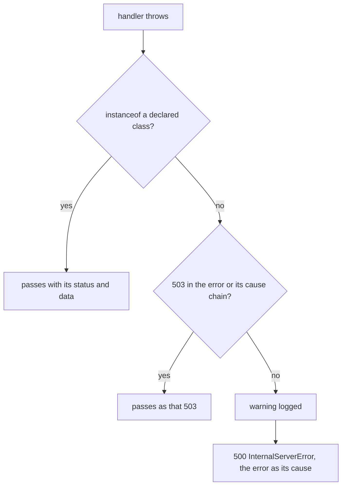

# Typed errors

Every error in Alepha is declared with `$error`: a name, and a schema for the data it carries. A `$action` can declare the errors it answers with. Declared errors are part of its contract: they reach the client with their status and typed `data`, they appear in the OpenAPI document, and the browser rebuilds them so `instanceof` works there too. Anything else the handler throws is a bug, and answers a `500` like any other crash.

This is opt-in, per action. An action without `errors` behaves as described in [Error Handling](/docs/guides-server-error-handling).

## Declaring an error

`$error` returns a class, declared once at module level like `$atom`. It is not tied to HTTP: the CLI, the ORM and the job runner declare theirs the same way.

```typescript check
import { $error, z } from "alepha";

export const QuotaExceeded = $error({
  name: "QUOTA_EXCEEDED",
  schema: z.object({ limit: z.number(), used: z.number() }),
  default: { limit: 5 },
  message: (data) => `Quota of ${data.limit} exceeded`,
});

// Optional: a name for function signatures.
export type QuotaExceeded = InstanceType<typeof QuotaExceeded>;

throw new QuotaExceeded({ used: 6 }); // `limit` has a default
```

- `name` is required, SCREAMING_SNAKE, and unique. It is the error's `Error.name` and its identity on the wire. Nothing enforces uniqueness: a second declaration of a name replaces the first in the registry (so a dev server re-evaluating a module never throws), and the client then rebuilds the later class.
- `schema` types `data`. `default` makes the keys it covers optional when constructing. The constructor does not validate: the schema is checked when the error is rebuilt from JSON (see [Branching in React](/docs/guides-server-typed-errors#branching-in-react)).
- `message` is the default message: a string, or a function of the data. Without one, the parent's, else the name.
- `description` is prose for OpenAPI and the docs.
- The constructor is `(data, { message?, cause? })`. When every data key is optional, `new X("message", { cause })` works as it does for `Error`.

## Deriving errors

`.extend` derives a real subclass: `instanceof` the parent holds, its schema is merged into the parent's and its defaults over the parent's. An HTTP error is an error derived from `HttpError`, whose schema carries the `status`:

```typescript check
import { z } from "alepha";
import { HttpError, NotFoundError } from "alepha/server";

export const ProjectQuotaExceeded = HttpError.extend({
  name: "PROJECT_QUOTA_EXCEEDED",
  default: { status: 409 },
  schema: z.object({ limit: z.number(), used: z.number() }),
});

export const ProjectNotFound = NotFoundError.extend({
  name: "PROJECT_NOT_FOUND",
  message: "No such project",
});

const error = new ProjectQuotaExceeded({ limit: 5, used: 6 });
error.status; // 409, a shortcut for error.data.status
error instanceof HttpError; // true
```

Any layer can throw them; a service needs no reference to the action that will answer.

`alepha/server` ships the common ones, each an `HttpError.extend` to derive from:

| Class                     | `name`                  | Status |
| ------------------------- | ----------------------- | ------ |
| `BadRequestError`         | `BAD_REQUEST`           | 400    |
| `ValidationError`         | `VALIDATION_FAILED`     | 400    |
| `UnauthorizedError`       | `UNAUTHORIZED`          | 401    |
| `ForbiddenError`          | `FORBIDDEN`             | 403    |
| `NotFoundError`           | `NOT_FOUND`             | 404    |
| `ConflictError`           | `CONFLICT`              | 409    |
| `TooManyRequestsError`    | `TOO_MANY_REQUESTS`     | 429    |
| `InternalServerError`     | `INTERNAL_SERVER_ERROR` | 500    |
| `ServiceUnavailableError` | `SERVICE_UNAVAILABLE`   | 503    |

## Declaring them on an action

`errors` lists what the handler may throw: errors derived from `HttpError`, the built-in ones included.

```typescript check
import { $inject, z } from "alepha";
import { $action, HttpError, NotFoundError } from "alepha/server";

const ProjectQuotaExceeded = HttpError.extend({
  name: "PROJECT_QUOTA_EXCEEDED",
  default: { status: 409 },
  schema: z.object({ limit: z.number(), used: z.number() }),
});

class ProjectService {
  async create(name: string) {
    return { id: name };
  }
}

class ProjectController {
  projects = $inject(ProjectService);

  createProject = $action({
    method: "POST",
    path: "/createProject",
    errors: [ProjectQuotaExceeded, NotFoundError],
    schema: {
      body: z.object({ name: z.text() }),
      response: z.object({ id: z.text() }),
    },
    handler: ({ body }) => this.projects.create(body.name),
  });
}
```

Setting `errors` turns on strict mode for that action. The filter wraps the handler only, and sorts what it throws:



- An error matching a declared class (`instanceof`, so a declared parent admits its children) reaches the client with its status and `data`.
- **Anything else becomes a `500 InternalServerError`**, including an undeclared `HttpError` such as a `NotFoundError` the list forgot. In production the body is byte for byte the one any other crash answers: no message, no cause. Outside production the message passes through, prefixed with the error's name. Either way a warning names the action and the error: `'createProject' threw NOT_FOUND, which it does not declare`.
- `errors: []` is strict too: nothing is expected.
- Omitting `errors` changes nothing: any `HttpError` passes with its status, as before.

### What always passes

Only what the handler, and the services it calls, throw is filtered. The framework's own answers sit outside the filter and never need declaring:

| Source                                  | Status    |
| --------------------------------------- | --------- |
| Request validation (body, query...)     | 400       |
| `$secure`                               | 401 / 403 |
| `$rateLimit`                            | 429       |
| The action's `timeout` (`TimeoutError`) | 503       |
| A database timeout (`DbTimeoutError`)   | 503       |

Any `use` middleware is outside the filter, and so is any error carrying a `503` (in itself or in its cause chain): a timeout tells the caller to retry, it is never a contract violation.

The ORM's errors are HTTP errors too, so a strict action declares them like any other: `DbEntityNotFoundError` (404) for a lookup by id that missed, `DbConflictError` (409) for a unique constraint.

### On the wire

A declared error answers its `status` with a JSON body built from `toJSON`, the request id added to `data`:

```json
{
  "name": "PROJECT_QUOTA_EXCEEDED",
  "message": "PROJECT_QUOTA_EXCEEDED",
  "data": { "status": 409, "limit": 5, "used": 6, "requestId": "..." }
}
```

The message here is the name because `ProjectQuotaExceeded` declares none. A `4xx` keeps its message and its `cause` (`{ name, message }`), which are deliberate, client-facing context. ⚠️ A `5xx` in production loses both, declared or not: the message becomes `Internal Server Error`. Put what the client must read in `data`, or use a `4xx`.

## OpenAPI

A strict action's operation documents every declared error under its default status, with `name` fixed and `data` typed by its schema (two errors on one status become a `oneOf`), the responses its middlewares declare (`401`, `403`, `429`), and the `500`. An error whose status has no default is documented as the `default` response. Every action, strict or not, also documents `400` when it validates input and the `503` `TimeoutError` when it has a timeout. Actions without `errors` are otherwise documented as before. See [OpenAPI](/docs/guides-server-openapi).

A middleware of your own documents its responses by setting the `MIDDLEWARE_RESPONSES` meta key to a comma-separated list of statuses. `$secure` sets `"401"` or `"401,403"`, `$rateLimit` sets `"429"`:

```typescript check
import { createMiddleware, MIDDLEWARE_RESPONSES } from "alepha";
import { HttpError } from "alepha/server";

const maintenance = { on: false };

export const notInMaintenance = () =>
  createMiddleware({
    name: "notInMaintenance",
    meta: { [MIDDLEWARE_RESPONSES]: "423" },
    handler:
      ({ next }) =>
      async (...args: any[]) => {
        if (maintenance.on) throw new HttpError({ status: 423 });
        return next(...args);
      },
  });
```

Like any `use` middleware, what it throws sits outside the filter, so the `423` needs no declaring.

## Branching in React

Every declared error registers under its name when its module is imported, and `HttpClient` rebuilds the registered class from the response body (`{ name, message, data }`). A page that writes `instanceof ProjectQuotaExceeded` has imported it, so the check holds in the browser:

```tsx
import { useAction } from "alepha/react";

const create = useAction({
  handler: (_ctx, name: string) => api.createProject({ body: { name } }),
  onError: (error) => {
    if (error instanceof ProjectQuotaExceeded) {
      // error.data is { status: number; limit: number; used: number; ... }
      openUpgradeDialog(error.data.limit);
    }
  },
});
```

`RunResult`'s error stays `Error`; `instanceof` is what narrows it, on `result.error` as in `onError`. An `onError` marks the failure handled, so the app's `ActionErrorToaster` stays quiet.

Built-in errors rebuild too: a `404` from the framework is a `NotFoundError` in the browser. A name nothing registered, or `data` failing its schema, stays a plain `HttpError`.

Where a function needs the whole union an action may reject with, `ActionErrors<typeof action>` names it: the declared errors plus `InternalServerError`.

## Finding an error under another

A library may wrap an error: drizzle demotes the driver's error to `cause` and throws its own. `X.find(error)` returns the `X` in an error or its cause chain:

```typescript check
import { DbTimeoutError } from "alepha/orm";

const isTimeout = (error: unknown) => DbTimeoutError.find(error) !== undefined;
```

The search follows `cause` at most ten levels deep, so a chain that loops on itself cannot hang.

## The one limit

TypeScript has no checked exceptions. Nothing proves at compile time that a service throws only what the action declares; the warning logged for an undeclared error is what keeps the list honest.
