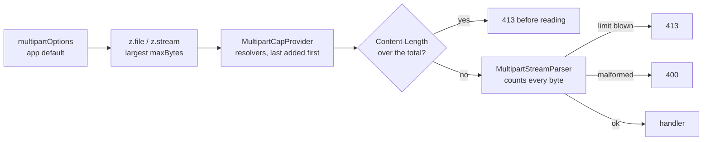

# Multipart

`alepha/server/multipart` is the layer underneath [File Upload](/docs/guides-server-file-upload):
the parser that reads `multipart/form-data`, and the registry that decides how
many bytes a given request is allowed to carry.

Most applications never import it. Reach for it when you need to raise a limit
for some routes but not others, or when you want to parse multipart yourself.

```typescript check
import {
  MultipartCapProvider,
  MultipartStreamParser,
} from "alepha/server/multipart";
```

## The Parser

`MultipartStreamParser` is written against RFC 2046 §5.1 and RFC 7578, on Web
streams only - one implementation for node, bun and workerd rather than three
that drift apart.

**Its memory is flat.** It holds one source chunk plus, at most, the length of a
delimiter - a delimiter can straddle two chunks, so the tail is kept until the
next chunk proves it was content. The bytes of a part are handed out and
forgotten.

The platform's own `Request.formData()` cannot do this: it yields `File`
objects, a `File` is re-readable by specification, and honouring that forces the
implementation to keep every byte. That difference is the whole reason this
parser exists.

Each part arrives as:

```typescript
interface MultipartPart {
  name?: string; // form field name
  filename?: string; // absent for a plain field
  mediaType?: string; // the part's Content-Type
  headers: Record<string, string>; // lowercased
  data: AsyncIterable<Uint8Array>; // the bytes, in arrival order
}
```

A part's `data` must be consumed - fully or not at all - before advancing to the
next one. The parser drains whatever is left behind, because the delimiter of
the next part can only be found by walking past this one's content.

Driving it by hand takes a boundary, read off the `Content-Type` with
`boundaryOf()` (`undefined` when the header is not multipart at all, a
`MultipartParseError` when it is multipart but carries no usable boundary), and a
`ReadableStream`. One parser instance parses one body:

```typescript
import { MultipartStreamParser } from "alepha/server/multipart";

const parser = new MultipartStreamParser({ maxFileBytes: 50_000_000 });
const boundary = parser.boundaryOf(request.headers.get("content-type"));
if (boundary && request.body) {
  for await (const part of parser.parse(request.body, boundary)) {
    for await (const chunk of part.data) {
      // write chunk somewhere
    }
  }
}
```

The constructor takes `maxHeaderBytes` (16 KB), `maxFileBytes` (5 MiB),
`maxParts` (10) and `maxTotalBytes` (10 MiB). A malformed body throws
`MultipartParseError`; a blown limit throws `MultipartLimitError` (see
[Refusals](#refusals)).

## Scalar Fields Are Coerced

A form can carry more than files, and the fields beside them are declared the
way any other body field is: `z.boolean()`, `z.integer()`, `z.enum()`, an
object. A part has no way to say what type it holds, so those values arrive as
text and are **coerced before validation**, exactly as a query parameter or a
header is - `"true"` becomes `true`, `"42"` becomes `42`, and a part holding
JSON is parsed for an object or array field.

A JSON request body is not coerced, and neither is the ORM: both carry their own
types, so widening them would only hide mistakes. A multipart part cannot, which
is the difference.

Coercion widens what is _accepted_, never what is _valid_. A value that cannot
be coerced is passed through unchanged, so the schema is still what rejects it:
`flag=yes` against a `z.boolean()` is a 400, not a `true`.

## How a Limit Is Resolved

Three levels, most specific last:

1. **`multipartOptions`** (an atom exported by `alepha/server`): the
   application-wide default, `fileLimit` 5 MB per file, `limit` 10 MB per
   request, `fileCount` 10 parts (text fields count too).
2. **`z.file({ maxBytes })` / `z.stream({ maxBytes })`**: what the route itself
   declares, in bytes.
3. **`MultipartCapProvider`**: a resolver, which is the only level that knows
   where the bytes are actually going. That is why it wins.

**A level can raise the ceiling, not merely lower it.** That inversion was the
original defect: a `$storage({ maxSize: 100 })` bucket was silently held at the
5 MB global it knew nothing about, so the declaration read like a promise the
framework could not keep - and nothing reported the gap.

Raising `maxFileBytes` lifts `maxTotalBytes` to match, so a route does not have
to state the same number twice.

Each level only overrides what it says: a resolver that returns
`{ maxFileBytes }` keeps the request total, the part count and the header cap
of the levels below it. When a route declares several `z.file()` /
`z.stream()` fields with different `maxBytes`, the **largest** one is used: the
parser applies one ceiling to every part, and enforcing the smallest would
refuse the field that was explicitly allowed to be bigger.



The `Content-Length` check is a courtesy that spares an obviously oversized
upload the trip; the parser counting bytes is what actually enforces the
budget, and it is the only guard a chunked body (no `Content-Length`) meets.

## Adding a Resolver

A resolver is called **before a single byte of the body is read** - the URL, the
route and the headers are all known by then, which is what makes a
per-destination budget possible at all. Return `undefined` to defer.

```typescript check
import { $hook, $inject } from "alepha";
import { MultipartCapProvider } from "alepha/server/multipart";

class LargeUploadCaps {
  protected readonly caps = $inject(MultipartCapProvider);

  public readonly register = $hook({
    on: "configure",
    handler: () => {
      this.caps.use((request, route) => {
        if (route.path !== "/ingest") {
          return undefined;
        }
        return { maxFileBytes: 200_000_000 };
      });
    },
  });
}
```

The last resolver added answers first, so an application can overrule a module
it imports without having to load before it. The first answer that carries at
least one number wins; `undefined` and `{}` both mean "not mine" and pass to
the next resolver.

Register through a `configure` hook rather than by substituting the provider.
Substitution has an ordering constraint this cannot satisfy: the server resolves
`MultipartCapProvider` while registering, and whoever wants to answer usually
loads _after_ - the container refuses the late substitution, loudly and
correctly. Adding to a list works whenever it happens.

This is what `alepha/api/files` does, mapping the targeted `$storage` bucket to
its `maxSize`. The bucket arrives in the query string, so the destination is
known before the first byte lands.

### Two warnings

**A resolver is a security surface, not a convenience.** It can raise a limit,
so whatever it keys on is chosen by the caller. A query parameter is
attacker-controlled, and a resolver that answers for _every_ route lets any
request claim the largest budget the application declares anywhere. Answer
`undefined` for routes you do not own.

**A raised limit is only safe on a path that streams.** `$secure` runs _after_
the body hook, so on the `z.file()` path the budget is reachable before
authentication - a bigger number there is a cheaper denial of service, not a
feature. On the `z.stream()` path the handler pulls the bytes, so nothing is
consumed before the guard has run.

## Refusals

Limits are **counted, never trusted**. `Content-Length` is a claim by the
sender, so the parser tallies bytes that actually arrived and refuses at the
first byte past the limit rather than after the whole body is in.

| Condition                                              | Status | Message                                                                 |
| ------------------------------------------------------ | ------ | ----------------------------------------------------------------------- |
| One file too large                                     | `413`  | `File "<field>" exceeds size limit. Maximum allowed: N bytes`           |
| Request too large                                      | `413`  | `Request body size limit exceeded. Maximum allowed: N bytes`            |
| Too many parts                                         | `413`  | `Too many files. Maximum allowed: N`                                    |
| Part headers too large                                 | `413`  | `Part headers exceed size limit. Maximum allowed: N bytes`              |
| Anything unparseable                                   | `400`  | `Malformed multipart/form-data`                                         |
| Not `multipart/form-data` on a route with a file field | `415`  | `Invalid content-type: <type> - only "multipart/form-data" is accepted` |

A limit blown while a `z.stream()` field is being drained still reads as a
`413`, even though the handler is long past the parser's own error handling.

`MultipartLimitError` carries `kind` (`"header" | "file" | "parts" | "total"`)
and `limit` as data, so a caller can phrase the refusal in its own vocabulary
without matching on prose.
