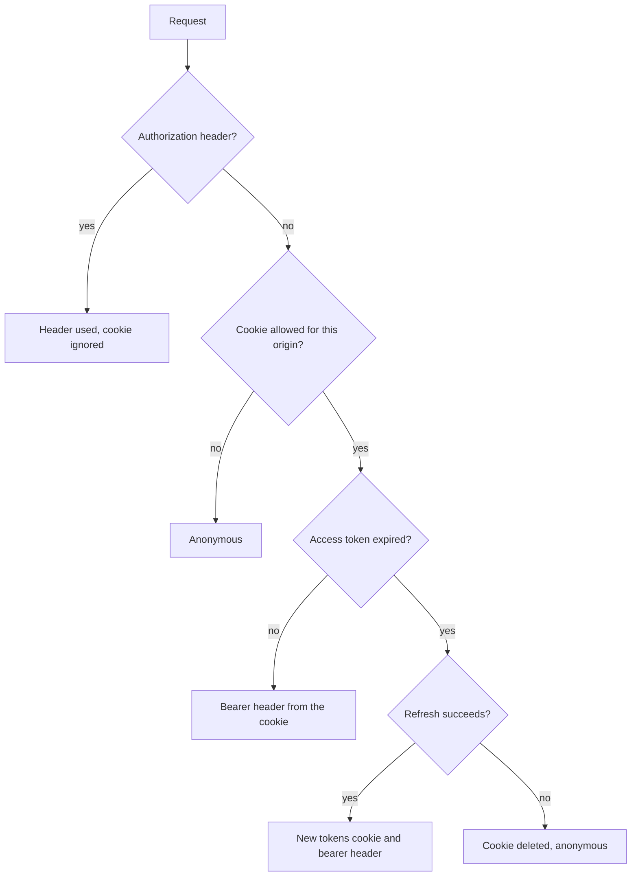
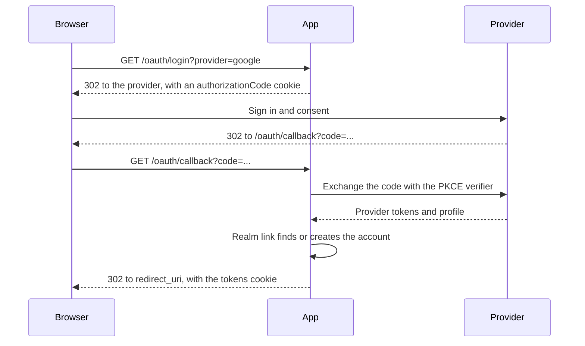

# Authentication

Alepha provides JWT-based authentication through `$issuer` for token management and `$realm` for full user management.

## Token Management with $issuer

`$issuer` is the low-level primitive for creating and verifying JWT tokens. Use it when you manage users yourself or integrate with an external identity provider.

```typescript check
import { z } from "alepha";
import {
  $issuer,
  InvalidCredentialsError,
  type UserAccount,
} from "alepha/security";
import { $action } from "alepha/server";

class AuthController {
  issuer = $issuer({
    secret: "your-secret-key",
  });

  login = $action({
    method: "POST",
    path: "/auth/login",
    schema: {
      body: z.object({
        email: z.email(),
        password: z.text(),
      }),
      response: z.object({
        access_token: z.text({ size: "rich" }),
        token_type: z.text(),
        expires_in: z.number().optional(),
        refresh_token: z.text({ size: "rich" }).optional(),
      }),
    },
    handler: async ({ body }) => {
      const user = await this.findUser(body.email, body.password);
      if (!user) {
        throw new InvalidCredentialsError(); // 401
      }
      return this.issuer.createToken(user);
    },
  });

  protected async findUser(
    email: string,
    password: string,
  ): Promise<UserAccount | undefined> {
    // Look the user up in your own store and verify the password.
    return undefined;
  }
}
```

A token is a few hundred characters, past the 255 a plain `z.text()` admits,
so declare it with `size: "rich"`.

### Internal vs External Issuers

An **internal** issuer signs and verifies tokens with a shared secret:

```typescript
issuer = $issuer({
  secret: "my-secret",
});
```

An **external** issuer verifies tokens from an identity provider it does not
hold the keys of (Keycloak, Auth0, Entra ID). It has two forms.

The `oidc` form points at the `$auth` that signs users in, and reads
everything from the provider's discovery: the keys, the issuer every token
must carry, and the client id:

```typescript
class Auth {
  keycloak = $auth({
    oidc: {
      issuer: "https://idp.example.com/realms/acme",
      clientId: "acme-web",
    },
  });

  issuer = $issuer({ oidc: () => this.keycloak });
}
```

Discovery runs on the first token verified, never at boot, so the app starts
while its provider is unreachable; a token that arrives before discovery
succeeds is refused, and the next one tries again. `issuer` or `audience`
written beside `oidc` replaces the discovered value, for an IdP that puts an
API identifier in `aud`.

The `jwks` form takes the key set and the expectations by hand:

```typescript
issuer = $issuer({
  jwks: () => "https://your-tenant.auth0.com/.well-known/jwks.json",
  issuer: "https://your-tenant.auth0.com/",
  audience: "my-app",
  profile: (payload) => ({
    id: payload.sub,
    email: payload.email,
    name: payload.name,
  }),
});
```

Either way a token passes only when its `iss` is the expected issuer and its
`aud` carries the audience, or, failing that, its `azp` names the client:
Keycloak's default access token says `aud: "account"` and `azp: "<client>"`.
On a shared realm every client's tokens are signed with the same keys, so
without this check a token minted for another client would authenticate. A
`jwks` issuer with no `issuer` warns once at start.

A federated token's `client_id` and `permission_scope` claims are not read:
they mark a grant of an Alepha realm, and an IdP's token is a person's.

### Token Lifecycle

`$issuer` manages access tokens and refresh tokens:

| Setting                  | Default    |
| ------------------------ | ---------- |
| Access token expiration  | 15 minutes |
| Refresh token expiration | 30 days    |

Override via the `settings` option:

```typescript
issuer = $issuer({
  secret: "...",
  settings: {
    accessToken: { expiration: [1, "hours"] },
    refreshToken: { expiration: [90, "days"] },
  },
});
```

`POST /_auth/refresh` answers `401` when the refresh token is expired, revoked or unknown, which tells the client to sign in again. Any other failure (the database, an OAuth provider that is down) is not wrapped: it answers with its own status, `500` for an outage, so a client never discards a good session because a dependency hiccuped.

A browser never has to call that route. The server reads the `tokens` cookie on
every request and refreshes it itself once the access token is within 10
seconds of expiry:



On this path a failed refresh, whatever the cause, deletes the cookie, and
`$secure` then answers 401. The origin rule is
[below](#the-session-cookie-needs-a-same-origin-request).

The security errors carry their own status the same way: an `InvalidTokenError` is an `UnauthorizedError` (401), an `InvalidPermissionError` a `ForbiddenError` (403), and a `RealmNotFoundError` an `AlephaError` (500), since it always means the app's configuration names a realm it does not declare.

### The `tokens` Cookie Can Outgrow One Cookie

Browsers cap one cookie at about 4 KB and silently drop anything larger, which reads as a logout right after a login. Tokens from an external provider such as Keycloak pass that easily: a JWT barely compresses, and encryption and encoding add to it. So `$cookie` chunks automatically: a value that encodes to more than 3,800 bytes is written as `app.tokens.0`, `app.tokens.1`, ... with the same attributes and joined back on read. Sign-out and refresh expire every chunk they no longer use, and a chunk that is lost or tampered with signs the user out rather than failing the request.

Chunking keeps the session; it does not make it free. Every chunk goes back on every request, and request headers are capped: 16 KB in total by default on Node, 8 KB for the `Cookie` header on a default nginx (`large_client_header_buffers`). Past that the request fails with a 431 or a 400, before any of your code runs. The server logs a warning naming the cookie and its size when a client's cookies pass about 6 KB. If you see it for `tokens`, ask the provider for fewer claims, or turn on the session store below.

### The Session Store

The session is stateless by default: the tokens themselves sit in the `tokens` cookie, encrypted. That needs no server state and scales without one. Two things it cannot do: keep an identity provider's large tokens out of every request, and end one session from the server.

The session store does both. Turn it on for the whole app:

```typescript
import { serverAuthOptions } from "alepha/server/auth";

alepha.store.set(serverAuthOptions, { sessionStore: true });
```

The cookie then holds `{ provider, realm, id }`, still encrypted, and the tokens live in a `$cache` entry under that random id, encrypted at rest with the key the cookie uses. The entry's lifetime is the cookie's and moves with each refresh. A refresh keeps the id; a new sign-in gets a new one and ends the entry it replaces; logout deletes its own.

- `ServerAuthProvider.endSession(id)` ends a session from the server: its cookie signs out on its next request. A missing entry (ended, evicted, a memory cache restarted) is a signed-out visitor.
- The store is `$cache`: memory in tests and on a single instance, Redis with `REDIS_URL`, the database cache or KV on Cloudflare. With the memory cache, two instances do not share sessions.
- On KV, a TTL under 60 seconds is refused (the store rounds it up), and KV is eventually consistent: a sign-in can take a moment to be readable from another location, and an ended session to end everywhere.
- Listing a user's sessions is not offered: a cache has no query by user.
- An app with the store off declares no `$cache` for it, and needs no database to sign users in.

An `$realm` app rarely needs it: its cookie holds the realm's small tokens, and its sessions are rows already. It matters for an `$auth({ oidc })` with no `issuer`, whose cookie holds the provider's tokens.

## User Management with $realm

`$realm` is a higher-level primitive that wraps `$issuer` with built-in user management: registration, login, sessions, password handling, and identity providers.

```typescript check
import { $realm } from "alepha/api/users";

class App {
  realm = $realm();
}
```

`$realm` ships with two default roles:

- **admin**: Full access to all resources and permissions.
- **user**: Access to owned resources only.

### Several realms: a token belongs to the one that minted it

Realms share a signing key by default, so a signature alone does not say which
realm a token came from. What does is its `aud` claim, which `createToken`
sets to the issuing realm's name; a resolver refuses a token whose audience
names a different realm.

Each deployed worker must have its own `APP_SECRET` (see
[Crypto and Secrets](/docs/guides-security-crypto)). A token minted by another
worker then fails signature verification before any claim is read.

That matters when you mint a token by hand. `JwtProvider.create`'s second
argument picks a signing key, not a realm, so in a multi-realm app a token
minted without an audience names nothing and is refused. Set one:

```typescript
await jwt.create({ sub: user.id, roles, aud: "staff" }, "staff", {
  header: { typ: jwt.accessTokenTyp },
});
```

A single-realm app is unaffected, and so is a federated issuer: its `aud` is
its IdP's client id, and it is protected by holding its own JWKS instead.

### Name the default realm, or pass one

Some lookups name no realm: a permission check given a bare string, a
per-tenant realm name the account carries without a `$realm` behind it. That
used to resolve to whichever realm was declared FIRST, so the order of fields
in a class decided it - silently, and with real consequences: an app that
declared its staff realm first had verified citizens refused their own
permissions, because their roles were resolved among staff roles.

With one realm there is nothing to be ambiguous about and nothing to declare.
From the second realm on, say which one answers:

```typescript
class App {
  staff = $realm({ issuer: { name: "staff" } });
  citizens = $realm({ issuer: { name: "citizens", default: true } });
}
```

Leave it out and a realm-less lookup is refused, naming the realms it could
have meant. That is deliberate: a caller that forgot to pass a realm should
fail at the call, not resolve against the wrong set.

### Settings That Send a Code Need `features.notifications`

`verifyEmailRequired`, `verifyPhoneRequired` and `resetPasswordAllowed` each
complete only by delivering a code. Turning one on without
`features: { notifications: true }` is refused at boot:

```typescript
class App {
  // Throws: sets resetPasswordAllowed but features.notifications is off.
  realm = $realm({
    settings: { resetPasswordAllowed: true },
  });
}
```

The feature flag is all it takes - it registers the notifications module
itself, so there is no separate import to remember. What that module then
does with the mail (templates, suppression, unsubscribe, delivery receipts)
is covered in [Notifications and Email](/docs/guides-features-notifications).

```typescript check
import { $realm } from "alepha/api/users";

class App {
  realm = $realm({
    features: { notifications: true },
    settings: { resetPasswordAllowed: true },
  });
}
```

Settings you never mention are unaffected; all three default to `false`.

### Registration Does Not Confirm Who Has an Account

Registration is deliberately unhelpful about which identifiers are already
taken, because a helpful answer is an account-enumeration oracle: post an
address, read the error, learn whether that person has an account here.

The behavior depends on `verifyEmailRequired`:

- **Verification on**: an address already on file gets the _same_ response a
  fresh one gets: an intent id and "check your inbox". No verification code is
  minted, so the intent can never be completed. The real owner is emailed a
  `registrationAttempt` notice instead, which carries no code and asks for no
  action.
- **Verification off**: a taken username, email or phone all produce one
  identical error. It never names the field that collided.

Server logs still record which identifier it was, at `debug` level.

If you present registration errors in your own UI, do not try to map the
generic conflict back to a specific field - there is nothing to map it to,
and re-deriving it client-side would reopen the hole.

### Letting One Address Into a Closed Realm

`settings.registrationAllowed: false` closes a realm to everyone. An app that
invites people by email needs a third state: closed, except for the addresses
it has invited. That is `isPreAuthorized`.

```typescript check
import { $realm } from "alepha/api/users";

class Security {
  realm = $realm({
    settings: { registrationAllowed: false },
    isPreAuthorized: async ({ email, method, token }) => {
      // The credentials path has proven nothing yet, so ask for the secret
      // that arrived in the invitation mail.
      if (method === "credentials") {
        return token === "the-token-you-mailed-them"
          ? { emailVerified: true }
          : false;
      }
      // The OAuth provider has already proven the address, so a pending
      // invitation for it is enough.
      return email.endsWith("@example.com");
    },
  });
}
```

It is consulted only when the realm is closed, and at **both** entry points
that can create an account: credentials registration and OAuth first login. A
realm that is closed to one and open to the other is not closed.

Three things it deliberately is not:

- **Not a rate-limit bypass.** The per-IP registration cap runs before the
  closed check, so a pre-authorized address is throttled like any other.
- **Not a captcha bypass.** [`captchaRequired`](#captcha) is enforced after it. An
  invitation proves an address, not a human.
- **Not a different answer.** A refusal produces the message a closed realm
  has always produced, so a prober cannot tell an invited address from any
  other one.

The credentials path carries `preAuthToken` on the register request body,
capped at 512 characters and otherwise opaque: the framework never reads it,
validates it or logs it. Returning `{ emailVerified: true }` says the
pre-authorization was itself delivered to that mailbox, so no verification
code is sent or asked for and the account still lands verified. Say that only
when it is true. On the OAuth path the hint is ignored, because there the
provider is the authority.

Leave `isPreAuthorized` unset and a closed realm behaves exactly as it did
before this existed.

### Attempt Limits Follow the Actor Store

Every attempt limit of `alepha/api/users` is a [`$rateLimit`](/docs/guides-server-rate-limiting):
login per address (`login:ip`) and per account (`login:account`), second-factor codes
(`mfa`), registration and password reset per address, OAuth dynamic client
registration and device codes. Login and MFA take their limit and window from the
realm's `loginRateLimit` settings. All of them fail closed: a counter store that
cannot answer refuses the login (or answers 503 on the other endpoints) rather than
waving attempts through.

Their counters are actor state, so the topology is the actor provider's:

- without `REDIS_URL`, an app is a **single instance**. Run two Node instances
  and each counts on its own, so five failed passwords per account become five per
  instance;
- with `REDIS_URL` set, every instance shares one count;
- on workerd, each counter is a Durable Object behind the `ALEPHA_ACTOR` binding,
  which the build generates.

The same `REDIS_URL` shares the cache, queue, topics and locks: there is no
actor module to register. See [the topology rule](/docs/guides-persistence-actors).

### Captcha

`captchaRequired` puts a captcha in front of the two flows that create work
for an anonymous caller: registration (`POST /users/register`) and password
reset (`POST /users/password-reset`), both of which send mail in your name.
Login is not gated. The token is checked before any lookup or side effect, so
a bot cannot probe which addresses exist without solving it, and a missing or
refused token answers **400**.

```typescript check
import { $realm } from "alepha/api/users";

class App {
  realm = $realm({
    settings: { captchaRequired: true },
  });
}
```

Verification goes through `CaptchaProvider` from `alepha/captcha`. The one real
implementation is Cloudflare Turnstile, bound by substitution:

```typescript
import { CaptchaProvider, TurnstileCaptchaProvider } from "alepha/captcha";

alepha.with({ provide: CaptchaProvider, use: TurnstileCaptchaProvider });
```

| Variable                      | Required | Purpose                                             |
| ----------------------------- | -------- | --------------------------------------------------- |
| `TURNSTILE_SECRET_KEY`        | yes      | Server-side verification against siteverify         |
| `TURNSTILE_SITE_KEY`          | yes      | Public key the browser renders the widget with      |
| `TURNSTILE_EXPECTED_HOSTNAME` | no       | Refuse a token solved on any other hostname         |
| `TURNSTILE_EXPECTED_ACTION`   | no       | Refuse a token solved for any other widget `action` |

Without the two optional pins, a token solved on one of your pages is accepted
on any other. Pin them once you know every hostname the app is served from.

With no provider bound, the default is `UnconfiguredCaptchaProvider`, which
refuses every token, and a realm that sets `captchaRequired: true` **refuses to
boot** rather than letting every registration fail later.

**Client side.** `GET /api/realms/config` returns `captchaSiteKey` when the
realm requires a captcha. Send the solved token as `captchaToken` in the
request body. `@alepha/ui/auth` ships `TurnstileWidget` (`siteKey`, `onToken`,
and a `ref` whose `reset()` asks for a fresh challenge, since tokens are
single-use), and its registration and password reset screens render it on
their own whenever the realm config carries a site key.

**Testing.** Under test, `alepha/captcha` binds `MemoryCaptchaProvider`, which
accepts every token and records each attempt:

```typescript
const captcha = alepha.inject(MemoryCaptchaProvider);
captcha.reject(); // every later verify() fails, until accept()
expect(captcha.wasVerified("token-1")).toBe(true); // `records`, `last` too
```

### The First Account Owns a Self-Hosted Instance

An app distributed as an image has a bootstrap problem: someone runs the
container, and there is no administrator yet. `bootstrapFirstUser` answers it
without a seed command, an `ADMIN_PASSWORD` in shell history, or a password
sitting in `docker inspect`.

```typescript check
import { $realm } from "alepha/api/users";

class Security {
  realm = $realm({
    bootstrapFirstUser: true,
  });
}
```

The operator runs the container, registers, and owns the instance from that
moment. Two behaviours, and the second is a guard rather than the main path:

- **The first account lands `admin`.** `isPreAuthorized` cannot do this:
  `admin` is a persisted role, granted only from `adminEmails` /
  `adminUsernames`. Both entry points are covered.
- **A closed realm stays reachable while it holds no account.** So an
  operator who sets `registrationAllowed: false` on a fresh instance does not
  brick it, with the only account that could reopen it now uncreatable. It
  logs at warn whenever it fires, because it loosens a setting that was asked
  for explicitly.

The account promoted is the **oldest row in the realm**, which is what makes
two concurrent registrations produce exactly one administrator. Promoting on
"the table was empty when I looked" produces two; re-counting afterwards and
promoting on a count of one produces none, which is worse.

The framework warns at boot while no account exists:

```txt
No accounts exist. Registration is open and the first account will become the administrator.
```

That line is the answer to the window between starting an instance and
finishing setup, and it is what Gitea, Grafana and Jellyfin all do. Finish
setup before the instance is publicly reachable.

> **Refused on serverless.** A freshly deployed Worker with an empty users
> table would hand admin to whoever registered first, and the lookup would
> run on every isolate forever. An app that ships both a Worker and a
> container gates the option on `!alepha.isServerless()` and grants its
> administrator through `adminEmails` on the Worker.

### Passkeys

Beside a password and the identity providers below, a realm with `passkeys: "optional"` in its settings lets a user add a passkey and sign in with it alone: no username, no password, through a button on the login page or the browser's autofill. See [Passkeys](/docs/guides-security-passkeys).

### Identity Providers

Enable login methods through the `identities` option:

```typescript
realm = $realm({
  identities: {
    credentials: true, // email/password (default)
    google: true, // Google OAuth
    github: true, // GitHub OAuth
  },
});
```

Seven providers are available:

| `identities` key | Primitive            | Protocol | Environment variables                                                            |
| ---------------- | -------------------- | -------- | -------------------------------------------------------------------------------- |
| `credentials`    | `$authCredentials`   | -        | none                                                                             |
| `google`         | `$authGoogle`        | OIDC     | `GOOGLE_CLIENT_ID`, `GOOGLE_CLIENT_SECRET`                                       |
| `github`         | `$authGithub`        | OAuth2   | `GITHUB_CLIENT_ID`, `GITHUB_CLIENT_SECRET`                                       |
| `microsoft`      | `$authMicrosoft`     | OIDC     | `MICROSOFT_CLIENT_ID`, `MICROSOFT_CLIENT_SECRET`, optional `MICROSOFT_TENANT_ID` |
| `apple`          | `$authApple`         | OIDC     | `APPLE_CLIENT_ID`, `APPLE_CLIENT_SECRET`                                         |
| `facebook`       | `$authFacebook`      | OAuth2   | `FACEBOOK_CLIENT_ID`, `FACEBOOK_CLIENT_SECRET`                                   |
| `franceconnect`  | `$authFranceConnect` | OIDC     | `FRANCECONNECT_CLIENT_ID`, `FRANCECONNECT_CLIENT_SECRET`                         |

A provider whose two variables are not both set is **disabled rather than
broken**: the app boots, the button is absent, and nothing throws. That is what
lets one codebase run with Google in production and without it locally.

### Declaring a provider yourself

`identities: { google: true }` is shorthand. It declares `$authGoogle(realm)` for
you, and every one of these primitives can be declared directly when you need to
pass options the shorthand does not expose:

```typescript check
import { $realm } from "alepha/api/users";
import { $authGoogle } from "alepha/server/auth";

class Auth {
  realm = $realm({ identities: { credentials: true } });

  google = $authGoogle(this.realm, {
    scope:
      "openid profile email https://www.googleapis.com/auth/calendar.readonly",
    authorizationParameters: { prompt: "consent", access_type: "offline" },
  });
}
```

The first argument is always the realm, which is what supplies the `link`
function that turns a provider profile into a local account. The second is a
partial OIDC or OAuth2 configuration merged over the defaults.

Three of them have quirks worth knowing before you enable them:

- **Apple** requires `response_mode=form_post` and the scope `name email`
  (there is no standard `profile` scope), and it sends the user's name **only on
  the very first authorization**, as a form field on the POST callback. The
  framework extracts it into the profile for you; a second login returns nothing
  but `sub` and `email`. Its client secret is not a string you copy from a
  console, it is an ES256 JWT you sign from your Apple private key, valid for at
  most six months. Rotate it before it expires or logins stop.
- **Microsoft** defaults to the `common` tenant, which accepts personal,
  work and school accounts. Set `MICROSOFT_TENANT_ID` to restrict it. Its
  discovery document for `common` returns a literal `{tenantid}` placeholder as
  the issuer; that is expected and handled.
- **France Connect** requires `acr_values=eidas1` (added automatically) and
  makes logout mandatory: store the `id_token` from login and pass it to the
  logout endpoint when the session ends.

### `$auth`, underneath all of them

Every shorthand above returns an `$auth`. Declare it directly for a provider
that has no shorthand, or for an identity provider that is not yours at all:

```typescript check
import { $realm } from "alepha/api/users";
import { $auth } from "alepha/server/auth";

class Auth {
  realm = $realm({ identities: { credentials: true } });

  gitlab = $auth({
    issuer: this.realm,
    name: "gitlab",
    oidc: {
      issuer: "https://gitlab.com",
      clientId: String(process.env.GITLAB_CLIENT_ID),
      clientSecret: process.env.GITLAB_CLIENT_SECRET,
    },
  });
}
```

It takes one of three configurations, and which one you pass decides the flow:

| Config        | Flow                       | Use for                                         |
| ------------- | -------------------------- | ----------------------------------------------- |
| `credentials` | Client credentials         | Your own login form against your own user store |
| `oauth`       | Authorization code, OAuth2 | A provider with no OIDC discovery document      |
| `oidc`        | Authorization code, OIDC   | Anything that publishes `/.well-known`          |

With `issuer` set to your realm, Alepha mints the tokens and the external
provider only proves identity. Pass `oidc` **without** `issuer` instead and the
relationship inverts: the external provider (Keycloak, Auth0) issues the tokens
and your app verifies them. That is the `AuthExternal` shape, and it is the one
to use when an identity server already exists and your app is a relying party
rather than the authority.

OIDC discovery is always lazy. A relying party has to boot when its identity
provider is briefly unreachable, so the discovery request happens on the first
authentication rather than at startup.

### The routes behind a sign-in

`alepha/server/auth` serves these as `$route`s, outside the `/api` prefix.
`provider` names the identity (`credentials`, `google`, ...); `realm` is needed
only when several realms register a provider under the same name.

| Route                                             | What it does                                                                                                                                  |
| ------------------------------------------------- | --------------------------------------------------------------------------------------------------------------------------------------------- |
| `POST /_auth/token?provider=credentials`          | Checks `username` and `password`, sets the `tokens` cookie, and answers the tokens with `user` and `api` for clients that keep no cookie      |
| `POST /_auth/mfa`                                 | Clears a second-factor challenge, see [Two-factor authentication](/docs/guides-security-two-factor-authentication)                            |
| `GET /oauth/login?provider=google&redirect_uri=/` | Redirects (302) to the provider                                                                                                               |
| `GET` or `POST /oauth/callback`                   | Exchanges the code, links the account, sets the `tokens` cookie and redirects to `redirect_uri` (`POST` serves Apple's `form_post`)           |
| `POST /_auth/refresh?provider=...`                | Trades `refresh_token` (plus `access_token` for an issuer without sessions) for new tokens                                                    |
| `GET /_auth/userinfo`                             | The current user and the API links it may call                                                                                                |
| `POST /oauth/logout`                              | Deletes the cookie and the session, then redirects to `post_logout_redirect_uri`, through the provider's end-session endpoint when it has one |

When a second factor is due, `/_auth/token` answers 401 `MFA_REQUIRED` with a
signed challenge instead of tokens. `redirect_uri` and
`post_logout_redirect_uri` accept only a relative path (or a subdomain of
`COOKIE_PARENT_DOMAIN` over https), so neither can be turned into an open
redirect.

An OAuth sign-in against your realm goes like this:



The `authorizationCode` cookie is encrypted and lives 15 minutes; it carries
the PKCE verifier, or `state` and `nonce` for a provider without PKCE. With an
external issuer (an `$auth` with no `issuer`), there is no link step: the
provider's own tokens go into the cookie.

### An OAuth Sign-Up Is Only as Verified as the Provider Says

A first OAuth login creates the local account, and its `emailVerified` flag
follows the provider's `email_verified` claim. A provider that sends `false`
produces an unverified account and the ordinary verification is sent.

A provider that sends no claim has asserted nothing at all.
`trustProviderEmail` decides what to do with those, and defaults to `true`, so
the major providers (Google, Microsoft, Apple, GitHub all send the claim) are
unaffected either way. Turn it off for a realm that accepts logins from a
provider where anyone can claim an address they do not own:

```typescript check
import { $realm } from "alepha/api/users";

class App {
  realm = $realm({
    features: { notifications: true },
    // A provider that stays silent about the address is not believed.
    settings: { trustProviderEmail: false },
  });
}
```

A claim of `false` is honoured whatever this setting says. It only ever
decides the silent case.

## Self-Service Account Endpoints

`alepha/api/users` ships the endpoints an account area needs, all under
`/users/me`. Every one carries `$secure()` with no permission (reads a bare
`$secure()`, writes `$secure({ sessionOnly: true })`) and resolves the row from
`user.id`. None of them takes an id parameter,
which is what makes it safe to leave them un-permissioned: a caller can only
ever ask about themselves. Operators go through the `Admin*` controllers, which
have their own permissions.

Declared paths are shown; as `$action`s they serve under the `/api` prefix
(`GET /api/users/me`).

| Controller               | Endpoints                                                                                                                                                        |
| ------------------------ | ---------------------------------------------------------------------------------------------------------------------------------------------------------------- |
| `MyProfileController`    | `GET`/`PATCH /users/me`                                                                                                                                          |
| `MyAvatarController`     | `POST`/`DELETE /users/me/avatar`                                                                                                                                 |
| `MyIdentityController`   | `GET /users/me/identities`, `POST /users/me/identities/password`, `DELETE /users/me/identities/:id`                                                              |
| `MyPasswordController`   | `POST /users/me/password`                                                                                                                                        |
| `MySessionController`    | `GET /users/me/sessions`, `DELETE /users/me/sessions/:id`, `POST /users/me/sessions/revoke-others`                                                               |
| `MyConnectionController` | `GET /users/me/connections`, `DELETE /users/me/connections/:id`                                                                                                  |
| `MyAccountController`    | `DELETE /users/me`                                                                                                                                               |
| `MyMfaController`        | `GET /users/me/mfa`, `POST /users/me/mfa/totp/enroll`, `POST /users/me/mfa/totp/activate`, `DELETE /users/me/mfa/totp`, `POST /users/me/mfa/totp/recovery-codes` |

The second-factor endpoints are covered in
[Two-factor authentication](/docs/guides-security-two-factor-authentication).

Two rules are worth knowing before you wire a UI to them:

- **Setting a first password and changing one are different endpoints.**
  `setMyFirstPassword` trusts the session and refuses once a `credentials`
  identity exists; `changeMyPassword` verifies the current password and revokes
  every other session. Using the first to change a password would make an
  unattended signed-in browser a full account takeover.
- **Unlinking the last identity is refused.** An account with no sign-in method
  is not locked, it is unreachable - and password reset cannot recover it,
  because that needs a `credentials` identity to reset.

`@alepha/ui` provides the matching UI as `AccountRouter` - see the
[frontend routing guide](/docs/guides-frontend-routing).

### Deleting an Account: the `user:delete:before` Hook

`deleteMyAccount` is a hard delete, and it asks for two independent proofs: the
current password (that it is _you_) and the account's email typed verbatim
(that you _meant it_). An OAuth-only account has no password to prove, so the
confirmation stands alone.

The framework only knows about users, identities and sessions. It cannot know
what your application hangs off a user id, so it emits `user:delete:before`
first and **awaits** it. A handler that throws aborts the deletion, and the
error reaches the caller unwrapped - with its own status and message.

The hook lives in `UserService.deleteUser`, which every deletion goes through:
self-service, `AdminUserController`'s single delete, and its bulk delete. One
account, one set of consequences, whoever pressed the button.

```typescript
import { $hook } from "alepha";
import { $repository } from "alepha/orm";
import { ConflictError } from "alepha/server";

import { projects } from "./entities/projects.ts";

class UserDeletionHook {
  protected readonly projects = $repository(projects);

  onUserDelete = $hook({
    on: "user:delete:before",
    handler: async ({ userId }) => {
      const owned = await this.projects.count({ createdBy: { eq: userId } });
      if (owned > 0) {
        throw new ConflictError(`You still own ${owned} project(s).`);
      }
    },
  });
}
```

> **Write one if you have foreign keys to `users.id`.** Without it you are
> trusting your own cascade rules, and the failure mode is silent: a column
> with no foreign key leaves orphaned rows pointing at a user that no longer
> exists, and an `onDelete: "cascade"` column can delete rows the account
> authored _inside other people's data_. Neither is visible in a diff.

## Securing Actions

Actions are public by default. To require authentication, add the `$secure()` middleware:

```typescript
import { $secure } from "alepha/security";

publicEndpoint = $action({
  method: "POST",
  path: "/publicEndpoint",
  handler: () => "anyone can access this",
});

protectedEndpoint = $action({
  method: "POST",
  path: "/protectedEndpoint",
  use: [$secure()],
  handler: () => "only authenticated users",
});
```

The authenticated user is on the request object. `user` is optional on a request; an action whose `use` lists `$secure`, `$owns` or `$ownsOrganization` receives it non-optional, since those refuse an anonymous call. Elsewhere it is `UserAccountToken | undefined`:

```typescript
profile = $action({
  method: "GET",
  path: "/me",
  use: [$secure()],
  handler: async ({ user }) => {
    return user;
  },
});
```

You can also restrict access to a specific issuer or role:

```typescript
adminOnly = $action({
  method: "POST",
  path: "/adminOnly",
  use: [$secure({ issuers: ["admin"] })],
  handler: () => "admin issuer only",
});

managersOnly = $action({
  method: "POST",
  path: "/managersOnly",
  use: [$secure({ roles: ["manager", "admin"] })],
  handler: () => "managers and admins only",
});
```

### User Resolution

`$secure()` resolves the authenticated user using atom-first resolution, which works across all transports:

1. **`currentUserAtom`**: checked first. Set by the global `server:request:before` hook, an `$action.run()` fork, pipelines, and jobs.
2. **`request.user`**: HTTP request user set by previous middleware.
3. **HTTP headers**: JWT or API key resolved from `Authorization` header. API
   keys, their expiry, rotation and scope have a guide of their own:
   [API keys](/docs/guides-security-api-keys).

### The Session Cookie Needs a Same-Origin Request

A browser session lives in the `tokens` cookie, and the server turns it into an `Authorization` header for each request. The browser attaches that cookie whatever page sent the request, and `SameSite=Lax` still lets a sibling subdomain through. So for a method that writes (anything but `GET`, `HEAD` and `OPTIONS`), the cookie stands for the user only when the request comes from the app's own origin:

1. If `Sec-Fetch-Site` is present, it must be `same-origin` or `none`. `same-site` and `cross-site` pass only for an `Origin` listed explicitly in CORS.
2. Otherwise, if `Origin` is present, it must be this host, or an origin listed explicitly in CORS.
3. With neither header the request is not from a browser (every browser sends one of them on a cross-site write), and the cookie stands as before.

A refused request stays anonymous, so `$secure` answers 401. An explicit `Authorization` header is never touched. "Listed explicitly" means the global CORS `origin` names it: the default `"*"` lists nothing.

The same rule guards a WebSocket upgrade, which carries the cookie the same way: the cookie becomes a bearer token only for an `Origin` on this host or listed in CORS, and an upgrade naming no origin stays anonymous. The OAuth consent and device approval posts go further and accept only a post from this host. All three share `RequestOriginPolicy` from `alepha/server`.

`GET` is never gated, because a cross-site link into the app is a `GET`. Keep writes off `GET`.

### Local Action Calls

When calling an action locally via `.run()`, pass the user in options:

```typescript
// Pass a specific user
await controller.action.run({}, { user: { id: "user-1", roles: ["admin"] } });

// Use the system user
await controller.action.run({}, { user: "system" });

// Use the user from the current HTTP request
await controller.action.run({}, { user: "context" });
```

The user is scoped to the action call using ALS fork isolation - it does not leak to subsequent calls.

In test mode, `.fetch()` automatically creates a JWT token from the user option:

```typescript
// Automatic test token creation
const res = await controller.action.fetch({}, { user: { id: "test-user" } });
```

## Roles and Permissions

Define roles with permission sets in the issuer:

```typescript
issuer = $issuer({
  secret: "...",
  roles: [
    {
      name: "admin",
      permissions: [{ name: "*" }],
    },
    {
      name: "editor",
      permissions: [
        { name: "articles:*" },
        { name: "media:upload" },
        { name: "admin:articles:*" },
      ],
    },
    {
      name: "viewer",
      permissions: [{ name: "articles:list" }, { name: "articles:get" }],
    },
  ],
});
```

### Wildcard Permissions

Permissions use a colon-separated hierarchy. The `*` wildcard matches everything at and below its level:

| Pattern            | Matches                                            | Does not match     |
| ------------------ | -------------------------------------------------- | ------------------ |
| `*`                | Everything (admin access)                          | -                  |
| `articles:*`       | `articles:list`, `articles:get`, `articles:delete` | `media:upload`     |
| `admin:articles:*` | `admin:articles:list`, `admin:articles:update`     | `admin:users:list` |

Permissions declared in `$secure({ permissions: [...] })` are **auto-created** in the permission registry at definition time - no separate registration step is needed.

### Ownership

The `ownership` flag restricts a permission to resources owned by the user:

```typescript
{
  name: "user",
  permissions: [
    {
      name: "*",
      ownership: true,
      exclude: ["admin:*"],
    },
  ],
}
```

This grants access to all actions, but only for the user's own resources. The `exclude` array removes specific permission patterns - here, all admin-namespaced actions are excluded entirely.

### Declaring roles and permissions as primitives

The `roles` array on `$issuer` is one way to write this. `$role` and
`$permission` from `alepha/security` are the other: the same registry, declared
where the code they govern lives rather than in one central list.

```typescript check
import { $permission, $role } from "alepha/security";

class ArticlePermissions {
  publish = $permission({
    description: "Publish an article to the public site",
  });

  editor = $role({
    permissions: ["articles:*", "media:upload"],
  });
}
```

A `$permission` takes its name from the property key and its group from the
class name, so `publish` in `ArticlePermissions` is `ArticlePermissions:publish`.
Both are overridable with `name` and `group`.

The reason to prefer these over the `roles` array is locality. A permission
declared in the file that enforces it is deleted when that file is, whereas a
central list quietly accumulates permissions for features that no longer exist.
The reason to prefer the array is that it is one place to look. Mixing them is
fine; the registry is shared.

Both primitives can answer questions directly, which is what you want in a
handler that has to branch rather than refuse:

```typescript
if (this.permissions.publish.can(user)) {
  // show the button
}
```

`$permission.can(user)` resolves the user's role names **inside their own
realm**. That scoping is not incidental: without it, a realm whose `admin` role
grants nothing would inherit the permissions of whichever homonymous `admin`
another realm happened to declare first.

`$role.can(permission)` and `$role.check(permission)` ask the same question from
the other side, given only a role name.

#### The registry as a catalogue

Everything the application ever named is in one registry: `$secure()` registers
a bare entry for every string it is handed, `$permission()` adds the rest.
`SecurityProvider.permissionCatalogue()` reads that registry back as ordered
groups, which is what a screen offering permissions - a role editor, a
per-resource rank matrix - renders itself from.

```typescript check
import { $permission } from "alepha/security";

class ArticlePermissions {
  publish = $permission({
    name: "publish",
    group: "article",
    label: "permissions.article.publish",
    groupLabel: "permissions.article.group",
    groupOrder: 2,
  });
}
```

`label` and `groupLabel` are translation **keys**, not text: a localised UI
renders the matrix in the reader's language, and `description` is a plain
string that cannot do that. `groupOrder` places the section, because
alphabetical is not the order anyone thinks in; a group nobody ordered sorts
after every group somebody did.

A group has no declaration of its own - it exists because permissions name it -
so its label and order are declared on the permissions inside it, and every
permission in one group must agree. Two declarations that disagree are refused
when the second one registers, rather than resolved by load order. For the same
reason, a later declaration **enriches** an earlier bare one: a `$secure` that
initialises before its `$permission` no longer swallows the label.

⚠️ **`group:name` is a stable id.** Whatever grants a permission stores that
string, so renaming either half silently re-points every grant that held the old
one, with nothing going red. Never derive an id from a position in an array
either: inserting a permission in the middle then re-maps every stored grant,
and the grants that move are not the ones being edited. Say what a permission is
called with `label`, which nothing stores and which is free to change.

#### `issuer` on a role, and the ordering trap

A `$role` with no `issuer` attaches to **every** realm, including realms
declared after it. Name one to scope it:

```typescript check
import { $issuer, $role } from "alepha/security";

class Security {
  staff = $issuer({ secret: "change-me" });

  admin = $role({
    issuer: this.staff,
    permissions: ["*"],
  });
}
```

Declaration order matters here, and it is enforced rather than silent. An
`$issuer` referenced by value only resolves once the container has walked that
property, so a `$role` written **above** the `$issuer` in the same class reads
nothing and would attach to every realm: exactly what naming an issuer was meant
to prevent. That case throws at startup, telling you to declare the `$issuer`
first or to name its realm as a string.

## $secure Options

`$secure()` accepts five options. All are optional - when none are provided, it only checks authentication.

```typescript
$secure({
  issuers?: string[],
  roles?: string[],
  permissions?: (string | Permission)[],
  sessionOnly?: boolean,
  guard?: (ctx: SecureGuardContext) => Async<boolean>,
})
```

`sessionOnly` refuses any identity authenticated by a machine credential (an
API key or an OAuth access token): see
[Permission scope and machine credentials](#permission-scope-and-machine-credentials).

The `guard` receives a context object - `{ user, params, query, body, request?, alepha }` - and may be async:

```typescript
guard: ({ user, params }) => user.id === params.id;
```

### Check Order

When multiple options are provided, checks run in this fixed order. Each check must pass before the next runs:

1. **Authentication**: Is there a valid user? → `UnauthorizedError` (401) if not. With `sessionOnly`, is it a signed-in session rather than a machine credential? → `ForbiddenError` (403) if not.
2. **Issuers**: Does the user's realm match one of the listed issuers? → `ForbiddenError` (403) if not.
3. **Roles**: Does the user have at least one of the listed roles? → `ForbiddenError` (403) if not.
4. **Permissions**: Does the user's role grant all listed permissions, and does the credential's `permissionScope` admit them? → `ForbiddenError` (403) if not.
5. **Guard**: Does the custom function return `true`? → `ForbiddenError` (403) if not.

### AND vs OR Logic

- **Issuers**: OR: user must match **at least one** of the listed issuers.
- **Roles**: OR: user must have **at least one** of the listed roles.
- **Permissions**: AND: user must have **all** listed permissions.
- **Options**: AND: all provided options must pass.

### Examples

```typescript
// Auth only - any authenticated user
profile = $action({
  method: "GET",
  path: "/profile",
  use: [$secure()],
  handler: ({ user }) => user,
});

// Role check (OR) - admin or manager
dashboard = $action({
  method: "GET",
  path: "/dashboard",
  use: [$secure({ roles: ["admin", "manager"] })],
  handler: () => {
    /* ... */
  },
});

// Permission check (AND) - must have both
publish = $action({
  method: "POST",
  path: "/publish",
  use: [$secure({ permissions: ["articles:create", "articles:publish"] })],
  handler: () => {
    /* ... */
  },
});

// Issuer restriction
adminPanel = $action({
  method: "POST",
  path: "/adminPanel",
  use: [$secure({ issuers: ["admin"] })],
  handler: () => {
    /* ... */
  },
});

// Custom guard - runs after all other checks
ownProfile = $action({
  method: "POST",
  path: "/ownProfile",
  use: [$secure({ guard: ({ user, params }) => user.id === params.id })],
  handler: () => {
    /* ... */
  },
});

// Combining options - all must pass
adminManage = $action({
  method: "POST",
  path: "/adminManage",
  use: [
    $secure({
      issuers: ["main"],
      roles: ["admin"],
      permissions: ["admin:manage"],
      guard: ({ user }) => !!user.email,
    }),
  ],
  handler: () => {
    /* ... */
  },
});
```

### Browser Behavior

On the server, `$secure` throws errors (401/403). In the browser, it returns `undefined` instead - the handler is never called. On `$client` virtual actions, `can()` checks authorization without calling:

```typescript
// Browser: undefined if unauthorized, the handler's result otherwise
const result = await action();

// $client actions expose can() to check without calling
if (client.myAction.can()) {
  // render the button
}
```

## Permission scope and machine credentials

Two things an identity can carry, besides its roles, change what `$secure` and
`SecurityProvider` answer for it.

### `permissionScope`: below the roles, never above

`permissionScope` caps what a credential may do, below what its roles grant:

- **`undefined`** is unrestricted. Every signed-in session is on this branch,
  so nothing changes for an identity that never had a scope.
- **An array** admits a permission only when one of its entries matches it:
  a permission name, or a pattern such as `project:*` or `*`.
- **`[]`** matches nothing, so every permission-checked route refuses. It reads
  like a no-op and is a denial.

The scope is applied wherever a permission is read, not only in `$secure`:
`checkUserPermission`, `getPermissions(user)` (so a scoped caller is never
shown actions it cannot call, in `/api/_links` or elsewhere) and
`permissionCatalogueFor(user)` all intersect with it.

⚠️ A scope binds **permission-checked routes only**. A route that declares no
`permissions` (a bare `$secure()`, or `$secure({ roles })`) admits a scoped
credential whatever its scope says. Declare a permission on a route a scope is
meant to keep a credential out of.

Where a scope comes from:

- An **API key** created with `permissions` carries them as its scope. See
  [API keys](/docs/guides-security-api-keys#permission-scope).
- An **OAuth access token** carries the permissions its granted scopes
  declare, as below.

### `credential`: a machine credential is not a session

An identity authenticated by an API key or by a connected app's OAuth access
token carries a `credential` marker (`{ type: "api-key" | "oauth", id }`);
a signed-in session carries none. `SecurityProvider.isMachineCredential(user)`
reads it, and `$secure({ sessionOnly: true })` refuses it with a 403.

Declare `sessionOnly` on every route that mints or revokes credentials,
approves an OAuth grant, or changes the account. The framework does so on the
API key routes that create, rotate and revoke, on OAuth consent and device
approval, and on every non-GET route under `/users/me`. A machine credential
still reads, and still calls the permission-checked actions its roles and
scope allow.

### OAuth scopes declare what a token reaches

When the realm runs the OAuth authorization server, each scope an app offers is
declared in `oauthOptions.scopes` with the sentence the consent screen shows,
and the permissions a token granted it may use:

```typescript
import { oauthOptions } from "alepha/api/oauth";

alepha.set(oauthOptions, {
  realm: "users",
  resource: "/mcp",
  loginPath: "/login",
  scopes: {
    openid: { label: "Who you are", permissions: [] },
    projects: {
      label: "Your projects",
      description: "Read and manage the projects you are a member of.",
      permissions: ["project:*", "quest:*"],
    },
  },
});
```

- A grant reaches the union of its scopes' `permissions`, which becomes the
  access token's `permissionScope`, resolved again at every refresh.
- `permissions: []` reaches nothing, which is right for an identity scope.
- **A scope declared without `permissions` leaves the whole grant
  unrestricted**, as every grant was before scopes narrowed anything, and the
  server logs a warning at boot for each one. Declare them.
- **Once any scope is declared, everything else fails closed.** Dynamic
  registration refuses a scope nobody declared (`invalid_client_metadata`),
  an authorization request whose scopes the client holds none of is sent back
  with `error=invalid_scope`, and a device flow must name at least one
  declared scope (a registered client, one of its own). A stored grant naming
  an undeclared scope, or none, reaches no permission-checked route. An app
  that declares no scope at all keeps granting unrestricted tokens.

## HTTP Basic Auth

`$basicAuth` provides HTTP Basic Authentication for simple use cases (webhooks, internal tools):

```typescript
import { $env, z } from "alepha";
import { $basicAuth } from "alepha/security";
import { $action } from "alepha/server";

class WebhookController {
  protected readonly env = $env(z.object({ WEBHOOK_SECRET: z.text() }));

  webhook = $action({
    method: "POST",
    path: "/webhook",
    use: [
      $basicAuth({ username: "stripe", password: this.env.WEBHOOK_SECRET }),
    ],
    handler: ({ body }) => {
      /* ... */
    },
  });
}
```

Uses timing-safe comparison to prevent timing attacks. Returns 401 with `WWW-Authenticate` header on failure.

An empty password is refused when the middleware is declared, so an app whose secret is unset fails to start rather than letting in anyone who sends the username with no password. Declare the variable as required, as above, rather than reading an optional one as `?? ""`.

To put a whole path family behind the same credentials (pages and static files included, not only actions), hand it to `$middleware`:

```typescript
import { $env, z } from "alepha";
import { $basicAuth } from "alepha/security";
import { $middleware } from "alepha/server";

class SiteAuth {
  protected readonly env = $env(z.object({ SITE_PASSWORD: z.text() }));

  site = $middleware({
    path: "/",
    exclude: ["/health"],
    use: [$basicAuth({ username: "admin", password: this.env.SITE_PASSWORD })],
  });
}
```

## Service Accounts

`$serviceAccount` manages tokens for service-to-service communication:

```typescript check
import { $env, z } from "alepha";
import { $issuer, $serviceAccount } from "alepha/security";

class Workers {
  env = $env(z.object({ CLIENT_ID: z.text(), CLIENT_SECRET: z.text() }));
  issuer = $issuer({ secret: "change-me" });

  // OAuth2 client credentials
  external = $serviceAccount({
    oauth2: {
      url: "https://provider.com/oauth2/token",
      clientId: this.env.CLIENT_ID,
      clientSecret: this.env.CLIENT_SECRET,
    },
  });

  // JWT-based (internal issuer)
  internal = $serviceAccount({
    issuer: this.issuer,
    user: { id: "batch-worker" },
  });

  async call() {
    // Tokens are cached and refreshed shortly before they expire.
    const token = await this.external.token();
    return fetch("https://provider.com/api", {
      headers: { authorization: `Bearer ${token}` },
    });
  }
}
```

Stored tokens use `refresh_token_expires_in` for the refresh lifetime. Keycloak
responses may use `refresh_expires_in`; Alepha normalizes that field at the
provider boundary before storing the token cookie.
