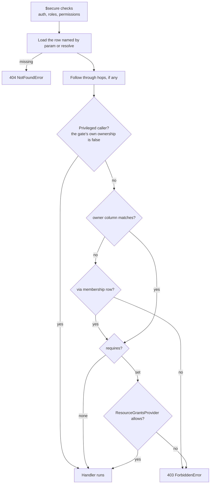

# Resource Authorization

`$secure` answers _what kind of user is this?_ - issuer, roles, permissions (see [Roles and Permissions](/docs/guides-security-authentication#roles-and-permissions)). It cannot answer _does this user own row 42?_, because ownership is a property of the data, not of the token. `$owns` is the gate for that second question: a `$secure` middleware that loads the row a request names, checks the caller against it, and hands the row to the handler.

```typescript check
import { $inject } from "alepha";
import { $owns, $secure, OwnedResourceProvider } from "alepha/security";
import { $action } from "alepha/server";
```

A gate decides in this order. Every step after the row is loaded runs only when the previous one passed:



## The problem

Without a resource gate, ownership checks live inside handlers:

```typescript
// Works, but nothing enforces it.
read = $action({
  method: "GET",
  path: "/campaigns/:id",
  use: [$secure({ permissions: ["campaign:read"] })],
  handler: async ({ params, user }) => {
    const campaign = await this.campaigns.getOne({
      where: { id: { eq: params.id } },
    });
    if (campaign.createdBy !== user.id) {
      throw new ForbiddenError("Not yours");
    }
    return campaign;
  },
});
```

The check is correct. The problem is that it is _invisible_: no test fails if the next endpoint forgets it, no tooling can see that this route is owner-scoped, and the rule gets copy-pasted into every handler that touches the resource.

## `$owns`

Move the rule into the middleware chain, where its absence is visible:

```typescript
class CampaignController {
  protected readonly campaigns = $repository(campaigns);
  protected readonly owned = $inject(OwnedResourceProvider);

  read = $action({
    method: "GET",
    path: "/campaigns/:id",
    use: [
      $secure({ permissions: ["campaign:read"] }),
      $owns({
        repository: () => this.campaigns,
        param: "id",
        owner: "createdBy",
        cast: Number,
      }),
    ],
    handler: async () => this.owned.get<Campaign>(),
  });
}
```

`cast` coerces the value before querying. It is rarer than it looks: the guard runs after request validation, so a param declared `z.integer()` arrives already decoded to a number, and `findById` coerces whatever is left to the primary key's declared type. Reach for it when the value needs a transformation the schema cannot express - an undeclared param, or a slug to decode.

`repository` is a thunk rather than the repository itself. `$owns()` runs during class-field initialization, so a `$repository()` field declared _after_ it would not exist yet; deferring the lookup to request time makes field order irrelevant.

An id that matches no row is a `404 NotFoundError`, raised before any access check. A param the handler does not declare at all is a wiring mistake, not a denial: the gate throws an `AlephaError` naming the missing key.

## The loaded row is handed to you

`$owns` has to read the row to make its decision, so it publishes it rather than throwing it away. Inject `OwnedResourceProvider` and read it back - no second query:

```typescript
handler: async () => {
  const campaign = this.owned.get<Campaign>(); // already loaded by the gate
  return this.present(campaign);
};
```

`get()` throws if no `$owns` ran, because that is a wiring mistake rather than a runtime condition. Use `find()` when a handler is legitimately reachable both with and without the gate.

## Membership: `via`

Shared resources are rarely owner-only. Point `via` at the join entity:

```typescript
$owns({
  repository: () => this.campaigns,
  param: "id",
  owner: "createdBy",
  cast: Number,
  via: {
    repository: () => this.characters,
    resource: "campaignId",
    user: "userId",
  },
});
```

Checks run in order: owner first, then membership. When you supply the `message` option, it's used for **both** denials on purpose - a different message per branch tells an attacker whether the resource exists and who owns it. (Without a custom `message`, the defaults differ; set one for endpoints where that distinction matters.)

`owner` is optional, so a **via-only** gate is legal: membership is then the whole answer, which is what an application that has stopped treating "who created the row" as an authorization input wants. A gate with neither `owner` nor `via` would allow every authenticated caller, so it is refused when the class is constructed rather than at request time.

## What a member may do: `requires`

`via` answers whether you are in. It does not answer what you may do once you are, and applications that give their members different powers - a viewer, a contributor, an administrator - need that second answer from the same gate. A rule split across a middleware and a hand-written check in the handler is a rule with two versions of itself.

```typescript
$owns({
  repository: () => this.campaigns,
  param: "id",
  via: {
    repository: () => this.members,
    resource: "campaignId",
    user: "userId",
  },
  requires: "release:manage",
});
```

**One string, checked twice.** It is folded into `secure.permissions`, so the application-scope check runs exactly as a separate `$secure({ permissions: ["release:manage"] })` beside the gate would have - and it lands in the middleware's options, which is what publishes it to the client's action registry and lets the UI hide a control nobody may use. It is then handed to `ResourceGrantsProvider` for the resource-scope check. No call site can name one permission at one layer and a different one at the other.

`ResourceGrantsProvider`'s default answers allow, unconditionally. An application that never substitutes it behaves exactly as it did before `requires` existed, whether or not its call sites use the option. `alepha/api/organizations` substitutes its rank-aware implementation when the module is registered. A custom resource model can substitute the seam directly:

```typescript
alepha.with({ provide: ResourceGrantsProvider, use: AppGrantsProvider });
```

An implementation receives the **rows** the gate already read - the authority row and the membership row - and never their ids. That is the whole performance contract: it cannot go and query for the assignment, because it was handed nothing to query with, so the assignment has to be a column on a row the request already pays for. It answers `{ allowed: true }`, or `{ allowed: false, message }` - the message being its own to write, since it is the only party that knows which conjunct failed.

⚠️ **An owner reads the membership row when `requires` is set.** The owner check short-circuits before the join, which is exactly why the owner of a resource costs one read fewer than a plain member - and a permission set lives on that join row. A gate that named a permission and then skipped the read would hand the owner an empty grant.

## The second hop: `through`

`via` only works when the route param names **the thing being shared**. It usually doesn't. Membership lives on a campaign; the route names a quest that belongs to one. There is no join to make, and `via` cannot express the rule at all.

`through` says the authority row is one hop away:

```typescript
$owns({
  repository: () => this.quests, // the row the param names
  param: "id",
  through: { column: "campaignId", repository: () => this.campaigns },
  owner: "createdBy", // read off the CAMPAIGN
  via: {
    repository: () => this.characters,
    resource: "campaignId",
    user: "userId",
  },
});
```

**Picking the wrong one of the two is silent**, so it is worth stating the distinction plainly:

| The route param names…              | Use                   |
| ----------------------------------- | --------------------- |
| the row that carries the membership | `via` alone           |
| a row that _belongs_ to that row    | `via` **+ `through`** |

`owner` and `via` keep their meaning; `through` only says which row they apply to. `via.resource` is matched against the resolved foreign key, so a membership in a _different_ campaign does not accidentally match.

When the authority row is itself a container, `via.key` names the column on
that row whose value identifies the membership scope. It defaults to the
authority's primary key, preserving the direct-resource form above:

```typescript
$owns({
  repository: () => this.projects,
  param: "projectId",
  via: {
    repository: () => this.organizationMembers,
    resource: "organizationId",
    user: "userId",
    key: "organizationId",
  },
});
```

Here the authority remains the project row, but the membership lookup uses
`project.organizationId`. A null or absent `via.key` value denies with the
same membership message. This makes an incomplete backfill fail closed.

A **null or absent foreign key denies**. An orphan row must not become world-readable, and falling through would refuse it only by accident. A foreign key that points at a missing row is a `404`, like a missing resource.

Pass an array to chain, when the resource does not carry the foreign key itself and neither does the next row:

```typescript
through: [
  { column: "questId", repository: () => this.quests },
  { column: "campaignId", repository: () => this.campaigns },
];
```

Only the last link is the authority. Keep chains short: each link is a query, and a rule that needs four of them is usually a missing column rather than a missing feature.

### Reading the authority row back

`OwnedResourceProvider.get()` always returns the row the param named. `authority()` returns the row the decision was made against - the same row without `through`, the hopped-to row with it:

```typescript
handler: async () => {
  const quest = this.owned.get<Quest>();
  const campaign = this.owned.authority<Campaign>();
  return { quest, ownerId: campaign.createdBy };
};
```

Both are published **before** the access decision, so a handler reads them identically on the owner, member and privileged paths.

## Where the id comes from: `from`

By default the id is a route param. An endpoint that takes it in the query string or the request body sets `from`:

```typescript
$owns({
  repository: () => this.campaigns,
  param: "campaignId",
  from: "query", // "params" (default) | "query" | "body"
  owner: "createdBy",
});
```

A body value is caller-controlled in a way a path segment is not. That widens nothing: it is still just an id handed to `findById`, and the gate is what decides access - a caller naming somebody else's row gets a 403 for it.

When no request source names the row at all (a single-tenant deployment with exactly one container row), compute the id with `resolve` instead of `param`:

```typescript
$owns({
  repository: () => this.workspaces,
  resolve: async () => (await this.workspaces.getOne({})).id,
  via: {
    repository: () => this.members,
    resource: "workspaceId",
    user: "userId",
  },
});
```

`resolve` receives the guard context (`user`, `params`, `query`, `body`, `alepha`). Exactly one of `param` and `resolve` is required, and `from` or `cast` beside `resolve` is refused: each of these mistakes throws when the class is constructed. A resolver that returns nothing throws rather than denying, because a gate that cannot name its resource is misconfigured, which is not a 403.

## Layering `$secure` checks: `secure`

`$owns` is itself a `$secure` middleware, so it already requires an authenticated caller. `secure` adds the usual `$secure` options (roles, permissions, issuers; not `guard`, which the gate owns) without a second middleware:

```typescript
$owns({
  repository: () => this.campaigns,
  param: "id",
  owner: "createdBy",
  secure: { permissions: ["campaign:read"] },
});
```

## Caching the authority read

`cache` is passed straight through to the authority read - the row the gate decides against, which is the resource itself when there is no `through`:

```typescript
$owns({
  repository: () => this.campaigns,
  param: "id",
  owner: "createdBy",
  cache: { ttl: 30_000 },
});
```

Deliberately **not** applied to the membership read. A membership row _is_ the grant, so caching it caches an authorization decision and revocation stops taking effect on the next request.

Independently of `cache`, `$owns` memoizes its reads **for the lifetime of one request**. A page that loads seven things at once sends one batched request, and every entry gates independently; without the memo the same `(user, resource)` pair is resolved seven times over. The two are not the same mechanism: the memo is deterministic (every gate in one request shares one query, warm process or cold) and never outlives the request, so it preserves revocation semantics exactly; `cache` is opportunistic across requests and trades a staleness window for the saving.

## Privileged identities

A caller with `ownership === false` bypasses the owner, membership and `requires` grant checks. `false` means an admin whose grant is _not_ narrowed to their own rows (see [Ownership](/docs/guides-security-authentication#ownership)). The bypass happens after the row is loaded, so an unknown id is still a `404`, and the application-scope half of `requires` (folded into `secure.permissions`) still applies.

An ownership decision belongs to the permission check that produced it. The gate reads the answer to **its own** permissions, the ones in `requires` and `secure.permissions`, and nothing else:

```typescript
// `docs:read` unrestricted for the caller's role: the owner check is skipped.
$owns({
  repository: () => this.docs,
  param: "id",
  owner: "createdBy",
  requires: "docs:read",
});

// No permission of its own: the owner check always runs, whatever another
// gate decided about another permission.
$owns({ repository: () => this.docs, param: "id", owner: "createdBy" });
```

So a gate that names no permission is never opened by a permission checked somewhere else: not by a `$secure({ permissions })` beside it in the same `use` list, not by the action whose handler reached this one through `run()`, not by a pipeline that ran earlier in the same context. To let an administrator past an owner check, name the permission on the gate. The same holds for the handler: after a bare `$secure()`, `user.ownership` is never another gate's unrestricted answer. A restriction is the opposite case and is kept: after `[$secure({ permissions: ["docs:read"] }), $secure()]`, a caller whose `docs:read` is owner-scoped still reads `user.ownership === true`.

It is not opened by a copy either. The unrestricted answer lives on the `user` object the gate gives its handler and is not an ordinary field: `{ ...user }`, a JSON round trip, `structuredClone` and `Object.assign` all produce a user without it, and `storeUserInContext(user)` stores the identity without it. Passing any of them (or `user` itself) to `run(..., { user })` reaches the inner gate as an ordinary caller. Read `user.ownership` on the object you were given, and pass that object along when a service needs the answer.

What does carry it is code that reads the field and writes it back, because that is building an identity by hand: `{ ...user, ownership: user.ownership }`, a decode of the user through `userAccountInfoSchema`, and `alepha.store.set(currentUserAtom, user)`, which validates with that schema. Each yields `ownership: false` as a plain field, which the next gate reads as a privileged identity (see below). The same goes for assigning `user.ownership` on a gate's user: the object keeps being read through the gate's record, while a spread of it carries whatever was assigned as a plain field. Never write `ownership` on a user you were given in order to hand it on.

A gate publishes its user only for as long as it runs, guard and handler. Once it returns, `currentUserAtom` reads what it held before, so a gated pipeline called from a handler never changes the answer that handler was given. A handler that replaces the current user itself (`alepha.store.set(currentUserAtom, other)`, to step down or act for someone) is obeyed for the rest of its gate: the next gate it reaches checks `other`.

Three cases where that sentence needs care:

- **Gates overlapping in one context.** Two pipelines under one `Promise.all` share `currentUserAtom`, and the `user` of the request they run inside. While both run, each can read the other's user there, and the last to settle restores what it found, which may be the other's user rather than the one from before. An owner gate reached afterwards still refuses a stranger, since it never takes another gate's unrestricted answer. The `user` a handler receives as an argument is the reliable one: read that, not the atom.
- **Deferred work.** A timer, an unawaited promise or an in-process subscriber started in a gated handler runs after the gate: it reads whatever the atom holds then, not the gate's user. Pass it the user it needs.
- **A request that carried no user.** When a gate resolves the user of a request that had none (a WebSocket upgrade, a request the security hook could not authenticate), that user stays on `request.user` after the gate, with the gate's answer. A later bare `$secure()` on that request authenticates from it; an owner gate still checks the row.

The one flag a gate without permissions honors is the identity's own: a user **built** with `ownership: false` (`action.run(..., { user })`, `run(..., { user: "system" })`, a job that sets `currentUserAtom` to its operator) is privileged by declaration. A user resolved from a request never carries one, and neither does one built by `createUserFromToken` or `resolveUserFromServerRequest` with a `permission`: that answer is a permission check's, like a gate's.

This is deliberately strict - `undefined` does **not** bypass. `undefined` only means no permission check ran, which is not the same as "this caller is privileged". If you are migrating hand-written authz that treated `!user.ownership` as the bypass, note that `undefined` used to pass and now does not.

### Administrators who must join first: `privileged: "identity"`

Some applications refuse that bypass to an administrator of the whole deployment: inside a tenant's resource, they are a stranger until they join it. `privileged: "identity"` keeps the bypass for an identity **built** unrestricted, the system user or an operator passed to `run(..., { user })`, and refuses it to a role whose `*` grant answers `ownership: false`:

```typescript
$owns({
  repository: () => this.projects,
  param: "id",
  via: {
    repository: () => this.members,
    resource: "projectId",
    user: "userId",
  },
  requires: "project:read",
  privileged: "identity",
});
```

The administrator still passes the permission check, and is then checked like anybody else: refused without a membership row, and held to their grants with one. The user the handler and `currentUserAtom` receive carries no `ownership: false` either, so a rank check further on reads their rank too. `$secure` takes the same option. With `alepha/api/organizations`, setting `privileged: "identity"` in the organizations config applies it to every `$ownsOrganization` gate, the module's own routes included.

## Raw guards

For rules that are not owner- or membership-shaped, `$secure`'s `guard` sees the whole request:

```typescript
$secure({
  guard: async ({ user, params, body, alepha }) => {
    const invite = await alepha.inject(InviteService).find(params.token);
    return invite?.email === user.email;
  },
});
```

Guards may be async and run after all other `$secure` checks. `params`, `query`, and `body` come from the action request when there is one, falling back to the raw HTTP request - so the same guard works over HTTP, over `action.run()`, and over MCP.

## Browser Behavior

On the client, `$secure` returns `undefined` instead of throwing, and the guard sees empty `params`. A guard that reads request data therefore denies in the browser and is re-evaluated for real on the server. `$owns` goes further: ownership lives in database rows the browser can't load, so its browser variant always returns `undefined` - the server-side gate is what actually enforces it.

That is the safe direction: the UI hides the action, and the API is what actually enforces it. Never treat a client-side pass as authorization.

## Options Reference

| Option       | Description                                                                                                      |
| ------------ | ---------------------------------------------------------------------------------------------------------------- |
| `repository` | Thunk returning the repository the guarded row is loaded from. Required.                                         |
| `param`      | Key holding the resource id in the `from` source. Exactly one of `param` and `resolve`.                          |
| `from`       | Where `param` is read: `"params"` (default), `"query"` or `"body"`.                                              |
| `resolve`    | `(ctx) => id` computing the id when the request does not carry it. Excludes `param`, `from` and `cast`.          |
| `cast`       | `(raw) => string \| number` coercing the raw value before `findById`.                                            |
| `owner`      | Column holding the owner's user id, on the authority row.                                                        |
| `via`        | Membership join: `{ repository, resource, user, key? }`. At least one of `owner` and `via` is required.          |
| `requires`   | Permission (or AND list) required in this resource, checked by `$secure` and by `ResourceGrantsProvider`.        |
| `through`    | One `{ column, repository }` hop, or an array of them, leading to the authority row.                             |
| `cache`      | Cache window for the authority read, passed to `Repository.findById`. Never applied to the membership read.      |
| `message`    | Denial message for every 403 the gate raises. A `ResourceGrantsProvider` message wins over it for grant denials. |
| `secure`     | Extra `$secure` options (`roles`, `permissions`, `issuers`, ...), everything except `guard`.                     |

## See Also

- [Authentication](/docs/guides-security-authentication#securing-actions): `$secure`, roles, permissions and the `ownership` flag.
- [Organizations](/docs/guides-security-organizations#resource-authorization): `$ownsOrganization`, a preset `$owns` gate with rank-aware `requires`.
- [Middlewares](/docs/guides-server-middlewares): how `use` arrays compose.
