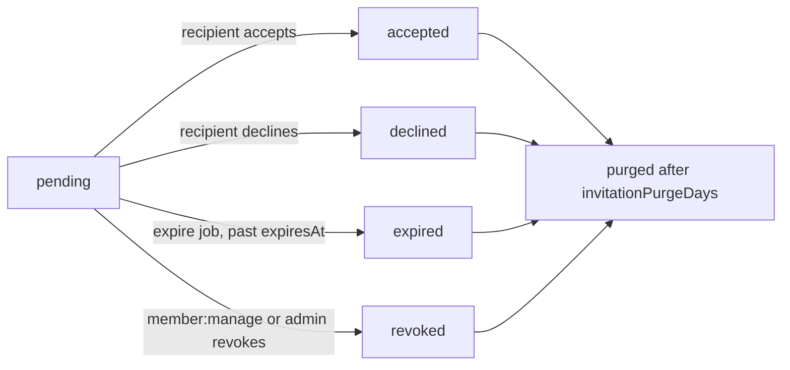

# Organizations

`alepha/api/organizations` provides organizations, members, ownership, ranks,
and invitations as one coherent boundary.

```typescript check
import { Alepha } from "alepha";
import { AlephaApiOrganizations } from "alepha/api/organizations";

const alepha = Alepha.create().with(AlephaApiOrganizations);
```

The module imports what it stands on: users and realms (`alepha/api/users`),
verifications, jobs and security. It needs a database like those do.

The module owns four related rows:

- an organization with a name, optional slug, logo, and metadata;
- a membership that links one user to one organization and carries a rank;
- a rank definition scoped to one organization;
- an invitation addressed to an email address and scoped to one organization.

Keeping these together matters. Membership is the authority row used by
resource authorization, the rank is stored on that same row, and accepting an
invitation creates that row. There is one owner rank and every organization is
created with an owner membership.

## Organizations and members

`OrganizationController` provides create, list, read, update, and delete
actions under `/organizations`. `MemberController` lists and removes members
(`/organizations/:organizationId/members`) and owns the explicit `leave` and
ownership `transfer` actions. There is no "add member" endpoint: a member joins
by accepting an invitation, and assigning a rank belongs to
`OrganizationRankController` (see [Ranks](/docs/guides-security-organizations#ranks)). Server code can call
`MemberService.add()` directly.

`AdminOrganizationController` (`/admin/organizations`, gated by
`admin:organization:read`, `:update`, `:delete`) and
`AdminOrganizationInvitationController` (`/admin/organization-invitations`,
`admin:invitation:read` to list and read, `admin:invitation:delete` to revoke
or delete) serve the back office. Like every `$action`, all of these live under
the `/api` prefix.

The member-facing actions are gated by organization permissions, checked
against the caller's rank (see [Ranks](/docs/guides-security-organizations#ranks)):

| Permission            | Gates                                                                                                                            |
| --------------------- | -------------------------------------------------------------------------------------------------------------------------------- |
| (membership only)     | reading the organization, leaving it                                                                                             |
| `organization:update` | updating the organization                                                                                                        |
| `organization:delete` | deleting it (owner-only by default)                                                                                              |
| `member:read`         | listing members                                                                                                                  |
| `member:manage`       | removing a member, listing and revoking invitations, assigning ranks, transferring ownership (the caller must also be the owner) |
| `invitation:create`   | inviting someone                                                                                                                 |
| `rank:manage`         | the permission catalogue, listing, saving and deleting ranks                                                                     |

Ownership is transferred, never assigned as an ordinary rank. The transfer
updates the old and new owner together, so an organization is not left with
zero or two owners. The owner cannot leave or be removed until ownership has
been transferred, and a user who still owns an organization cannot delete their
account (`user:delete:before` answers `409`) until they transfer or delete it.

Applications can narrow creation, deletion, capacity, and refusal policy by
substituting `OrganizationPolicyProvider`:

```typescript
import { OrganizationPolicyProvider } from "alepha/api/organizations";

class AppOrganizationPolicy extends OrganizationPolicyProvider {
  public override async assertRoom(organizationId: string): Promise<void> {
    // Apply the application's subscription or seat policy here.
  }
}

alepha.with({
  provide: OrganizationPolicyProvider,
  use: AppOrganizationPolicy,
});
```

The provider also exposes `assertCanCreate`, `assertCanDelete`, `ownedBy`, and
`refuse`:

| Method                                | Called when                                                                    | Default           |
| ------------------------------------- | ------------------------------------------------------------------------------ | ----------------- |
| `assertCanCreate(user)`               | a user creates an organization                                                 | allows            |
| `assertCanDelete(organization, user)` | an organization is deleted                                                     | allows            |
| `assertRoom(organizationId)`          | an invitation is created, and again on accept                                  | allows            |
| `ownedBy(userId)`                     | listing what a user owns (account deletion)                                    | owner memberships |
| `refuse(refusal, rows)`               | a rank lacks a permission: returns the message, or `undefined` for the default | `undefined`       |

Throw from an `assert*` method to refuse. The module supplies permissive
defaults except for the structural membership, owner, and rank invariants.

## Resource authorization

Use `$ownsOrganization` when a route is directly scoped to an organization:

```typescript check
import { z } from "alepha";
import { $ownsOrganization } from "alepha/api/organizations";
import { $permission } from "alepha/security";
import { $action } from "alepha/server";

class ReportController {
  reportRead = $permission({ group: "report", name: "read" });

  read = $action({
    method: "GET",
    path: "/organizations/:organizationId/report",
    use: [
      $ownsOrganization({
        param: "organizationId",
        requires: "report:read",
      }),
    ],
    schema: { response: z.object({ total: z.number() }) },
    handler: () => ({ total: 0 }),
  });
}
```

Declare every permission you pass to `requires` with `$permission`: a rank can
only be granted permissions the application declares.

The primitive is `$owns` configured with `organization_members`. It checks
membership and hands `requires` to the module's `RankGrantsProvider`.
Application permission and organization rank permission are both required.

For a resource whose route names an application row rather than the
organization, pass its repository and use `key` to identify the organization
column on the authority row:

```typescript
$ownsOrganization({
  repository: () => this.projects,
  param: "projectId",
  key: "organizationId",
  requires: "project:update",
});
```

Here `$owns` loads the project, then matches memberships with
`project.organizationId`. A missing or null key fails closed. `through` is
also available for routes whose row belongs to another authority row.

`$ownsOrganization` also passes `from`, `resolve`, `secure`, `cache` and
`message` straight to `$owns` (see
[Resource Authorization](/docs/guides-security-resource-authorization)). It has
no `owner` option: membership is the whole answer, and the owner is simply the
member holding the `owner` rank. The default denial message is
`Not a member of this organization`.

## Ranks

A rank answers what somebody may do inside one organization. Roles remain
application-wide; ranks vary by organization for the same user.

The module creates two built-ins:

- `owner`, which grants `*` and cannot be edited or assigned;
- `member`, which starts from `organizationConfigAtom.memberPermissions` and
  can be customized.

Anything else is a custom rank the owner creates. The module seeds none: an
organization starts with these two, and `@alepha/ui`'s `OrganizationRanks`
editor offers a blank rank plus whatever `presets` the application passes it
(Lore's Admin, Contributor and Viewer), each saved as an ordinary custom rank
under a fresh key.

A custom rank holds exact permission names: a wildcard like `report:*` is
refused, since it is not a name the application declares (the built-in owner
rank holds `*`). The effective set includes `organizationConfigAtom.floor`,
which every rank must hold. A rank can only be granted permissions the
application declares, never `*` or an `admin:` permission, and never one listed
in `ownerOnly`. A writer also cannot grant a
permission they do not hold, change their own assignment, remove a rank that
somebody holds, or edit their rank into a self-lockout (dropping `rank:manage`
from it).

Rank definitions are cached for 30 seconds. Assignments are not: the membership
row is read for each authorization decision, so a demotion or removal applies
on the next request.

To find who can act, rather than whether one user can, call
`RankService.holdersOf(organizationId, permission)`. It returns the user ids of
the members whose rank grants the permission, the owner always among them,
from one read of the members and one of the rank definitions:

```typescript
const ranks = alepha.inject(RankService);
const recipients = await ranks.holdersOf(organizationId, "invoice:approve");
```

A member with no rank holds the default `member` rank, and a member whose rank
key has no definition holds nothing, as the gate answers. The method reads the
rank only: an application that also narrows permissions by a feature switch
applies that on top.

`OrganizationRankController` provides the permission catalogue, rank list,
save, delete, and assignment actions under
`/organizations/:organizationId/ranks`. These actions use the same policy as
the authorization gate, so a custom editor cannot bypass the module's
invariants.

## Invitations

An organization invitation is keyed by email rather than user ID, so it can
address someone who has no account without creating a placeholder user. Its
status moves from `pending` to exactly one final state:



Accepting creates the membership row with the invited rank, or `member` if that
rank has since been deleted.

`OrganizationInvitationController` creates, lists and revokes invitations under
`/organizations/:organizationId/invitations`, and serves the recipient's side
under `/organizations/invitations`: `me` (my pending invitations),
`:invitationId/accept` / `:invitationId/decline` (signed in, and only for the
invitation's own address), and `preview?token=...`, which needs no session and
tells a landing page whether a token is `ok`, `invalid`, `expired`, `accepted`,
`declined` or `revoked`.

Creating an invitation checks the inviter's rank, validates the target rank,
checks organization capacity through `OrganizationPolicyProvider.assertRoom`,
and enforces the configured pending caps. Acceptance checks capacity again,
because two pending invitations may race for the last seat.

The `organization:invitation:created` hook carries the one-time token. Send it
using the application's own mail and registration URL:

```typescript
$hook({
  on: "organization:invitation:created",
  handler: async ({ invitation, token }) => {
    await this.mail.push({
      contact: invitation.email,
      variables: {
        url: `${base}/auth/register?invitation=${encodeURIComponent(token)}`,
      },
    });
  },
});
```

The module emits a hook at every step: `organization:invitation:created`,
`:accepted`, `:declined`, `:expired` and `:revoked`, plus
`organization:member:removed` (with `leave: true` when the member left) and
`organization:ownership:transferred`.

The token is valid only while the invitation is pending, unexpired, and bound
to the registering email address. Revocation changes status instead of
deleting the row, preserving the audit trail until the purge job removes old
resolved invitations.

## Closed-realm signup

An invitation can admit its recipient while ordinary registration stays
closed. Connect the module's `InvitationRegistrationService` to `$realm`:

```typescript
realm = $realm({
  settings: { registrationAllowed: false },
  isPreAuthorized: (context) =>
    this.alepha.inject(InvitationRegistrationService).preAuthorize(context),
});
```

`isPreAuthorized` is consulted only while registration is closed. A credentials
registration must present the token, as the register body's `preAuthToken`
(`@alepha/ui`'s `AuthRegister` takes it as a prop of the same name). A verified
OAuth address
can use its pending invitation because the token does not survive the provider
round trip. A valid token proves the email address and avoids sending a second
verification message.

## Configuration and jobs

`organizationConfigAtom` configures:

| Key                                    | Default                   |
| -------------------------------------- | ------------------------- |
| `memberPermissions`                    | `[]`                      |
| `floor`                                | `[]`                      |
| `ownerOnly`                            | `["organization:delete"]` |
| `invitationExpirationDays`             | `7`                       |
| `maxPendingInvitationsPerOrganization` | `50`                      |
| `maxPendingInvitationsPerInviter`      | `100`                     |
| `invitationPurgeDays`                  | `90`                      |

`OrganizationInvitationJobs` expires overdue invitations
(`system.organization-invitations.expire`) and purges old resolved rows
(`system.organization-invitations.purge-resolved`), both hourly. Set
`invitationPurgeDays` to `0` to keep the audit rows indefinitely.

Registering the module substitutes `RankGrantsProvider` for
`ResourceGrantsProvider`, so every `requires` in the application becomes
rank-aware. It must be registered before the classes whose `$owns` gates use
`requires`; the wrong order throws `TooLateSubstitutionError` at boot, naming
both classes.

## See also

- [Resource Authorization](/docs/guides-security-resource-authorization)
- [Authentication](/docs/guides-security-authentication)
- [`alepha/api/organizations`](/docs/packages-alepha-api-organizations) and
  the [`@alepha/ui` organization screens](/docs/packages-alepha-ui-organizations)
