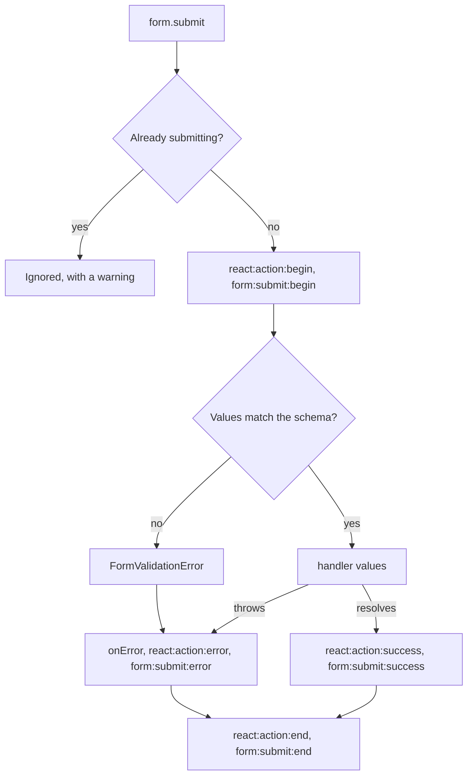

# Forms

Alepha provides `useForm` for schema-driven forms with Zod validation, automatic input generation, and lifecycle events, and `useActionForm` on top of it for the most common form of all: one that posts one `$action`.

## A Form for One Action

When the form's values are the body of an action, build it from that action:

```tsx
import { AutoForm } from "@alepha/ui/form";
import { useClient } from "alepha/react";
import { useActionForm } from "alepha/react/form";

import type { QuestApi } from "../api/QuestApi.ts";
import { createQuestBodySchema } from "../schemas/createQuestBodySchema.ts";

const NewQuest = (props: { projectId: number }) => {
  const api = useClient<QuestApi>();
  const form = useActionForm(api.createQuest, {
    schema: createQuestBodySchema,
    params: { projectId: props.projectId },
    onSuccess: (quest) => console.log("created", quest.id),
  });

  return <AutoForm form={form} />;
};
```

- **The schema is the action's body schema**, imported from the shared `schemas/` file the action declares it in. In the browser an action carries no runtime schema, so the form cannot read it from the action; the type does check it: a schema whose values are not exactly the action's body, or an action with no body, is a compile error.
- **The handler is written for you**: it calls the action with the decoded values as `body`, plus the `params`, `query` and `headers` you give. `onSuccess` receives the action's typed response and the values sent.
- **A refusal from the server lands on its fields.** A `400` for the body, whether request validation raised it or the handler did, shows under every field it names, and is not toasted when every one of them landed. A refusal of the `params`, `query` or `headers` is not the user's input: it stays a form-level error, toasted like any other failure.
- Everything else is `useForm`'s: the options below (but `schema` and `handler`), the same `FormModel`, events, submit state, `validate` modes and `AutoForm` support.

`useActionForm` also takes a local `$action` (on the server, in a test). Keep `useForm` for a form that is not one action: a wizard step, a filter, a form whose fields are not the body.

### Refusing a field from the handler

A handler refuses a field by throwing `ValidationError` with the part of the request and the failing fields. It is the same `400` request validation sends, so the form treats both alike:

```typescript
import { $action, ValidationError } from "alepha/server";

class UserApi {
  register = $action({
    method: "POST",
    schema: { body: registerBodySchema, response: userSchema },
    handler: async ({ body }) => {
      if (await this.users.emailTaken(body.email)) {
        throw new ValidationError({
          part: "body",
          issues: [{ path: "/email", message: "Email already in use" }],
        });
      }
      return this.users.create(body);
    },
  });
}
```

Each issue's `path` is a JSON pointer into the body (`/email`, `/address/city`, `/items/0/name`). On the wire a `ValidationError` carries `data.part` (`"params"`, `"query"`, `"headers"` or `"body"`) and `data.issues` (`{ path, message }` only), alone or inside a batched call. A `SchemaValidationError` thrown from a handler is not a refusal: it means the handler's own data broke a schema, and answers a `500`.

## Basic Usage

```typescript
import { z } from "alepha";
import { useForm } from "alepha/react/form";

const LoginForm = () => {
  const form = useForm({
    schema: z.object({
      email: z.email(),
      password: z.text(),
    }),
    handler: async (values) => {
      await api.login(values);
    },
  });

  return (
    <form {...form.props}>
      <input {...form.input.email.props} />
      <input {...form.input.password.props} type="password" />
      <button type="submit">Login</button>
    </form>
  );
}
```

Spread `form.props` on the `<form>` element and `form.input.<field>.props` on each input. The props include `name`, `type`, `onChange`, `required`, `defaultValue`, and other attributes derived from the schema.

## useForm Options

| Option          | Type                                    | Description                                                                                                               |
| --------------- | --------------------------------------- | ------------------------------------------------------------------------------------------------------------------------- |
| `schema`        | `ZObject`                               | Zod schema defining fields and validation.                                                                                |
| `handler`       | `(values) => unknown`                   | Called on submit with validated values.                                                                                   |
| `initialValues` | `Partial<Infer<T>>`                     | Pre-populate fields with existing data.                                                                                   |
| `keepDirty`     | `boolean` (default `true`)              | When `initialValues` changes (a refetch after a save), keep the fields the user edited instead of overwriting them.       |
| `validate`      | `"submit" \| "blur" \| "change"`        | When a field is checked against the schema (default `"submit"`). See [When Fields Are Checked](#when-fields-are-checked). |
| `id`            | `string`                                | Prefix for field IDs and `data-testid` attributes.                                                                        |
| `onChange`      | `(key, value, store) => void`           | Called on every field change.                                                                                             |
| `onError`       | `(error) => void`                       | Called when submission throws an error. Marks the error handled, so `ActionErrorToaster` does not toast it.               |
| `onReset`       | `() => void`                            | Called when the form is reset.                                                                                            |
| `onCreateField` | `(name, schema) => InputHTMLAttributes` | Customize generated input attributes.                                                                                     |

The second argument to `useForm` is a dependency array (defaults to `[]`). When dependencies change, the form is re-created. To switch the form to another record (editing A, then B), put the record id in the dependencies rather than swapping `initialValues`. The latest `handler`, `onError`, `onChange`, `onReset` and `onCreateField` are always used, so a handler may close over render state.

## FormModel

`useForm` returns a `FormModel<T>` instance with the following API:

### form.props

Spread on the `<form>` element. Includes:

- `id`: unique form identifier
- `noValidate`: set to `true` (validation is handled by the schema)
- `method`: `"post"`, so a submit that happens before hydration (slow bundle, Enter in a text field) never serialises the fields, a password included, into the URL
- `onSubmit`: calls `form.submit()` with `preventDefault`
- `onReset`: calls `form.reset()`

### form.input

A proxy object where each key corresponds to a schema property. Each field has:

| Property       | Type                         | Description                                                                                    |
| -------------- | ---------------------------- | ---------------------------------------------------------------------------------------------- |
| `props`        | `InputHTMLAttributes`        | Spread on the `<input>` element.                                                               |
| `path`         | `string`                     | JSON pointer path (e.g., `/email`).                                                            |
| `required`     | `boolean`                    | Whether the field is required.                                                                 |
| `schema`       | `ZType`                      | The Zod schema for this field.                                                                 |
| `set`          | `(value: any) => void`       | Programmatically set the field value.                                                          |
| `blur`         | `() => void`                 | Tell the form focus left the field (`validate: "blur"`). `props.onBlur` calls it.              |
| `initialValue` | `any`                        | The field's initial value (from `initialValues` or schema defaults).                           |
| `items`        | `Record<string, InputField>` | Child fields, for object-typed properties - see [Nested Object Fields](#nested-object-fields). |
| `form`         | `FormModel`                  | Reference back to the parent form.                                                             |

### form.submit()

Triggers form submission programmatically. Coerces the input strings to the schema's types and validates them, then calls the `handler` with the decoded values. A second submit while one is in flight is ignored.



### form.reset(event)

Restores the form to its initial values (empty if no `initialValues` were given) and emits a `form:reset` event.

### form.errors

The error shown under each field, by JSON pointer: `{ "/email": "Email already in use" }`. A failed submit fills it with every issue whose path names a field of the schema, the form's own schema refusal and a server `400` alike; an issue for the root (`""`) or for a path naming no field stays the form-level error. A field's entry clears when that field changes (an array row on its own, not its siblings), and every entry clears on reset and when a new submit begins. `form:errors:changed` fires on each change.

`form.setErrors(issues)` replaces them by hand and returns `true` when every issue named a field; `form.clearErrors(path?)` removes one field's (and those under it) or all.

### form.currentValues

Returns the current form values as a restructured object (nested keys like `address.city` become `{ address: { city: ... } }`).

### Submission state

To react to an in-progress submission (e.g. disable the submit button), use the `useFormState` hook:

```typescript
const { loading } = useFormState(form, ["loading"]);
```

## Automatic Type Detection

Input types are automatically inferred from the schema:

| Schema Type            | Input Type                                 |
| ---------------------- | ------------------------------------------ |
| `z.integer()`          | `number`                                   |
| `z.number()`           | `number`                                   |
| `z.boolean()`          | `checkbox`                                 |
| `z.text()`             | `text`                                     |
| Field named `password` | `password`                                 |
| Field named `email`    | `email`                                    |
| Field named `url`      | `url`                                      |
| `z.date()`             | `date`                                     |
| `z.dateRange()`        | range picker (`@alepha/ui` `Control` only) |
| `z.time()`             | `time`                                     |
| `z.datetime()`         | `datetime-local`                           |
| `z.binary()`           | `file`                                     |

Note that `email`/`password`/`url` are detected from the **field name**, not the schema - a `z.email()` schema on a field named `contact` renders as plain `text`.

String constraints like `maxLength` and `minLength` are also applied to the input attributes.

## Nested Object Fields

For schemas with nested objects, use `items` to access child fields:

```typescript
const form = useForm({
  schema: z.object({
    address: z.object({
      street: z.text(),
      city: z.text(),
    }),
  }),
  handler: async (values) => { /* values.address.street, values.address.city */ },
});

// Access nested fields:
<input {...form.input.address.items.street.props} />
<input {...form.input.address.items.city.props} />
```

## Tracking Form State

Use `useFormState` to reactively track loading, dirty, error, and value states:

```typescript
import { useFormState } from "alepha/react/form";

const MyForm = () => {
  const form = useForm({ /* ... */ });
  const { loading, dirty, error } = useFormState(form);

  return (
    <form {...form.props}>
      {/* inputs */}
      {error && <p>{error.message}</p>}
      <button type="submit" disabled={loading || !dirty}>
        {loading ? "Saving..." : "Save"}
      </button>
    </form>
  );
}
```

**useFormState options:**

The first argument is the form model (or `{ form, path }` to track a specific field). The second argument is an array of keys to track, `["loading", "dirty", "error"]` by default (`values` is only tracked when asked for):

```typescript
// Track only loading and error
const { loading, error } = useFormState(form, ["loading", "error"]);

// Track a specific field's error
const { error } = useFormState({ form, path: "/email" }, ["error"]);

// Track current values
const { values } = useFormState(form, ["values"]);
```

**Return type:**

| Property  | Type                  | Description                                                                                                                            |
| --------- | --------------------- | -------------------------------------------------------------------------------------------------------------------------------------- |
| `loading` | `boolean`             | True during form submission.                                                                                                           |
| `dirty`   | `boolean`             | True after any field change. Resets on successful submit and on reset.                                                                 |
| `error`   | `Error \| undefined`  | With the form: the last failed submit's error. With `{ form, path }`: that field's entry of `form.errors`, as a `FormValidationError`. |
| `values`  | `Record \| undefined` | Current form values (updated on change and submit).                                                                                    |

## When Fields Are Checked

By default the schema is checked when the form is submitted. `validate` checks a field sooner:

```typescript
const form = useForm({ schema, handler, validate: "blur" });
```

- `"submit"` (default): on submit only.
- `"blur"`: also when focus leaves the field. Every `Control` reports it, pickers included; a raw `<input {...props} />` does through `props.onBlur`.
- `"change"`: also on every change.

Blur and change decode the **whole** form and show only the touched field's issues, so an object-level `.refine()` (a "confirm password" match) lands on the field it names. Zod runs an object's refinements once its own fields pass, so such an error appears when the rest of the form is valid. Once a submit was refused, a field showing an error is rechecked on every change whatever the mode, so the error leaves as soon as it is fixed.

## Reading Values

`useForm` keeps values in the model, not in React state, so typing does not re-render the form. Subscribe only where a component needs them:

- `useFieldValue(form.input.email)` returns `[value, setValue]` for one field and re-renders on that field only.
- `useFormValues(form)` returns every current value and re-renders on every change. Keep it for live previews and debug panels.
- `<FormState form={form}>{({ loading, dirty }) => ...}</FormState>` is a render-prop wrapper around `useFormState`.

`useFormQuerySync(form, { keys: ["status", "q"] })` mirrors the listed fields to the URL query (`?status=new&q=foo`) and back, so a filter form survives a reload, a shared link and back/forward. It replaces the history entry rather than pushing one, and leaves query params it does not own alone.

All four are exported from `alepha/react/form`.

## With `@alepha/ui`

Raw `<input {...props}>` is the bare layer. In an application using `@alepha/ui`, render each field with `Control` from `@alepha/ui/form`, which picks the widget from the schema (select, date, date range, number, switch, upload, ...) and shows the label, description and field error. Flags force a variant (`<Control input={form.input.status} select />`). `AutoForm` renders a whole form from the schema.

```tsx
import { Control } from "@alepha/ui/form";

<form {...form.props}>
  <Control input={form.input.email} />
  <Control input={form.input.role} select />
</form>;
```

`Control` shows its field's error from `form.errors`, so several show at once, and a field mounted after the failure (an array row, a collapsed object opened later) shows its own. After a refused submit, `AutoForm` scrolls to the first invalid field and focuses it, opening a collapsed object to reach it, and its error popover lists every issue.

A picker with local state is still a form: make it a one-field `useForm` (`initialValues` for what the server says, `onChange` to save on change) rather than a hand-built control.

## Form Events

Forms emit events on the Alepha event system:

| Event                 | Payload                         | Description                                                        |
| --------------------- | ------------------------------- | ------------------------------------------------------------------ |
| `form:changed`        | `{ id, path, value, initial? }` | A field value changed (`initial: true` marks programmatic resets). |
| `form:reset`          | `{ id }`                        | Form was reset.                                                    |
| `form:submit:begin`   | `{ id }`                        | Submission started.                                                |
| `form:submit:success` | `{ id, values }`                | Submission succeeded.                                              |
| `form:submit:error`   | `{ id, error }`                 | Submission failed.                                                 |
| `form:submit:end`     | `{ id }`                        | Submission finished (always).                                      |
| `form:errors:changed` | `{ id, errors }`                | `form.errors` changed; `errors` is the whole new map.              |

Forms also emit `react:action:begin`, `react:action:success`, `react:action:error`, and `react:action:end` events with `type: "form"`, so global action handlers apply to form submissions too.

The `react:action:error` of a form carries `handled: true` in three cases, and `@alepha/ui`'s `ActionErrorToaster` does not toast it: the form was given an `onError`, the error is a `FormValidationError` with a field `path`, whose message is already shown under that field, or it is a server `ValidationError` whose every issue `useActionForm` placed under a field. Any other failure, including a `FormValidationError` with no path and a `400` naming a field the form does not have, still toasts.

## FormValidationError

Throw a `FormValidationError` in a `useForm` handler to report field-level errors the browser finds itself (with `useActionForm`, the server's `ValidationError` does this for you):

```typescript
import { FormValidationError } from "alepha/react/form";

handler: async (values) => {
  const exists = await api.checkEmail(values.email);
  if (exists) {
    throw new FormValidationError({
      message: "Email already in use",
      path: "/email",
    });
  }
};
```

The `path` is a JSON pointer matching the field path (e.g., `/email`, `/address/city`). The message is shown under that field and not as a toast: the error is marked handled (see [Form Events](#form-events)). To refuse several fields at once, pass `issues: [{ path, message }, ...]` as well; each lands on its field.

The form's own schema refuses input the same way: a required field left empty or a value out of range fails with a `FormValidationError` too, before the handler runs. So a `react:action:error` listener can tell a person's input from a fault by the error alone: a `FormValidationError` is a refusal, while a `SchemaValidationError` thrown from inside the handler (a response that broke its own schema, say) is left as it is. The `@alepha/lore` browser sigil relies on that, and does not report a refusal as a crash.
