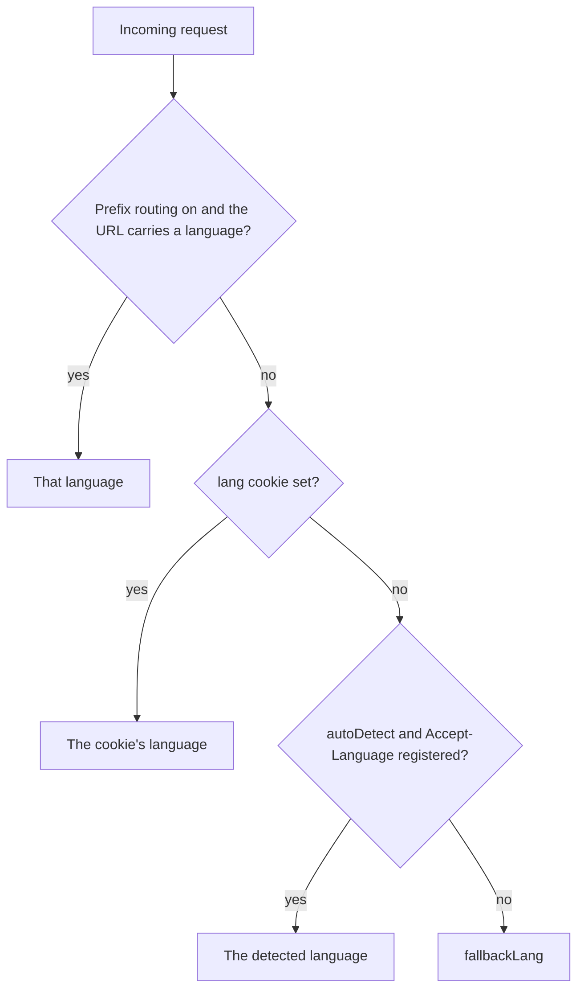

# Localization

Alepha provides `$dictionary` for registering translations and `useI18n` for accessing them in React components. Translations are lazy-loaded per language and support SSR with cookie-based language selection and `Accept-Language` autodetection.

## Setup

Register translation dictionaries as class properties. The property name determines the language code.

```typescript
import { $dictionary } from "alepha/react/i18n";

class App {
  en = $dictionary({ lazy: () => import("./translations/en.ts") });
  fr = $dictionary({ lazy: () => import("./translations/fr.ts") });
}
```

Each translation file exports a default object mapping keys to strings:

```typescript
// translations/en.ts
export default {
  hello: "Hello",
  welcome: "Welcome, $1",
  items_count: "$1 items",
};
```

```typescript
// translations/fr.ts
export default {
  hello: "Bonjour",
  welcome: "Bienvenue, $1",
  items_count: "$1 elements",
};
```

Interpolation uses positional placeholders: `$1`, `$2`, `$3`, etc. A placeholder can appear several times, and one with no matching argument is left as written.

Register the i18n module in your web module's `imports`: `AlephaReactI18n` from `alepha/react/i18n`. It is required as soon as `@alepha/ui` components are mounted, even in a single-language app with no dictionary, because every `@alepha/ui` string goes through `useI18n()`. Without it the server render looks right and hydration fails in the browser.

## $dictionary Options

| Option | Type                            | Description                                     |
| ------ | ------------------------------- | ----------------------------------------------- |
| `lazy` | `() => Promise<{ default: T }>` | Async loader for the translation module.        |
| `lang` | `string`                        | Language code. Defaults to the property name.   |
| `name` | `string`                        | Dictionary name. Defaults to the property name. |

### Multiple Dictionaries Per Language

You can split translations across files by using the `lang` option:

```typescript
class App {
  enCommon = $dictionary({
    lang: "en",
    lazy: () => import("./translations/en-common.ts"),
  });

  enDashboard = $dictionary({
    lang: "en",
    lazy: () => import("./translations/en-dashboard.ts"),
  });
}
```

All dictionaries for the same language are merged. Key lookups search all dictionaries for the current language.

### Translating `@alepha/ui`

The components in `@alepha/ui` call `tr()` with English defaults - dialogs say "Cancel / Confirm", tables announce "Open row actions". A default is _not_ a translation: until you define the key, a French application shows English there, and setting the browser locale changes nothing because the browser language was never the problem.

`@alepha/ui` ships a French record you spread into your own catalogue:

```typescript
import { uiFr } from "@alepha/ui/i18n/fr";

class AppI18n {
  fr = $dictionary({
    lazy: async () => ({
      default: {
        ...uiFr,
        // your own keys after, so they win on any collision
        "nav.home": "Accueil",
      },
    }),
  });
}
```

It is a plain object rather than a `$dictionary` because `@alepha/ui` is a component library with no module of its own - nothing to register into.

`uiFr` covers **every** key the package asks for - `tr()` calls and the `labelKey` / `groupKey` declarations below - across dialogs, tables, generated forms and controls, the auth screens, the account kit, and the whole `@alepha/ui/admin` back office. A test asserts that parity in both directions, so a component that gains a key fails the suite until the translation lands: a missing key would otherwise fall back to its English default, which looks deliberate and is how an entire back office once stayed in English inside a French application.

There is no `uiEn`, since the components already default to English. For any other language, copy `uiFr` as a starting point.

### Nav labels: name a key, don't call `tr()`

A page's `nav` is a class field, evaluated once when the router is constructed - outside React, where `tr()` does not exist and where the active language is whatever it happened to be at startup. Writing the label as a `tr()` call there freezes it; that is how the admin sidebar stayed English inside an otherwise French back office.

So a shell page names the key instead, and the sidebar, breadcrumbs and command palette resolve it at render time:

```tsx
products = $pageAdmin({
  path: "/products",
  nav: {
    label: "Catalogue",
    labelKey: "shop.nav.products",
    group: "Commerce",
    groupKey: "shop.nav.group.commerce",
    order: 100,
  },
  lazy: () => import("./AdminProducts.tsx"),
});
```

`label` stays the English text and becomes the default passed to `tr()`, so a page whose key nobody translated renders exactly what it rendered before - never a raw key. `group` is untouched by the translation: it is the grouping _key_, and two pages are in the same section when they agree on it, in every language. Only `groupKey` decides what the heading says.

`labelKey` and `groupKey` are `@alepha/ui`'s own additions to `$page`'s `nav`, available through `$pageNav`, `$pageAdmin` and `$pageAccount`. The framework's router never reads them.

## Lazy Loading

Only the current language and the fallback language (default: `"en"`) are loaded on startup. When the user switches languages, the new language's dictionaries are loaded on demand.

On the server, all languages are loaded at startup for SSR.

## useI18n Hook

```typescript check
import { useI18n } from "alepha/react/i18n";
```

The hook accepts two type parameters for full type safety: the class containing the dictionaries and one of its dictionary keys (to infer available translation keys).

```typescript
const Header = () => {
  const { tr, l, setLang, lang, languages } = useI18n<App, "en">();

  return (
    <div>
      <h1>{tr("hello")}</h1>
      <p>Current: {lang}</p>
      <select value={lang} onChange={(e) => setLang(e.target.value)}>
        {languages.map((l) => (
          <option key={l} value={l}>{l}</option>
        ))}
      </select>
    </div>
  );
}
```

### tr(key, options?)

Translate a key. Returns the translated string, or the key itself if not found.

```typescript
tr("hello");
// "Hello"

tr("welcome", { args: ["Alice"] });
// "Welcome, Alice"

tr("greeting", { args: { name: "Alice", last4: 4242 } });
// "Hello Alice, your card ends in 4242"

tr("ticket.status", { select: "open" });
// "Open"

tr("missing_key", { default: "Fallback text" });
// "Fallback text"
```

**Options:**

| Option    | Type                               | Description                                                       |
| --------- | ---------------------------------- | ----------------------------------------------------------------- |
| `args`    | `(string \| number)[]` or a record | Positional arguments for `$1`, `$2`, or named ones for `{name}`.  |
| `count`   | `number`                           | Selects a plural variant and fills `{count}` (see Plurals below). |
| `select`  | `string`                           | Selects the variant of that name (see Select below).              |
| `default` | `DictionaryEntry`                  | Fallback if the key is not found: a string or a variant object.   |

Fallback behavior: if the key is not found in the current language, the fallback language (`"en"` by default) is checked. If still not found, the raw key string is returned.

### Plurals

A catalog value can be a variant object instead of a string, keyed by the plural categories of `Intl.PluralRules` (`zero`, `one`, `two`, `few`, `many`, `other`). `other` is required: a variant object without it does not compile.

```typescript
// en.ts
export default {
  "tickets.count": { one: "{count} ticket", other: "{count} tickets" },
};

// pl.ts
export default {
  "tickets.count": {
    one: "{count} zgłoszenie",
    few: "{count} zgłoszenia",
    many: "{count} zgłoszeń",
    other: "{count} zgłoszenia",
  },
};
```

```typescript
tr("tickets.count", { count: 1 }); // "1 ticket"
tr("tickets.count", { count: 1234 }); // "1,234 tickets"
```

- **`count` picks the variant**, through `Intl.PluralRules` of the language the entry is written in. An English entry reached through the fallback on a Polish page is selected with English rules, since it is English text.
- **`{count}` is the count formatted for that language** with `Intl.NumberFormat` (`1,234` in English, `1 234` in French). `$1`, `$2` keep working inside a variant.
- **A category the entry lacks renders `other`**, and so does a variant entry read without a `count`. A language with no plural distinction writes `{ other: "..." }` alone.
- A plain string entry is unchanged, and fills `{count}` when it is given one.
- There are no exact-number variants: a zero case that needs its own sentence is its own key.

A `default` can carry a variant object too. It belongs to no dictionary, so it is selected with the rules of the fallback language:

```typescript
tr("files.deleted", {
  count,
  default: { one: "{count} file deleted", other: "{count} files deleted" },
});
```

### Named arguments

A `{name}` placeholder is filled from a record passed as `args`; values are strings or numbers, inserted as written. Positional `$1`, `$2` keep working, and an array never fills a name.

```typescript
// en.ts
export default {
  greeting: "Hello {name}, your card ends in {last4}",
};

tr("greeting", { args: { name: "Alice", last4: 4242 } });
```

- **`{count}` is the `count` option's**: a named argument called `count` does not fill it.
- **A placeholder with no argument is left as written**, and a substituted value is never read again: a value containing `{name}`, `$2` or `<b>` is inserted literally.
- **A literal brace is written doubled**: `{{` renders `{` and `}}` renders `}`, so `"Write {{name}}"` renders `Write {name}`.

Braces are syntax since named arguments: a catalog written before them that holds a literal `{word}` keeps rendering it only while no argument has that name, and should double its braces.

Names are type-checked when the catalog is written `as const`: a missing or misspelled name is then a compile error at `tr()`, across every variant of the entry. Any other catalog types its values `string` and accepts any record, and `alepha i18n check` reports a call that omits a name.

### Select

A variant object can also be chosen by a string, with the `select` option. `other` is what a value with no variant of its own renders:

```typescript
// en.ts
export default {
  "ticket.status": { open: "Open", closed: "Closed", other: "Unknown" },
};

tr("ticket.status", { select: ticket.status });
```

A call takes one selector: `count` and `select` together are a type error. A variant name carries no dot.

To type a catalog file, use `DictionaryEntry`:

```typescript
import type { DictionaryEntry } from "alepha/react/i18n";

export default {
  "tickets.count": { one: "{count} ticket", other: "{count} tickets" },
} satisfies Record<string, DictionaryEntry>;
```

### l(value, options?)

Localize a value (date, number, or error) according to the current locale. It always returns a `string`, like `tr()`, so its result goes straight into a string-typed field or a TSX attribute with no `String()` around it.

**Number formatting:**

```typescript
l(1234.56);
// "1,234.56" (en) / "1 234,56" (fr)

l(1234.56, { number: { style: "currency", currency: "USD" } });
// "$1,234.56"

l(0.85, { number: { style: "percent" } });
// "85%"
```

Uses `Intl.NumberFormat` under the hood. The `number` option accepts standard `Intl.NumberFormatOptions`.

**Date formatting:**

```typescript
l(new Date());
// "2/7/2026" (en) / "07/02/2026" (fr)

l(new Date(), { date: "LLL" });
// "February 7, 2026 10:30 AM" (dayjs format string)

l(new Date(), { date: "fromNow" });
// "2 hours ago"

l(new Date(), { date: { year: "numeric", month: "long", day: "numeric" } });
// "February 7, 2026" (Intl.DateTimeFormatOptions)

l(new Date(), { date: "LLL", timezone: "America/New_York" });
// Formatted in Eastern time
```

The `date` option accepts:

- A dayjs format string (e.g., `"LLL"`, `"YYYY-MM-DD"`, `"dddd, MMMM D YYYY"`)
- `"fromNow"` for relative time
- `Intl.DateTimeFormatOptions` for native formatting

The `timezone` option accepts IANA timezone names.

**Validation error localization:**

`SchemaValidationError` is the schema-validation error Alepha throws:

```typescript
l(validationError);
// Localized validation error message
```

### setLang(lang)

Switch the current language. On the browser, this:

1. Loads the new language's dictionaries if not already loaded
2. Sets a `lang` cookie (persists for 1 year)
3. Updates the store, causing all `useI18n` consumers to re-render

```typescript
setLang("fr");
```

### lang

The current language code string.

### languages

Array of all available language codes, derived from registered dictionaries.

### dir

The writing direction of the current language: `"rtl"` for a right-to-left language, `"ltr"` otherwise.

```typescript
const { dir } = useI18n();
```

The right-to-left languages are a fixed list (`ar`, `he`, `fa`, `ur`, `ps`, `sd`, `ug`, `yi`, `dv`, `ckb`), matched on the base language of the tag, so `ar-EG` is right-to-left. Anything else, a string that is not a language tag included, is `"ltr"`.

`<html dir>` follows it, next to `<html lang>`: on the server for each request's language, and in the browser on a language switch. That is what makes Tailwind's `rtl:` variants match. An application that sets `htmlAttributes.dir` in its own `$head` keeps its value.

### Right-to-left in @alepha/ui

The kit's components mirror on a right-to-left page with nothing to configure:

- **Spacing and placement are logical.** The components use `ms-*`, `pe-*`, `start-*`, `end-*`, `text-start`, `border-s` and `rounded-e-*` rather than their left and right forms, so a margin, an icon inside a field or a rounded corner lands on the side the text starts or ends. Write your own classes the same way. The few places where a side is physical on purpose (centring with `left-1/2`, the device safe areas `pl-safe` / `pr-safe`, a time axis) say so in a comment.
- **Directional icons flip.** A chevron that opens a submenu, a back arrow or a pagination arrow carries `rtl:-scale-x-100`. An icon that names an action rather than a direction does not.
- **Base UI gets the direction.** Popups placed on `side="inline-start"` or `side="inline-end"`, submenus and context menus included, and keyboard navigation in menus, sliders and tabs, read it from Base UI's direction provider, not from the document. A non-`embedded` `AppShell` mounts `DirectionProvider` from `useI18n().dir`. An application with its own layout mounts it once, around everything:

```tsx
import { DirectionProvider } from "@alepha/ui";

<DirectionProvider>
  <Layout />
</DirectionProvider>;
```

- **`Sidebar`, `Sheet` and `PaneRail` take `side="start" | "end"`**, which follows the direction, beside the physical `left` and `right`.
- **The calendar and the toaster follow it too**: the calendar swaps its previous and next buttons and its arrow keys, and toasts move to the bottom-left corner.

## Translate Component

`<Translate>` (also exported as `<Tr>`) is `tr()` as JSX:

```tsx
import { Tr } from "alepha/react/i18n";

<Tr k="welcome" args={["Alice"]} fallback="Welcome, $1" />;
<Tr k="tickets.count" count={3} />;
```

It takes the same `args` (positional or named), `count` and `select` as `tr()`, and its `fallback` can be a variant object.

## Localize Component

A component wrapper around `l()` for inline use in JSX:

```typescript
import { Localize } from "alepha/react/i18n";

<Localize value={new Date()} date="LLL" />
<Localize value={1234.56} number={{ style: "currency", currency: "EUR" }} />
<Localize value={new Date()} date="fromNow" timezone="Europe/Paris" />
```

**Props:**

| Prop       | Type                                                            | Description                |
| ---------- | --------------------------------------------------------------- | -------------------------- |
| `value`    | `string \| number \| Date \| DateTime \| SchemaValidationError` | The value to localize.     |
| `number`   | `Intl.NumberFormatOptions`                                      | Number formatting options. |
| `date`     | `string \| Intl.DateTimeFormatOptions`                          | Date formatting options.   |
| `timezone` | `string`                                                        | IANA timezone name.        |

## SSR Language Detection

On the server, the language is resolved on each request via a server hook, so
SSR renders use the correct language. The priority is:



With locale-prefix routing on (see below), the language in the URL (`/fr/about`)
wins over everything else. Otherwise:

1. The `lang` cookie value (set by `setLang`) - a manually-selected language
   always wins.
2. The `Accept-Language` request header - used only for first-time visitors
   (no cookie), and only when the detected language is actually registered. A
   region-qualified header like `fr-FR` matches an exact registration first,
   then its base language (`fr`).
3. The configured fallback language (`"en"` by default).

Because the cookie takes precedence, autodetection never overrides a choice the
user made explicitly. To always start in the fallback language regardless of the
browser's preferred language, disable it with `autoDetect` (see below).

## Configuration

The fallback language defaults to `"en"`. It can be changed on the
`I18nProvider`:

```typescript
const i18n = alepha.inject(I18nProvider);
i18n.options.fallbackLang = "es";
```

`Accept-Language` autodetection is on by default. Disable it to always start in
the fallback language for first-time visitors:

```typescript
i18n.options.autoDetect = false;
```

If no dictionary is registered for `fallbackLang`, the first registered
language is used as the fallback instead.

## Locale-prefix routing (SEO)

By default the active language lives in a cookie and the URL is the same for
every language. That is invisible to search-engine crawlers - Googlebot does not
vary `Accept-Language` or keep cookies, so it only ever sees one language and
cannot index the others.

For multilingual SEO, enable **prefix routing**, which gives every non-default
language its own crawlable URL:

```typescript
const i18n = alepha.inject(I18nProvider);
i18n.options.routing = "prefix";
```

```txt
/about        →  en   (default language, unprefixed)
/fr/about     →  fr
/de/about     →  de
```

The default language (`fallbackLang`) stays unprefixed; every other registered
language gets a `/<lang>` path prefix. With prefix routing on:

- **The URL is the source of truth for language.** `/fr/about` always renders in
  French, regardless of cookie or `Accept-Language`. This is what makes each
  language a stable, shareable, indexable URL.
- **Every generated link carries the active prefix automatically**: `router.path`,
  `router.push`, and `<Link>` all stay within the current language. No app code
  changes are needed.
- **`setLang(code)` navigates** to the same page under the new prefix (instead of
  writing a cookie), so the language switcher just works.
- **`hreflang` alternates are emitted** in the SSR `<head>` for every language
  (plus `x-default` → the unprefixed URL), telling crawlers the pages are
  translations of one another:

  ```html
  <link rel="alternate" hreflang="en" href="https://site.com/about" />
  <link rel="alternate" hreflang="fr" href="https://site.com/fr/about" />
  <link rel="alternate" hreflang="x-default" href="https://site.com/about" />
  ```

- **There is no automatic redirect.** An unprefixed path (`/about`) is the default
  language by definition - visiting it never bounces a French browser to `/fr`.
  Google's guidance discourages auto-redirecting by perceived language, and it
  would hide content from crawlers. Use a soft "View in Français?" banner if you
  want to nudge first-time visitors.

Subtrees with nothing to crawl (a back office behind a sign-in) can stay
unprefixed with `routingExclude`, matched on a segment boundary. Inside them the
language is carried by the cookie, as with the default routing:

```typescript
i18n.options.routingExclude = ["/admin", "/account"];
```

Prefix routing requires the router module (`alepha/react/router`). Apps that are
fully behind authentication (not indexed) generally do not need it - the
cookie-based default is simpler there.
