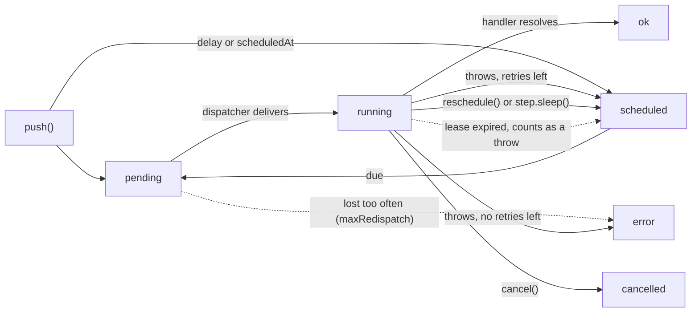

# Background Jobs

`$job` is the primitive for work that happens outside a request. It is backed by
a database table (the _outbox_), which is what makes it durable: a push writes a
row before anything runs, so a handler that throws - or a process that dies
mid-flight - leaves a record that a reconciliation sweep picks back up.

```typescript check
import { $job } from "alepha/api/jobs";
```

`$job` lives under `alepha/api/` because it needs an ORM connection and ships an
admin controller. Register the module alongside your other API modules:

```typescript
import { AlephaApiJobs } from "alepha/api/jobs";

alepha.with(AlephaApiJobs);
```

Every queued execution is one row in `job_executions`, and its `status` moves
through a small state machine. The handler only ever runs on a row it has
claimed (`running`); everything else is the outbox and the sweep making sure
that claim eventually happens:



Dotted edges are the sweep's recovery work: a `pending` row whose delivery was
lost is re-dispatched (up to `maxRedispatch` times), and a `running` row whose
worker stopped renewing its lease is treated as a failed attempt. `ok`, `error`
and `cancelled` are terminal: the sweep never touches them, only the
[retention](#retention) trim and the admin delete routes remove them.

## Two modes, never both

A job declares **either** `schema` (queue-mode, push-driven) **or** `cron`
(cron-mode, schedule-driven). Declaring both is a configuration error.

```typescript check
import { z } from "alepha";
import { $job } from "alepha/api/jobs";

class Emails {
  // queue-mode - call push() to enqueue work
  welcome = $job({
    name: "emails.send-welcome",
    description: "Sends the welcome email to a new user.",
    schema: z.object({ userId: z.text() }),
    retry: { retries: 3 },
    handler: async ({ payload, attempt }) => {
      // send the welcome email for payload.userId
    },
  });

  // cron-mode - fires on a schedule, no payload
  digest = $job({
    name: "emails.send-digest",
    description: "Builds and sends the daily digest.",
    cron: "0 8 * * *",
    handler: async () => {
      // build and send the daily digest
    },
  });
}
```

To run scheduled work _over a set of payloads_, compose the two: a cron job that
pushes, and a queue job that handles.

```typescript
class Reminders {
  sweep = $job({
    name: "reminders.sweep",
    description: "Pushes a reminder for every row that is due.",
    cron: "0 * * * *",
    handler: async () => {
      const due = await this.repository.findMany({ where: { due: true } });
      await this.remind.pushMany(
        due.map((row) => ({ payload: { id: row.id } })),
      );
    },
  });

  remind = $job({
    name: "reminders.send",
    description: "Sends one reminder.",
    schema: z.object({ id: z.text() }),
    handler: async ({ payload }) => {
      /* ... */
    },
  });
}
```

## Naming

Every job declares a `name` and a `description`.

- The name is `<domain>.<action>` in lowercase kebab-case: `estates.sweep-commands`,
  `quests.send-due-reminders`. The domain is the module or business area, a
  plural noun where natural; the action is a verb phrase that does not repeat
  it.
- `system.<domain>.<action>` is reserved for jobs shipped from `packages/`
  (`alepha` and every `@alepha/*`), such as `system.notifications.send`, so a
  framework job never collides with an application's. An application never
  uses `system.`.
- The description is one sentence saying what the job does, shown to operators
  in the admin, at most 255 characters. Neither is translated.

The name is checked at registration, and `yarn check:conventions` checks that
`system.` is used exactly where it belongs.

**The name is the job's identity in `job_executions`.** Renaming a job loses its
rows: its history, and any work queued or scheduled under the old name, are
deleted at the next trim tick (see [A rename loses the history](#a-rename-loses-the-history)).
Get the name right when you declare it.

## Pushing work

```typescript
const executionId = await this.welcome.push({ userId: "u1" });
```

`push()` accepts a second options argument:

| Option            | Type           | Description                                                                               |
| ----------------- | -------------- | ----------------------------------------------------------------------------------------- |
| `delay`           | `DurationLike` | Run no earlier than now + delay                                                           |
| `scheduledAt`     | `Date`         | Run no earlier than this instant                                                          |
| `key`             | `string`       | Deduplication key - see the caveat below                                                  |
| `inline`          | `boolean`      | Run now and wait, no retry - see [`inline`](#inline-when-a-retry-is-worse-than-a-failure) |
| `triggeredBy`     | `string`       | Who pushed it (user id), shown in the admin                                               |
| `triggeredByName` | `string`       | Display name for `triggeredBy`                                                            |

`pushMany()` takes an array of `{ payload, key?, delay?, scheduledAt? }`
and writes them in a batched INSERT.

`trigger()` runs a job now, outside its schedule: a cron job fires its handler
once (see [Multi-replica deployments](#multi-replica-deployments) for how it
avoids overlapping a tick), a queue job takes `{ payload }` and is pushed like
any other. Both accept `triggeredBy` / `triggeredByName`; it is what the
admin's "run now" button calls.

### Pushing inside a transaction

A push inside `$transactional()` (or `DatabaseProvider.transactional()`) is
part of that transaction: the job is an outbox row written beside your own.

```typescript
await this.db.transactional(async () => {
  const order = await this.orders.create(input);
  await this.confirmation.push({ orderId: order.id });
});
```

- **The row commits with your write.** The handler runs once the outermost
  transaction has committed, never on its still-open connection, and promptly,
  without waiting for a sweep.
- **A rollback cancels both.** No execution row is left and the handler never
  runs.
- **D1 has no transaction**, nor does a driver started with
  `DATABASE_TRANSACTIONS=false`: each write stands alone, and the job is
  dispatched as soon as it is pushed.
- **A dispatch that fails after the commit is not thrown at you**: your
  transaction has already committed. It is logged, the row stays `pending`,
  and the sweep dispatches it.
- **`inline` is the exception.** An inline push runs the handler in the caller,
  so inside a transaction it still runs before the commit. Call it after the
  commit.

`pushMany()` follows the same rule, and so do delayed and keyed pushes.

### `key` dedups in-flight work, not completed work

A push with a `key` returns the existing execution id instead of enqueueing a
second row - but only while a live row holds that key. When the execution
reaches a terminal state (`ok`, `error` or `cancelled`) the row is either
deleted (a queue job keeps no successes by default) or updated with `key` set
to `null`. Either way **the key is released once the execution is over**,
whatever its outcome.

So `key` means _"don't enqueue this twice while it's still pending, running, or
waiting for a retry"_ - it is not _"run this at most once ever"_. If you need
the stronger guarantee, enforce it in the handler against your own data.

## Retries

Set `retry: { retries: n }`, optionally with `when: (error) => boolean` to retry
only certain failures.

A failed attempt is rescheduled with **exponential backoff and full jitter**:
attempt _n_ waits a uniformly random time in
`[0, min(retryBackoffMax, retryBackoffBase * 2^(n-1))]`, defaults 5 s and
30 min. The jitter matters at least as much as the curve - without it every
retrying row in the system shares one `scheduledAt` and they all hit a
struggling downstream together.

A job can carry its own curve when the global one does not fit: `retry.backoff`
replaces the base, the factor and the cap for that job. A settlement that polls
a payment provider wants minutes between attempts, not seconds:

```typescript
reconcile = $job({
  name: "checkouts.reconcile",
  description: "Settles a checkout the payment provider has confirmed.",
  schema: z.object({ sessionId: z.uuid() }),
  retry: {
    retries: 3,
    backoff: { initial: [1, "minute"], factor: 4, max: [30, "minute"] },
  },
  handler: async ({ payload }) => {
    await this.payments.sync(payload.sessionId);
  },
});
```

Attempt _n_ waits `initial * factor^(n-1)`, capped by `max` (default: the
global `retryBackoffMax`), then jittered the same way: `jitter` is on by default
and means the full jitter above. `jitter: false` gives the exact curve, which is
what a test asserting on `scheduledAt` wants.

The row's `scheduledAt` is the truth and the sweep is the backstop, so nothing
can lose a retry. What varies by runtime is only **how soon** something looks
at it:

| Runtime                                   | Dispatch        | Retry lands                       |
| ----------------------------------------- | --------------- | --------------------------------- |
| Node, any dispatcher                      | direct or queue | at the backoff, on a local timer  |
| Cloudflare Workers + `AlephaApiJobsQueue` | queue           | at the backoff, held by the queue |
| Cloudflare Workers, no queue              | direct          | **next sweep tick** (see below)   |

The last row is a real limit, not an oversight. A timer armed after the
response never fires on Workers - the isolate freezes once `waitUntil`
settles - so direct mode there cannot arrange a wake-up at all and retries
keep `sweepCron` granularity. Add `AlephaApiJobsQueue` if that matters, or use
[`inline`](#inline-when-a-retry-is-worse-than-a-failure) for a payload that
expires before the next tick.

Cron-mode jobs without `retry` do not retry - the next tick is the retry. Cron
jobs that _declare_ `retry` go through the outbox instead, which is useful for
once-daily jobs where waiting a full day is not acceptable.

### What a transport does with a delay

`$job` asks exactly one thing of a transport: **do not deliver before time T.**
Durability, retry policy, attempt counting, dead-lettering and crash recovery
are all already owned by the outbox, which is why the interface carries one
optional argument rather than a broker abstraction.

The rule every backend follows:

> `delaySeconds` is an optimisation. The outbox row's `scheduledAt` is the
> truth, and the sweep is the backstop. A backend that cannot honour a delay
> must **decline to enqueue** rather than enqueue immediately.

Declining is not the same as ignoring. For a push transport, ignoring a delay
means _delivering now_, and for a retry that is worse than doing nothing at
all: no backoff whatsoever against a downstream that has just failed.

| Backend                 | Delay                                                                  |
| ----------------------- | ---------------------------------------------------------------------- |
| Cloudflare Queues       | native, clamped at its 12-hour ceiling                                 |
| Redis (`REDIS_URL` set) | a sorted set scored by due-time, promoted into the list when it is due |
| in-memory               | a due timestamp, filtered on pop                                       |

Every backend that ships with Alepha honours a delay, so nothing declines in
practice today. The rule still matters: it is what a custom `QueueProvider` is
held to, and "ignore it and deliver now" has to stay unavailable as an option.

The Redis tier buys two things a local timer cannot. A delayed message is
**server-side state**, so it survives the process that pushed it - a deploy
inside the delay window used to drop every armed timer it was holding. And one
sorted-set entry costs nothing per message, where one live `setTimeout` per
delayed job is real heap on a large backlog.

Its scan only runs when the list is empty, so a busy queue pays no extra round
trip for the tier at all. `ZREM` is the claim, so two pollers racing the same
due message agree on an owner instead of delivering it twice.

## Looping with `reschedule`

A handler that calls `reschedule()` instead of returning parks its own
execution again: the same row goes back to `scheduled` with a new
`scheduledAt` and, optionally, a new payload, keeps its `id` and its `key`, and
its `attempt` starts over. It is the tool for a loop over a changing payload,
such as a poll that backs off until an export is ready:

```typescript check
import { z } from "alepha";
import { $job } from "alepha/api/jobs";

class ExportApi {
  async status(exportId: string): Promise<"ready" | "running"> {
    return "ready";
  }
}

class Exports {
  api = new ExportApi();

  waitForExport = $job({
    name: "exports.wait-ready",
    description: "Polls an export until it is ready, backing off each time.",
    schema: z.object({ exportId: z.text(), round: z.integer().optional() }),
    handler: async ({ payload, reschedule }) => {
      if ((await this.api.status(payload.exportId)) === "ready") return;
      const round = (payload.round ?? 0) + 1;
      if (round > 10) return; // give up after ten rounds
      reschedule({
        delay: [Math.min(2 ** round, 60), "minute"],
        payload: { ...payload, round },
      });
    },
  });
}
```

The wait is persisted before any timer is armed, so a redeploy inside it loses
nothing: the row's `scheduledAt` is the truth and the sweep is the backstop,
exactly as for a delayed push. Each round gets the job's full retry budget,
because `attempt` resets.

**Use `reschedule` for a loop, and [steps](#steps) for a fixed sequence with
side effects.** A reschedule is a new iteration: it clears the run's steps, so
every `step.run` of the next pass runs again.

The rules that keep it honest:

- `reschedule()` records an intent; the row is written when the handler
  resolves. A handler that **throws** after calling it takes the retry path on
  the old payload, and the intent is discarded. Called twice, the last call
  wins.
- The write is guarded on `running`: a `cancel()` that lands while the handler
  is finishing wins, and nothing is dispatched.
- The new payload is validated against the schema when `reschedule()` is
  called, so a bad one fails the run there rather than parking garbage.
- A rescheduled run emits `job:end` but not `job:success`; the execution is not
  over. Retention only applies to the stage that completes.
- It throws from a cron tick (no row to park) and from an
  [`inline`](#inline-when-a-retry-is-worse-than-a-failure) push (the caller is
  waiting for an outcome).
- `step.sleep` after `reschedule()` in the same run is refused: one of them
  parks the row, not both.

## Steps

A handler that does two things with side effects has a problem the moment the
second one fails:

```typescript check
import { z } from "alepha";
import { $job } from "alepha/api/jobs";

declare const payments: { capture(orderId: string): Promise<void> };
declare const mail: { sendReceipt(orderId: string): Promise<void> };

class Orders {
  settle = $job({
    name: "orders.settle",
    description: "Captures the payment, then sends the receipt.",
    schema: z.object({ orderId: z.text() }),
    retry: { retries: 3 },
    handler: async ({ payload }) => {
      await payments.capture(payload.orderId); // runs again on every retry
      await mail.sendReceipt(payload.orderId); // fails: the job retries
    },
  });
}
```

The retry captures the payment twice. `step` fixes it: a completed step's
result is stored on the job's row, and when the handler runs again, that step
returns the stored result instead of running.

```typescript check
import { z } from "alepha";
import { $job } from "alepha/api/jobs";

class Payments {
  async capture(orderId: string) {
    return { id: `ch_${orderId}` };
  }
}
class Invoices {
  async issue(orderId: string, chargeId: string) {
    return { number: `INV-${orderId}-${chargeId}` };
  }
}
class Mail {
  async sendReceipt(orderId: string, invoice: string) {}
}

class Orders {
  payments = new Payments();
  invoices = new Invoices();
  mail = new Mail();

  settle = $job({
    name: "orders.settle",
    description: "Captures the payment, issues the invoice, sends the receipt.",
    schema: z.object({ orderId: z.text() }),
    retry: { retries: 3 },
    handler: async ({ payload, step }) => {
      const charge = await step.run("capture", () =>
        this.payments.capture(payload.orderId),
      );
      const invoice = await step.run("invoice", () =>
        this.invoices.issue(payload.orderId, charge.id),
      );
      await step.run("receipt", () =>
        this.mail.sendReceipt(payload.orderId, invoice.number),
      );
    },
  });
}
```

A failing receipt retries the receipt alone: `capture` and `invoice` return
what they returned the first time. A value computed in one step is available to
the next as a plain variable, without being copied into the payload.

### Waiting: `step.sleep`

`step.sleep(name, duration)` and `step.sleepUntil(name, date)` wait durably
between steps. The cart recovery of `@alepha/commerce` is this shape:

```typescript check
import { z } from "alepha";
import { $job } from "alepha/api/jobs";

class Carts {
  async isRecoverable(cartId: string) {
    return true;
  }
  async remind(cartId: string, n: 1 | 2) {}
  async markAbandoned(cartId: string) {}
}

class CartRecovery {
  carts = new Carts();

  recover = $job({
    name: "carts.recover",
    description:
      "Reminds a buyer about an abandoned cart, then marks it abandoned.",
    schema: z.object({ cartId: z.uuid() }),
    retry: { retries: 3, backoff: { initial: [1, "minute"], factor: 4 } },
    handler: async ({ payload, step }) => {
      // Asked again on every pass, before each stage.
      if (!(await this.carts.isRecoverable(payload.cartId))) return;
      await step.run("first-reminder", () =>
        this.carts.remind(payload.cartId, 1),
      );
      await step.sleep("until-second", [23, "hour"]);
      await step.run("second-reminder", () =>
        this.carts.remind(payload.cartId, 2),
      );
      await step.sleep("until-abandon", [24, "hour"]);
      await step.run("mark-abandoned", () =>
        this.carts.markAbandoned(payload.cartId),
      );
    },
  });
}
```

A sleeping job is an ordinary `scheduled` row, visible and cancellable in the
admin (`cancelByKey` cancels it like any parked row), and the sleep spends no
attempt. It wakes as precisely as a delayed push does: see
[What a transport does with a delay](#what-a-transport-does-with-a-delay).

### The handler runs from the top

**Every pass runs the handler from its first line; only steps are skipped.** A
retry, a crash recovered by the sweep and a wake-up after a sleep all replay
the handler, and every completed step returns its stored result. That is a
feature: a guard such as "is this cart still recoverable?" sits once, before
the first step and outside any step, precisely because it must be asked again
after each wake.

### The rules

- **Names are unique in a run**, 1 to 64 characters of lower-case kebab
  segments joined by dots. Name loop iterations:
  ``step.run(`charge.${i}`, ...)``.
- **Results are JSON and capped**: 64 KB per result and 512 KB per run
  (`jobConfig.stepResultMaxBytes`, `jobConfig.stepsMaxBytes`). A `Date`, a
  `Map`, a class instance or a `bigint` is refused, so return
  `date.toISOString()`. Results are stored in clear: never return a secret.
- **Do not `catch` around `step.sleep`.** It unwinds the handler by throwing;
  a handler that catches it and carries on fails with an error saying so.
- **Not inside a transaction.** The step's record would roll back with a later
  throw while its work stays done. Open the transaction inside the step's
  function instead.
- **Not in a cron job**, with or without `retry` (push a queue job from the
  cron), **nor in an `inline` push.**
- **Any `reschedule()` starts the steps over.**
- **`retries: n` is n + 1 tries of each step**: the retry budget starts over
  when a step completes.

### Retry from the admin resumes

Retrying a failed or cancelled run from the admin creates a new execution that
carries the steps the old one completed: they are not run again, and the run
carries on at the step that failed. Two consequences: to run every step again,
push the job again (or use Trigger with the payload), since the admin has no
"retry from the start"; and a step whose stored result is what makes the next
one fail is not re-run by Retry.

### What steps are not

| you may expect                                      | what you get                                                                                                                                                            |
| --------------------------------------------------- | ----------------------------------------------------------------------------------------------------------------------------------------------------------------------- |
| exactly-once steps                                  | at-least-once: a crash between a step finishing and its result being stored runs it again. Make the step idempotent, or pass an idempotency key to the service it calls |
| parallel steps, child workflows, waiting for events | not provided. Push another job, or use `cancelByKey` and a re-check                                                                                                     |
| compensation on failure                             | not provided. Write the undo as a step in a `catch` of your own, around `step.run` calls only                                                                           |
| a workflow server                                   | none: the state is one column on a row in your own database, on every runtime                                                                                           |

### Testing

Poll the row until it is `scheduled` with the sleep's entry in its `steps`,
then `travel()` past it. The promoting timer is armed once the handler has
unwound, so a travel issued before the park computes the wait from the
travelled clock. `travel()` also fires every cron in the container, the sweep
included, which is what promotes a sleep longer than a day.

```typescript check
import { Alepha } from "alepha";
import { jobExecutionEntity } from "alepha/api/jobs";
import { DateTimeProvider } from "alepha/datetime";
import { $repository } from "alepha/orm";

class Probe {
  executions = $repository(jobExecutionEntity);
}

const waitForSleep = async (alepha: Alepha, id: string, sleep: string) => {
  const probe = alepha.inject(Probe);
  for (;;) {
    const row = await probe.executions.findById(id);
    if (row?.status === "scheduled" && row.steps?.[sleep]) return;
    await new Promise((r) => setTimeout(r, 10));
  }
};

export const wakeUp = async (alepha: Alepha, id: string) => {
  await waitForSleep(alepha, id, "until-second");
  await alepha.inject(DateTimeProvider).travel([24, "hour"]);
};
```

## `inline`: when a retry is worse than a failure

Some payloads expire. A verification code lives 300 seconds by default while
the sweep runs every 900, so a retried code is **guaranteed** to arrive after
it expired: all three attempts produce garbage and the user meanwhile sees
nothing at all.

`inline` says: run the handler here, make me wait, and if it fails tell me.

```typescript
await myJob.push(payload, { inline: true });
// resolves -> the handler ran to completion, outbox row terminal
// rejects  -> the handler failed, row terminal `error`, nothing retries it
```

No dispatcher, no queue, no `waitUntil`. Behaviour is identical with and
without `AlephaApiJobsQueue`, because the flag bypasses `JobDispatcher`
entirely.

Two things it does, and it is worth separating them:

1. **The caller learns.** A password reset fails in front of the user, who can
   simply ask for another one, instead of quietly succeeding on attempt two
   with a code that no longer works.
2. **A failure is terminal, never `scheduled`.** This half holds even where the
   caller swallows the rejection, and it is the one that closes the expired-code
   problem: nothing will deliver that payload later.

**Per push, not per job.** Declare it on the job as a default if you like, but
the useful form is the call-site override, because one job usually sits behind
many callers - `sendNotification` is the single job behind every notification.
Whether you can afford to wait is a property of the call site.

```typescript
await myJob.push(payload); //                 async, retries per the policy
await myJob.push(payload, { inline: true }); // this one waits, and does not retry
```

On a job that declares `retry`, a per-push `inline` means _this execution does
not retry_: one attempt, terminal on failure, thrown to you. Declaring `inline`
and `retry` together **on the job** is rejected at registration, as is `inline`
with `cron` (a tick has no caller to block) and `inline` on `pushMany`.

Read the contract precisely:

- **"Ran to completion" means the handler resolved.** For an email that is the
  provider accepting the message, not delivery to an inbox.
- **Call it after the commit, not inside a transaction.** An email cannot be
  rolled back, so sending inside a transaction that later fails means mailing a
  code for a row that no longer exists. `inline` buys ordering, not
  transactionality.
- **Never on a message addressed to somebody other than the caller.** Blocking
  a login or registration response on a mail to the account _owner_ turns
  response time into an account-enumeration oracle: a slow answer means the
  account existed. Alepha's own `registrationAttempt` and `accountLockout`
  notifications are excluded for exactly this reason.

Not to be confused with `$notification`'s `critical`, which is a different
property one layer up: that one means the recipient cannot opt out.

## Timeouts and cancellation

`timeout` caps a single attempt. Past it, the handler's `signal` aborts with a
`TimeoutError` and the attempt fails at once, even if the handler ignores the
signal. A timed-out attempt is a failure like any other: it is retried per the
`retry` policy, never recorded `cancelled`.

The `signal` is the same object as `alepha.context.signal` inside the handler,
so what the handler calls inherits it: an `HttpClient` request or an ORM query
started from the handler stops with it. Pass it explicitly to anything else
that accepts one (`fetch`, a child process); JavaScript cannot interrupt
synchronous work, so a CPU-bound loop keeps running until it yields. See
[Cancellation](/docs/guides-core-cancellation).

```typescript
report = $job({
  name: "reports.build",
  description: "Builds one report.",
  schema: z.object({ id: z.text() }),
  timeout: [30, "seconds"],
  handler: async ({ payload, signal }) => {
    await fetch(`https://example.com/${payload.id}`, { signal });
  },
});
```

`await job.cancel(executionId)` cancels a pending, scheduled or running
execution; pass `{ cancelledBy, cancelledByName }` to say who did, the admin
shows it. A running handler sees its `signal` abort. A run aborted by a cancel,
or by the shutdown drain (`drainTimeout`), is recorded `cancelled`, never
`error`, and is not retried.

`await job.cancelByKey(key)` cancels the execution parked under a `key` and
returns its id, or `null` when nothing is parked. It is the disarm half of a
keyed push: an order that pays cancels the cart's reminder sequence by the cart
id. Only a `pending` or `scheduled` row is cancelled; a `running` one is left to
finish, because a listener reacting to an event cannot know whether that event
is the running handler's own doing (a reconciliation stage that settles a
checkout emits the very event that would cancel it). The handler's own re-check
at its next stage is the right place for that decision.

## Dispatch modes

How a pushed execution reaches its handler depends on which modules are loaded:

- **direct** (default): the handler runs in-process right after `push()`
  returns. The outbox row is the durability guarantee: if the process dies, the
  sweep re-dispatches. Best for single-instance Node and Cloudflare Workers,
  where standing up a broker is overkill.
- **queue**: add `AlephaApiJobsQueue` and dispatch goes through a real broker
  (Cloudflare Queues on workerd, Redis on Node and Bun once `REDIS_URL` is set)
  so a worker pool consumes the work.

```typescript
import { AlephaApiJobs, AlephaApiJobsQueue } from "alepha/api/jobs";

alepha.with(AlephaApiJobs).with(AlephaApiJobsQueue);
```

Both modes are at-least-once. Write handlers to be idempotent.

## Retention

A job keeps a history of its runs in `job_executions`, and `retention` says how
much of it, per status: `ok` for successes, `error` for failures, which
cancelled runs follow.

```typescript check
import { $job } from "alepha/api/jobs";

class Reminders {
  send = $job({
    name: "reminders.send-due",
    description: "Sends the reminders that are due.",
    cron: "0 0 * * *",
    retention: {
      ok: { last: 7 }, // the last 7 successes
      error: { days: 30 }, // 30 days of failures
    },
    handler: async () => {
      // send the reminders that are due
    },
  });
}
```

Each status takes `{ last?, days? }` or `false`:

| Rule                | Keeps                                                   |
| ------------------- | ------------------------------------------------------- |
| `{ last: 7 }`       | The newest 7 rows                                       |
| `{ days: 30 }`      | Rows that completed within the last 30 days             |
| `{ last, days }`    | Rows within both limits: a row goes when it breaks one  |
| `{ days: () => n }` | A window read at every trim tick, for a runtime setting |
| `false`             | Nothing: no row is written for that outcome             |

`last` is an integer of at least 1 and `days` is positive; a rule with neither
is refused at registration. There is no "forever".

A status the job leaves out takes a default, decided by how often the job runs.
A cron's cadence is the shortest gap among its next 10 fire dates, so
`0 9 * * 1-5` is a daily job:

| Job                             | Successes    | Failures |
| ------------------------------- | ------------ | -------- |
| cron, at least every 15 minutes | last 12      | 30 days  |
| cron, up to hourly              | last 24      | 30 days  |
| cron, up to daily               | last 7       | 30 days  |
| cron, slower                    | last 5       | 30 days  |
| queue                           | not recorded | 30 days  |

Successes are kept by count and failures by age: the last 12 runs of a `*/15`
cron are three hours of history, and the last 7 of a daily one are a week. A
queue job's successes are not recorded unless it says so, in days: for per-item
work, "the last 10" means the last 10 items whatever the volume. For a cron the
newest row of each status outlives its window, so a monthly job never looks like
it never ran.

Every kept run keeps the log entries it produced (up to `logMaxEntries`),
whatever its outcome. Nothing is written while a run is in progress: a queue
job's row says `running`, and a cron tick has no row until it ends.

The trim runs on its own cron (`trimCron`, hourly by default), orders by
`completedAt`, and costs one grouped query for the whole tick, so a status that
is within its limits is never queried individually. A status over its limits is
cut back in chunks, however far over it is; if one tick cannot finish, it logs
what is left and the next tick continues.

The effective rule of every job, defaults filled in, is in the admin's job list
and in devtools, with where it came from.

### A rename loses the history

The trim also deletes every row whose job name no job declares, whatever its
status. The name is a job's identity in `job_executions`: rename a job and its
old rows, pending and scheduled ones included, are gone at the next trim tick.

Any process pointed at the same database with a different job set does the same
to the jobs it does not declare, so give each application its own database. A
container that declares no job at all purges nothing.

## Configuration

Tune the `jobConfig` atom:

```typescript
import { jobConfig } from "alepha/api/jobs";

alepha.store.mut(jobConfig, (c) => ({ ...c, sweepCron: "*/5 * * * *" }));
```

**Mutate before you wire the module.** A cron expression is read once, when the
`$job` field initializes, and wiring a module injects its services immediately.
A mut applied after the module is wired lands in the store but never reaches the
already-registered cron - no error, no effect:

```typescript
// Works - the store is set before anything reads it.
const alepha = Alepha.create();
alepha.store.mut(jobConfig, (c) => ({ ...c, sweepCron: "*/5 * * * *" }));
alepha.with(MyApp);

// Silently does nothing to the schedule.
const alepha = Alepha.create().with(MyApp);
alepha.store.mut(jobConfig, (c) => ({ ...c, sweepCron: "*/5 * * * *" }));
```

Inside a `$module`, the `register()` hook runs before `imports[]` and
`services[]`, so it is also a safe place to do this.

| Key                    | Default        | Description                                                                                                                     |
| ---------------------- | -------------- | ------------------------------------------------------------------------------------------------------------------------------- |
| `sweepCron`            | `*/15 * * * *` | Reconciliation sweep - bounds retry latency                                                                                     |
| `trimCron`             | `0 * * * *`    | Trim tick: purges unregistered jobs' rows, enforces retention                                                                   |
| `sweepBatchSize`       | `200`          | Rows one sweep phase reads per tick - see below                                                                                 |
| `maxRedispatch`        | `3`            | Lost deliveries tolerated before a `pending` row is failed                                                                      |
| `retryBackoffBase`     | `5000`         | First retry's backoff ceiling (ms); doubles per attempt, full jitter                                                            |
| `retryBackoffMax`      | `1800000`      | Ceiling for that curve (ms)                                                                                                     |
| `staleThreshold`       | `300000`       | Pending age (ms) before the sweep re-dispatches                                                                                 |
| `runTimeout`           | `1800000`      | Time (ms) a `running` row may go without a lease renewal before a crash is assumed; twice the job's own `timeout` if it has one |
| `retention.errorDays`  | `30`           | Days of failures a job keeps when it declares no `retention.error`                                                              |
| `retention.maxRows`    | `1000`         | Cap on rows one status keeps under a default rule; a declared rule is never capped                                              |
| `drainTimeout`         | `30000`        | Time (ms) to wait for in-flight jobs on shutdown                                                                                |
| `logMaxEntries`        | `100`          | Log lines captured per run                                                                                                      |
| `directMaxConcurrency` | `10`           | Concurrent handlers in direct mode - what keeps a `pushMany` of thousands from exhausting the DB pool                           |

### The sweep is bounded

Each sweep phase reads at most `sweepBatchSize` rows per tick and leaves the
rest for the next one. This matters under exactly the conditions where the
sweep is load-bearing: a downstream outage turns the entire retrying
population into rows the sweep matches at once, and every row carries its
payload and any captured logs. A phase that fills its batch logs that it did,
so a backlog is visible in the logs rather than something you infer from a
graph.

Every phase's action moves the row out of the status that phase owns, so
progress across ticks is guaranteed. Every phase serves its oldest rows
first, so under a backlog work is picked up in the order it has been waiting.
There is no priority: a job cannot jump the queue.

A `pending` row whose delivery is lost is re-dispatched at most
`maxRedispatch` times before it is failed. This is counted separately from
`attempt`, which only moves when a worker actually claims the row: a payload
that kills the process between dispatch and claim never increments `attempt`,
so the retry policy would never end it.

### Sweeps owned by other modules

Modules that ship their own crons expose them the same way. All default to
`*/15 * * * *` so they collapse onto the jobs sweep's trigger instead of adding
their own - which matters on Cloudflare, where each distinct expression costs a
Cron Trigger.

| Atom                                           | Key                      | Default        | Bounded by                                           |
| ---------------------------------------------- | ------------------------ | -------------- | ---------------------------------------------------- |
| `paymentsConfig` (`alepha/api/payments`)       | `expireStaleIntentsCron` | `*/15 * * * *` | The 30-minute intent cutoff                          |
| `checkoutConfig` (`@alepha/commerce/checkout`) | `stockSweepCron`         | `*/15 * * * *` | Nothing - `reserved()` excludes holds by `expiresAt` |

## Multi-replica deployments

Cron-mode jobs claim each tick (`lock: true` by default), so a fleet of
replicas fires the handler once, not once per replica. The claim is a row in
the database `$job` already uses (`job_cron_claims`), so replicas sharing that
database agree with nothing else: no Redis is needed. On Cloudflare a Cron
Trigger fires once per schedule, so there is nothing to deduplicate.

The unit that is claimed is the **schedule instant**, not the job. Every replica
derives the same instant from the same cron expression and inserts the same
key, the first insert wins and the others stand down - including a replica whose
clock lags by a few milliseconds and arrives after the handler has already
finished. That claim is what makes "once per tick" hold for a job with `retry`,
where the tick only writes an outbox row and is over in a millisecond. The
hourly trim deletes claims more than a day old.

A run also holds a per-job lock through the `LockProvider`, which keeps a
manual `trigger()` from overlapping a run in progress. That lock is
cross-instance once `REDIS_URL` is set (`RedisLockProvider`); without it, it is
per process, so a trigger on one replica can overlap a tick on another. See
[Bare metal deployment](/docs/guides-deployment-bare) for the setup.

A manual `trigger()` is not a scheduled instant, so it is never suppressed by
one. It still never overlaps a run of the same job already in progress, whether
on this replica or, through the per-job lock, on another: it returns without
running instead. It resolves either way, so a trigger from the admin that lands
on a tick is a no-op, not a second run. With `retry`, the run it cannot overlap
is the tick writing its outbox row; the handler runs afterwards from the
outbox, outside that guard.

`lock` has no effect on queue-mode and direct-mode jobs. Those serialize through
the outbox `claim()` UPDATE-guard instead, which is always on.

## Admin

`AlephaApiJobs` ships `AdminJobController`, the API behind the jobs screen of
`@alepha/ui`'s admin (see `AdminRouter` in
[Routing](/docs/guides-frontend-routing)). It lists every registered job with
its effective mode and retention, pages its executions with their captured
logs, and acts on them:


| Action                              | Route (under `/api`)                                                  | Permission          |
| ----------------------------------- | --------------------------------------------------------------------- | ------------------- |
| List jobs, executions, one run      | `GET /jobs`, `GET /jobs/:name/executions`, `GET /jobs/executions/:id` | `admin:job:read`    |
| Run now (`trigger()`)               | `POST /jobs/:name/trigger`                                            | `admin:job:trigger` |
| Retry an `error` or `cancelled` run | `POST /jobs/executions/:id/retry`                                     | `admin:job:trigger` |
| Cancel                              | `POST /jobs/executions/:id/cancel`                                    | `admin:job:cancel`  |
| Delete terminal runs                | `DELETE /jobs/executions/:id`, `POST /jobs/executions/delete`         | `admin:job:delete`  |

A retry is a new execution: the old row stays as it was, and the payload is
pushed again (a cron job is triggered). A run that recorded
[steps](#retry-from-the-admin-resumes) resumes: the steps it completed are not
run again. Deleting only removes terminal rows: a
`pending`, `scheduled` or `running` row is work the outbox still owns, so a
single delete refuses it and the bulk delete skips it (and reports how many it
skipped); cancel it first.

## Events

`$job` emits lifecycle events you can hook:

| Event         | Payload                        |
| ------------- | ------------------------------ |
| `job:begin`   | `{ name, now, executionId }`   |
| `job:success` | `{ name, executionId }`        |
| `job:error`   | `{ name, error, executionId }` |
| `job:cancel`  | `{ name, executionId }`        |
| `job:end`     | `{ name, executionId }`        |

## When not to use `$job`

- **A bare periodic tick with no database.** `$job` needs an ORM connection.
  For a tick without one, register directly against the cron engine:

  ```typescript check
  import { $hook, $inject } from "alepha";
  import { CronProvider } from "alepha/scheduler";

  class Ticker {
    protected readonly cron = $inject(CronProvider);

    protected readonly setup = $hook({
      on: "start",
      handler: () => {
        this.cron.createCronJob("revalidate", "0 * * * *", async () => {
          // ...
        });
      },
    });
  }
  ```

  You get the tick, but no distributed lock - on multiple replicas every
  replica fires - no run history, no retry and
  nothing in the admin UI. Reach for it only when a database is genuinely
  unavailable.

- **A fixed interval rather than a schedule.** `$interval` from
  `alepha/datetime` runs a function every N units of time, starting when the
  container starts and stopping when it stops:

  ```typescript check
  import { $interval } from "alepha/datetime";

  class Poller {
    poll = $interval({
      duration: [30, "seconds"],
      handler: async () => {
        // ...
      },
    });
  }
  ```

  It is `setInterval` with the container's lifecycle and the testable clock
  attached, so `travel()` advances it. A throwing tick is logged and the next
  tick still runs, which is the one thing raw `setInterval` gets dangerously
  wrong: an unhandled rejection there takes the process down.

  Same caveats as the cron engine above, plus one more. "Every 30 seconds"
  means every 30 seconds _of this process's uptime_, so a restart resets the
  phase and two replicas drift apart. Use it for things where that does not
  matter - refreshing an in-memory cache, emitting a gauge - and use `$job`
  for anything where a missed or doubled run is a business problem.

- **Fan-out to many subscribers.** Use `$topic` / `$subscriber`, which is
  publish/subscribe rather than work distribution.
