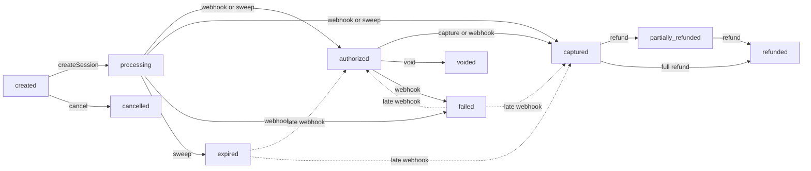
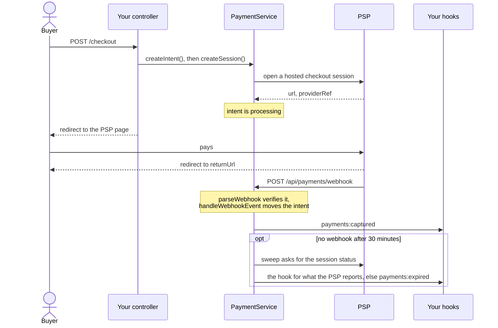

# Payments

Alepha provides a provider-agnostic payments layer through `alepha/api/payments`. The framework owns the data model and lifecycle (intents, captures, refunds, payment methods); concrete payment service providers (PSPs) like Stripe or Mollie plug in via the `PaymentProvider` abstract class.

The same application code works against any provider - swap implementations without touching controllers, services, or hooks.

## The model

Three entities anchor the data:

| Entity           | Role                                                                                                                                                                                                            |
| ---------------- | --------------------------------------------------------------------------------------------------------------------------------------------------------------------------------------------------------------- |
| `paymentIntents` | The unit of value transfer. Tracks status across the lifecycle: `created → processing → authorized → captured → refunded` (with branches for `partially_refunded`, `failed`, `voided`, `cancelled`, `expired`). |
| `paymentMethods` | Saved cards / mandates tied to a user, with provider reference + masked metadata (`brand`, `last4`, `expMonth`, `expYear`).                                                                                     |
| `refunds`        | Per-refund records linked to a captured intent. Supports partial and multi-step refunds.                                                                                                                        |

An intent moves through these statuses. Solid arrows are the normal path; dotted ones are a late webhook arriving after the intent was given up on:



`recordCashPayment()` creates an intent directly in `captured`. Currencies are stored lowercased (`"EUR"` becomes `"eur"`).

Every state transition emits a hook on Alepha's event bus:

| Hook                  | Fires when                                                                   |
| --------------------- | ---------------------------------------------------------------------------- |
| `payments:authorized` | The PSP holds the funds (`authorize: true` sessions).                        |
| `payments:captured`   | The money is taken: webhook, `capture()`, or `recordCashPayment()`.          |
| `payments:failed`     | The PSP reports a failure or the buyer cancelled; the PSP session is closed. |
| `payments:voided`     | `void()` released an authorization.                                          |
| `payments:cancelled`  | `cancel()` abandoned an intent still in `created`.                           |
| `payments:expired`    | The stale-intent sweep gave up on an intent stuck in `processing`.           |
| `payments:refunded`   | A refund went through; fires once per refund.                                |

Every payload carries `{ intentId, amount, currency, metadata }`. `metadata` is the intent's: what you passed to `createIntent()`, plus the `checkoutUrl` that `createSession()` records. `payments:refunded` adds `refundId`, sets `amount` to what this refund gave back, and adds `refundedTotal`, the sum of every refund on the intent. A refund event can be delivered twice, so a listener keeping a running total should set it from `refundedTotal`, not add `amount`.

`payments:expired` is emitted by the stale-intent sweep described below - wire it if your fulfilment or notification code needs to release a reservation when a checkout is abandoned.

An expiry is not always the last word. If the buyer pays on a PSP page that outlived it (the sweep raced the payment, or its call to close the session failed), the intent moves on to `captured` (or `authorized`) and the usual `payments:captured` fires. The same holds for a `failed` intent: a declined card can be retried on the same PSP page and succeed. Your `payments:captured` listener must therefore handle a capture for something it already released: record it, then refund it with `PaymentService.refund()` or keep it, but never ignore it.

Your own modules (accounting, notifications, fulfilment) listen via `$hook` - they never call the PSP directly.

> **Recurring billing** is deliberately out of scope: let your PSP own it. Create
> the subscription with the provider (e.g. a Stripe Checkout in
> `mode: "subscription"`), then reconcile its status from webhooks into whatever
> field gates access in your app. Charging on your own cron means holding cards,
> reimplementing dunning, and diverging from the PSP's source of truth.

## Registering the module

```typescript check
import { Alepha } from "alepha";
import { AlephaApiPayments } from "alepha/api/payments";

const alepha = Alepha.create().with(AlephaApiPayments);
```

Out of the box this gives you:

- `POST /api/payments/checkout`: body `{ intentId, returnUrl, authorize? }`, returns `{ url, intentId }`. It opens a PSP session for an intent your app already created (the amount must come from your server, never from the browser), and refuses an intent that belongs to another user. Requires a signed-in user.
- `GET/POST/DELETE/PATCH /api/payments/payment-methods/...`: list, add, remove, set default, plus `POST .../setup` (open a PSP setup session to save a card without paying) and `POST .../reconcile` (record the card that setup session saved).
- `POST /api/payments/webhook`: PSP webhook ingress (no `$secure` middleware; the provider verifies authenticity).
- `/api/admin/payments/...`: list and read intents (permission `admin:payment:read`); capture, void, refund, cancel and record cash payments (`admin:payment:write`).
- A cron running every 15 minutes (`system.payments.expire-stale-intents`) that looks at intents stuck in `processing` for more than 30 minutes. It asks the PSP first (`syncIntent()`), so a payment whose webhook was lost still settles, and expires only the intents the PSP does not know as paid.

Change the sweep's cadence through the `paymentsConfig` atom, before the module is wired:

```typescript check
import { Alepha } from "alepha";
import { AlephaApiPayments, paymentsConfig } from "alepha/api/payments";

const alepha = Alepha.create();
alepha.store.mut(paymentsConfig, (config) => ({
  ...config,
  expireStaleIntentsCron: "*/5 * * * *",
}));
alepha.with(AlephaApiPayments);
```

`AlephaApiPayments` registers `MemoryPaymentProvider` as the default provider - you can boot the module with no PSP configured and exercise the full flow end-to-end via the mock checkout page (see [Local development](#local-development)). The mock pages answer only while `MemoryPaymentProvider` is the provider, and refuse in production unless `mockCheckoutOptions.allowInProduction` is set.

⚠️ **Never ship `MemoryPaymentProvider` to production.** Its confirm page marks an intent as paid without any payment, and its webhook parser trusts any JSON body (`{ providerRef, status }`) with no signature. Without a real PSP, `POST /api/payments/webhook` lets anyone move an intent to `captured`.

## Creating a payment

The high-level service is `PaymentService`. A typical "buy a one-off thing" flow:

```typescript
import { $inject, z } from "alepha";
import { PaymentService } from "alepha/api/payments";
import { $repository } from "alepha/orm";
import { $secure } from "alepha/security";
import { $action } from "alepha/server";

import { productEntity } from "./entities/product.ts";

class CheckoutController {
  protected readonly payments = $inject(PaymentService);
  protected readonly products = $repository(productEntity);

  buy = $action({
    method: "POST",
    path: "/checkout",
    use: [$secure()],
    schema: {
      body: z.object({ productId: z.uuid() }),
      response: z.object({ url: z.text() }),
    },
    handler: async ({ body, user }) => {
      const product = await this.products.getById(body.productId);

      const intent = await this.payments.createIntent(
        product.priceCents,
        product.currency,
        { productId: product.id },
        { userId: user.id },
      );

      const session = await this.payments.createSession(
        intent.id,
        "https://app.example.com/orders/success",
      );

      return { url: session.url };
    },
  });
}
```

Amounts are integers in the currency's minor unit (cents). Passing `userId` to `createIntent()` ties the intent to its buyer: `createSession()` refuses it when called with another `userId`, as the built-in checkout endpoint does with the signed-in user. `createSession(intentId, returnUrl, authorize?, userId?, options?)` takes, in `options`, `label` (what the payer sees on the PSP page), `customerEmail` (pre-fills the payer's email), `saveCard` (store the card as one of the user's payment methods once the payment captures), `idempotencyKey`, and for Stripe Connect `stripeAccount` and `applicationFeeAmount`.

Then react to the captured payment to fulfil the order:

```typescript
import { $hook } from "alepha";

class OrderFulfillment {
  protected readonly onPaid = $hook({
    on: "payments:captured",
    handler: async (event) => {
      const productId = (event.metadata as any)?.productId;
      if (!productId) return;
      await this.fulfill(productId, event.intentId);
    },
  });
}
```

The whole round trip, with the hook as the only place the payment is confirmed:



Do not fulfil on the redirect to `returnUrl`: the buyer can land there before the webhook arrives, or reach it without paying. Show a "payment pending" page there and let the hook do the work.

## Authorize then capture

Pass `authorize: true` when creating the session to hold funds without capturing immediately. Useful for marketplace flows where the final amount isn't known up front:

```typescript
await this.payments.createSession(intent.id, returnUrl, true /* authorize */);
// ... later ...
await this.payments.capture(intent.id, finalAmountCents);
```

`capture()` accepts an amount lower than the authorized amount (partial capture), and captures the full amount when you omit it. Higher amounts throw a `PaymentError`.

`void(intentId)` releases an authorization instead of capturing it, and `cancel(intentId)` abandons an intent still in `created` (before a session was opened for it). Every method checks the intent's current status first and throws a `PaymentError` on a transition that is not allowed.

## Embedded card fields

A redirect to the PSP's hosted page works with every provider. When the provider also has an embeddable card field (Stripe's Payment Element), `PaymentService.supportsEmbeddedPayment()` returns `true` and `createElementSession(intentId)` returns `{ clientSecret, publishableKey, provider, providerRef, intentId }` for the browser SDK, keeping the payer on your own domain. The payment then settles through the same webhook and hooks as a redirect session.

## Refunds

Refunds support partial amounts and multiple refunds against the same intent, from `captured` or `partially_refunded`. A refund larger than what remains refundable throws a `PaymentError`.

```typescript
const refund = await this.payments.refund(intentId, 500, "Customer dispute");
// intent.status becomes "partially_refunded" until the full amount is reached.
```

## Cash / offline payments

Skip the PSP entirely for in-person sales:

```typescript
await this.payments.recordCashPayment(2500, "EUR", { invoice: "INV-001" });
// Creates an intent already in "captured" state and emits payments:captured.
```

## Local development

With no provider configured, the `MemoryPaymentProvider` is wired in. `createSession` returns a URL to the bundled mock checkout page, `/payments/mock-checkout/:intentId` (a plain page, outside `/api`). Its buttons drive the same code path a real webhook would, then send the buyer back to `returnUrl` with a `booking` query parameter:

| Button  | Intent becomes     | Hook                              | Redirect                    |
| ------- | ------------------ | --------------------------------- | --------------------------- |
| Confirm | `captured`         | `payments:captured`               | `returnUrl?booking=success` |
| Defer   | stays `processing` | none (the sweep expires it later) | `returnUrl?booking=pending` |
| Cancel  | `failed`           | `payments:failed`                 | `returnUrl?booking=cancel`  |

Confirm always captures, even for an `authorize: true` session. Card setup sessions get a matching page at `/payments/mock-setup/:id`.

In tests, skip the page and drive the transition yourself with `handleWebhookEvent()`, which is what the page calls. `MemoryPaymentProvider` is the module's default, so injecting it returns the provider in use:

```typescript check
import { Alepha } from "alepha";
import {
  AlephaApiPayments,
  MemoryPaymentProvider,
  PaymentService,
} from "alepha/api/payments";
import { describe, expect, it } from "vitest";

describe("checkout", () => {
  it("captures, then refunds part of it", async () => {
    const alepha = Alepha.create().with(AlephaApiPayments);
    const payments = alepha.inject(PaymentService);
    const provider = alepha.inject(MemoryPaymentProvider);
    await alepha.start();

    const intent = await payments.createIntent(2500, "EUR");
    await payments.createSession(intent.id, "/orders/done");
    await payments.handleWebhookEvent(intent.id, "captured");
    expect((await payments.getIntent(intent.id)).status).toBe("captured");

    await payments.refund(intent.id, 500);
    expect((await payments.getIntent(intent.id)).status).toBe(
      "partially_refunded",
    );
    expect(provider.getRefunds()).toHaveLength(1);
  });
});
```

Besides `getCharges()` and `getRefunds()`, the provider answers `wasCharged(providerRef)`, `wasRefunded(providerRef)` and `wasExpired(providerRef)`. `wasCharged` reflects what the mock session was opened as, not the intent: it is already `true` once a non-authorize session exists, so assert on the intent status for the outcome. `retrieveSessionStatus()` always returns `null` on the memory provider, so the sweep expires every intent left in `processing`.
