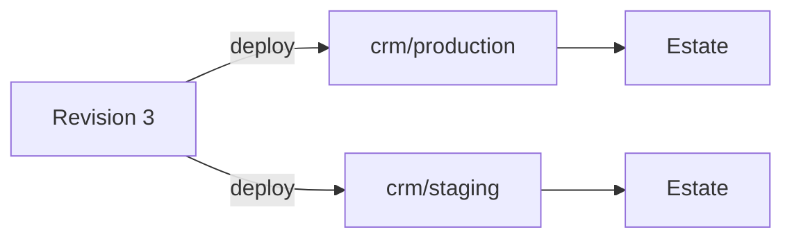

# Stacks

A stack is a group of apps and services deployed together from one
`compose.yml` onto a Bay estate. Lore stores the file and its revisions, holds
the variables, and tells the machine what to run. This page covers Lore's side:
the console, revisions, deploys and the rights they need. The file's format, and
what Bay does with it, are in [Stacks](/bay/docs/guides-stacks) in the Bay
documentation.

## Turning it on

Stacks are the **Stacks** option of the Apps capability, off by default, in
**Settings ▸ General ▸ Capabilities**. It adds **Stacks** to the sidebar, at
`/<project-slug>/stacks`.

Reading needs `app:read`, which the default Member rank holds. Everything that
changes something needs `deploy:manage` and the option on, and so does reading a
service's logs, because logs can hold what an app printed. Turn the option off
and your stacks stay, readable, for when it comes back.

⚠️ Two things need the **Deploy apps** option as well, which is off by default:
deploying one app service, and storing a registry credential.

Only a Bay runs stacks. A stack needs an [estate](/lore/docs/guides-estates) lent
to the project, and that estate must have **Allow deploys** on.

## Stacks, environments and revisions

| Word        | What it is                                                                                            |
| ----------- | ----------------------------------------------------------------------------------------------------- |
| Stack       | A name, unique in the project, and a default estate. Lowercase letters, digits and hyphens, up to 64. |
| Environment | One running copy of the stack, such as `production`, addressed as `<stack>/<env>`.                    |
| Revision    | One numbered upload of the Compose file, with the files it references. A stack has many.              |
| Member      | An app instance that belongs to an environment.                                                       |



An environment deploys to its own estate if it names one, and otherwise to the
stack's default. A deploy never asks: as with an app, where it goes is a property
of the environment.

## Creating a stack

Open **Stacks ▸ New stack**, or from a project directory:

```bash
lore stack create --estate my-vps --file compose.yml
```

The name defaults to the project slug. On the page, the next steps are **Add
environment**, then uploading the Compose file on the **Revisions** tab.

## Uploading a revision

A revision is a `compose.yml`, or a gzip or zstd tar bundle holding one with the
files it mounts.

Lore parses it and checks it before storing anything, against every estate the
stack deploys to, in Bay's own words, so a file the machine would refuse is
refused at upload. Every reason is listed at once:

- no `container_name`, no `build`, no `privileged`, no host network, PID, IPC or
  user namespace;
- no `container:` under `network_mode`, `pid`, `ipc` or `volumes_from`, which
  would reach another environment's containers: `service:<name>`, or a plain
  service name under `volumes_from`, names one of the stack's own;
- every plain service needs an `image`;
- no Docker socket;
- no bind mount, `env_file`, or `file:` under `secrets` or `configs` outside the
  bundle, and no variable in an `env_file` path;
- no `include`, and no `extends` from another file: a stack is one compose file;
- no named volume with `driver_opts`, which could bind any host path;
- no named volume or network marked `external`, or with a `name` of its own;
- a plain service cannot depend on an app service.

The **Revisions** tab lists them newest first and shows the difference between
two.

## Deploying

**Deploy** on an environment sends the newest revision, or the one you name. From
a terminal, `lore stack deploy` uploads the Compose file beside the command as a
new revision first, and creates the environment on its first deploy:

```bash
lore stack deploy -e staging
lore stack deploy -e staging --file deploy/compose.yml
lore stack deploy -e staging --revision 4    # a revision already uploaded
lore stack deploy -e staging --dry-run       # say what would happen
```

`-e` defaults to `production`.

Lore checks everything before anything reaches the machine, and refuses:

- an environment with no estate, or one no longer lent to the project;
- an estate that is not a Bay, or that does not accept deploys;
- a revision that cannot run there;
- a Compose file that interpolates a required variable this environment has not
  set, naming every one.

Then it queues the deploy for the machine. The **Deploys** tab follows it, with
the plan and the outcome of each service.

### Rolling back

A rollback deploys an earlier revision again, and it is the same operation as a
deploy.

⚠️ **The Compose file goes back. Volumes and their data do not.**

```bash
lore stack rollback -e production --to 2
```

### One app at a time

An app service can be deployed alone. When a copy is a member of an environment,
a deploy of that copy sends its stored build into its own service, blue/green,
against the revision the environment already runs. No other service is touched
and nothing of the Compose file is applied.

An app names its stack in `alepha.config.ts`:

```ts
lore({ stack: "crm" });
```

`alepha deploy staging` then puts the app into `crm/staging`, creating the copy if
needed and making it a member. The stack and the environment must already exist,
so deploy the stack there once first.

A copy joins the environment of its own environment name: `crm-api/staging` can
join `crm/staging`, never `crm/production`. It belongs to one environment at a
time, and it takes its estate from that environment rather than from its own
**Settings** tab.

## The environment page

Each environment has seven tabs:

| Tab       | What it shows                                                                                 |
| --------- | --------------------------------------------------------------------------------------------- |
| Services  | What the revision declares, beside what the machine last reported, with restart, stop, start. |
| Deploys   | Its deploys, newest first, with their plan and outcome.                                       |
| Revisions | The stack's revisions and their differences, with upload.                                     |
| Routes    | The full domains it serves.                                                                   |
| Variables | Its variables, never their values.                                                            |
| Volumes   | The named volumes of the running revision, and whether a backup hook covers each.             |
| Settings  | The stack's default estate, this environment's override, and its base domain.                 |

⚠️ A stopped service stays stopped. The way back is **Start**, or a deploy.

### Logs

Opening a service's logs asks the machine for the last 200 lines, and shows them
once it has answered. They are kept for 24 hours. The CLI and the tool take a
different count, up to 2,000:

```bash
lore stack logs web -e production --lines 1000
```

## Variables

Variables are per environment and write-only. Lore seals them, opens them only
for the deploy, and answers with names and at most a four-character prefix of a
long value. A generated value shows no prefix.

```bash
lore stack secrets set DATABASE_URL=postgres://... -e production
lore stack secrets set APP_SECRET --generate -e production
lore stack secrets list -e production
```

`--generate` makes a random hex value on the server, 64 characters unless
`--length` says otherwise (16 to 256), so it never passes through a terminal.
`-e` is required on these commands: a variable set on the wrong environment is a
production secret in staging. An environment holds up to 200 variables, each
up to 5,000 characters. Bay refuses a deploy with a variable named `COMPOSE_*`,
which would configure Compose itself.

## Routes

An environment's base domain and `routes` labels are Bay's, see
[Routes and domains](/bay/docs/guides-stacks#routes-and-domains). The **Routes**
tab adds a full domain on top, served by one service:

```bash
lore stack route add web --domain app.example.com -e production
```

### A test hostname, with no DNS

A server bought for an hour has an IP and no domain. `--test-hostname <service>`
on `lore stack deploy` serves that service on a name derived from the estate's
public IP, before the deploy runs:

```bash
lore stack deploy -e staging --test-hostname web
# Routing https://staging-umami.203-0-113-10.sslip.io/ to web.
```

The name is `<env>-<stack>.<ip-with-dashes>.sslip.io`. sslip.io answers any such
name with the IP it contains, so it points at the machine at once, and Bay gets
a real certificate for it as for any route. Nothing is created in anyone's DNS,
so nothing needs cleaning: the route goes with the environment. The IP is the
one Lore saw when the machine connected, so the estate must have connected once
(`lore estate wait`); `lore estate get` shows it.

## Private registries

An image from a private registry needs a credential, stored per project and
pulled by the machine for the deploy:

```bash
lore registry add ghcr.io --username bot --password-stdin
```

See [The lore CLI](/lore/docs/guides-cli#container-registries).

## Removing

**Delete environment**, on its **Settings** tab, forgets an environment in Lore,
with its routes and variables. Its member apps stay, as ordinary copies, and ⚠️
**nothing on the estate is touched**: what runs keeps running. `lore stack destroy
--env <env>` asks the machine to remove the environment first, its volumes,
variables and registry credentials kept, then forgets it in Lore. It is held to
the estate's deploy switch; on an estate that does not accept deploys it forgets
the environment and prints the `bay stack destroy` to run on the machine.
`--purge` asks the machine for nothing: Lore never deletes data on a machine, so
it forgets the environment and prints `bay stack destroy --purge`.

A whole stack, with its revisions, is deleted once it has no environment left:
**Delete stack** on its card on the Stacks page, or `lore stack delete <name>`
(`--yes` skips the prompt). While an environment remains, Lore refuses and
names each one with the `lore stack destroy` that forgets it, so nothing still
running on a machine is forgotten by accident.

## For agents

| Tool             | What it does                                                                                                                 |
| ---------------- | ---------------------------------------------------------------------------------------------------------------------------- |
| `stack_list`     | Every stack, with its environments, routes, member apps and the revision each runs.                                          |
| `stack_get`      | One stack: each environment's services and newest deploys. Never a variable's value.                                         |
| `stack_deploy`   | Deploy a revision to an environment, the newest by default. With `app`, deploy one app service alone from a stored build.    |
| `stack_rollback` | Deploy an earlier revision again.                                                                                            |
| `stack_logs`     | Two calls: with `service` it asks for the tail and answers a `request`; with that `request` it answers the lines when ready. |

No `stack_*` tool takes an estate. Creating a stack, uploading a revision and
setting variables and routes have no tool: those are for the CLI and the page.
