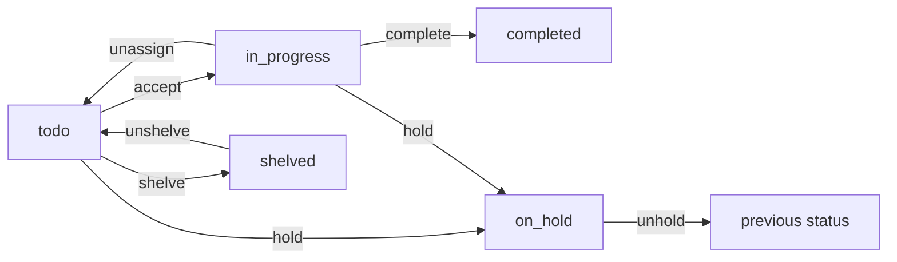

# Quests

A quest is one piece of work in a Lore project: a bug to fix, a feature to
build, a chore to do. This page covers what a quest carries, the statuses it
moves through, the board, and how an agent works one from start to finish.

Quests need the **Plan and track work** capability.

## What a quest carries

| Field                 | What it says                                                                                                         |
| --------------------- | -------------------------------------------------------------------------------------------------------------------- |
| **Number**            | Its id in the project, written `#Q12`. Numbers are per project, so every project has a `#Q1`.                        |
| **Title**             | What changes, in one line.                                                                                           |
| **Description**       | Why, in Markdown.                                                                                                    |
| **Area**              | The part of the system it touches. Required, exactly one.                                                            |
| **Priority**          | How urgent: `optional`, `low`, `medium` or `high`, in that order.                                                    |
| **Size**              | How big, on a t-shirt scale: 1 XS, 2 S, 3 M, 4 L, 5 XL. Defaults to M, which reads as "nobody sized this".           |
| **Tags**              | The nature of the work: `bug`, `feat`, `chore`, ... Lowercased and deduplicated.                                     |
| **Objectives**        | A checklist of at most 10 steps. More than that is more than one quest.                                              |
| **Depends on**        | Another quest that must be completed before this one can start.                                                      |
| **Due date**          | A deadline, independent of any release's.                                                                            |
| **Epic**, **release** | Where it belongs, when the project uses [epics](/lore/docs/guides-epics) and [releases](/lore/docs/guides-releases). |

Area, tags and epic are three separate axes. The **area** is _where_ (a module,
a package, a screen), the **tags** are _what kind_ of work, and the **epic** is
the bounded initiative it belongs to, which can span several areas and ends.

With the **Estimates** option on, a quest also carries how long it should take;
with **Timer**, how long it actually took. Both are switched in the work
capability's options.

### Areas

Areas are the project's map of itself. They are listed, described, renamed,
merged and deleted in **Settings ▸ Areas**, and an area's description is what an
agent reads to decide where a new quest goes.

⚠️ Area names are matched exactly: `Auth` and `auth` are two areas, and filing a
quest with a name nobody used before silently creates a new one. Reuse the
existing names; `lore project info` and the agent tool `project_context` both
list them.

## Statuses

A quest is always in one of five statuses:

| Status        | Meaning                                                                      |
| ------------- | ---------------------------------------------------------------------------- |
| `todo`        | In the backlog, nobody on it.                                                |
| `in_progress` | Accepted: someone (a person or an agent) is working on it.                   |
| `on_hold`     | Blocked on something outside itself: an answer, a credential, a decision.    |
| `shelved`     | Set aside as out of scope for now. Kept, but hidden from lists and progress. |
| `completed`   | Done.                                                                        |



- **Accept** assigns the quest to you and moves it to `in_progress`. It is
  refused while the quest it depends on is not completed.
- **Complete** needs every objective ticked, or waived with a reason. A waiver
  records work that was not done; an objective that was done is ticked, never
  waived. A quest completed with no release joins the project's default
  release, if it has one.
- **Hold** needs a reason, posted as a comment. Mention someone with
  `@handle` in it and it lands in their inbox, so name whoever you are waiting
  on. Lifting the hold restores the previous status and assignee. While held, a
  quest can be neither accepted nor completed.
- **Shelve** only works on a `todo` quest: unassign an accepted one first.
  Prefer it to deleting when the idea is worth keeping.
- **Delete** is permanent. The quest's creator can do it, and so can anyone whose
  rank grants `quest:delete`, which a **Member** has by default. It is refused
  inside an in-progress or completed epic: shelve the quest instead.

A quest waiting on _another quest_ is not on hold: set **Depends on** instead,
which also draws the link between the two.

Quests inside an epic follow its workflow too: they can be accepted only while
the epic is ready or in progress. See [Epics](/lore/docs/guides-epics).

## The list and the board

**Quests** (`/<project>/quests`) lists them. Shelved quests are left out
unless you ask for them.

With the **Board** option on, **Kanban** (`/<project>/kanban`) shows them as a
board. You name the columns in the board settings, give each a WIP limit and a
colour, and say which of `todo`, `in_progress` or `completed` a card dropped
there means. When no column carries `todo` or `completed`, the board adds a
**To do** or **Completed** column of its own.

Dragging a card moves it along `todo`, `in_progress`, `completed`. A `todo`
quest has to be accepted before it can be completed, and a completed quest
cannot be dragged back.

## Talking about a quest

A quest's page has a **Discussion**: its comments, interleaved with its history
(accepted, held, completed, ...). Comments posted by an agent are marked as
agent-authored, so an agent does not need to sign them.

Anywhere Lore renders Markdown (descriptions, comments, folios), `[[#Q12]]`
links to quest 12 of the same project. The same grammar reaches the other
kinds: `[[#F3]]` a folio, `[[#E4]]` an epic, `[[#R2]]` a release, `[[#P120]]` a
feedback item.

## Commits

Put the quest number in your commit messages (`fix login redirect (#Q12)`) and
record the commits on the quest, so "what shipped for #Q12" is a field rather
than a search through the git log. Recording is idempotent per sha, and is
allowed on completed quests, since the final sha is often only known after the
merge.

```bash
lore quest complete 12 --message "Redirect fixed" --commit 3f9c2a1
```

## From an agent

An agent connected over MCP works quests with the same rules as a person. The
usual loop:

1. `project_context`: the capabilities, areas, epics, your active quests and
   the folio index, in one call.
2. `folio_get` on the folios that look relevant, `quest_list` / `quest_get` on
   the work.
3. `quest_tags` before `quest_create`, so existing tags are reused. `quest_create`
   can file the quest into an epic (`epic_number`) and accept it in the same
   call (`accept: true`).
4. `quest_accept` before the first commit.
5. `quest_objective_set` as objectives are done, `quest_comment_add` for what
   the next reader should know.
6. `quest_commit_add` for each commit, then `quest_complete` with a `message`
   and its `commits`.

The other quest tools: `quest_update` (fields, including `dependsOn_shortId`),
`quest_hold` / `quest_unhold`, `quest_shelve` / `quest_unshelve`,
`quest_unassign`, `quest_delete`, and `quest_attachment_add` /
`quest_attachment_get` for [attachments](/lore/docs/guides-attachments).

To hand the same instructions to an agent from the web, see
[Agent prompts](/lore/docs/guides-agent-prompts).

## From the command line

```bash
lore quest list --status in_progress
lore quest get Q12
lore quest create --title "Add a dark mode toggle" --area web --priority medium --accept
lore quest objective set 12 --objective 3
lore quest complete 12 --commit 3f9c2a1
```

A quest can be named `12`, `Q12` or `'#Q12'` (quote it, or the shell reads a
comment). See [The lore CLI](/lore/docs/guides-cli#quests) for every flag.
