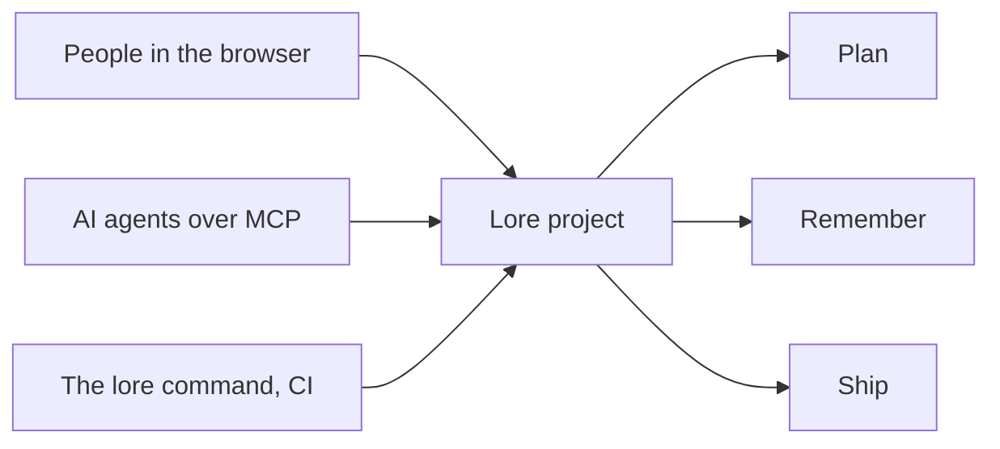

# Introduction

Lore is an open-source app for running a software project: what is planned,
what was decided, what your users ask for and how your apps are doing, in one
place that people and AI agents share.

You can use the hosted instance at [lore.alepha.dev](https://lore.alepha.dev)
or [run your own](/lore/docs/start-self-hosting) from one Docker image. Lore
does not care what your project is written in: planning, knowledge and feedback
work the same for a Rust service, a mobile app or a hardware product.

## What a project holds

A project is made of three **capabilities**, one for each thing Lore does:
**Plan**, **Remember** and **Ship**. You pick them when you create the project
and you can switch any of them later, without losing anything.

| Capability   | What you get                                                                                                                               | Start here                                      |
| ------------ | ------------------------------------------------------------------------------------------------------------------------------------------ | ----------------------------------------------- |
| **Plan**     | **Quests** (units of work), grouped into **epics** and shipped in **releases**, with a list and a board, and **feedback** your users send. | [Quests](/lore/docs/plan-quests)                |
| **Remember** | **Folios**: linked notes in a tree, with files and history. The project's memory.                                                          | [Folios](/lore/docs/remember-folios)            |
| **Ship**     | Your deployed apps: deploys, analytics, errors and healthchecks.                                                                           | [Apps and instances](/lore/docs/ship-instances) |

Every project also has a [dashboard](/lore/docs/project-dashboard),
[reports](/lore/docs/project-reports), members with
[ranks](/lore/docs/project-members) and
[notifications](/lore/docs/project-notifications), whatever its capabilities.
[Capabilities](/lore/docs/project-capabilities) explains each one and its
options.

## Three ways in

Everything in a project can be reached three ways, with the same permissions
behind each:

- **In the browser.** This is where most of this documentation takes place.
- **From an AI agent.** Lore is an MCP server, so a coding agent can read the
  project's folios before it starts, pick up a quest, tick its objectives and
  write down what it learned. An agent acts as the person who connected it and
  can never do more than that person. See
  [Connecting an agent](/lore/docs/agents-connecting).
- **From a terminal.** The `lore` command does the same from a shell or a CI
  job. See [The lore CLI](/lore/docs/reference-cli).

You do not need an agent to use Lore. A team that never connects one gets a
complete project tool; a team that does gets a place where the agent's work is
planned, visible and reviewable like anyone else's.

## Lore and Alepha

Lore is built with the [Alepha](/docs/guides-introduction) framework and is
released alongside it, which is why its documentation lives on this site. You
do not need to know Alepha, or use it in your own project, to use Lore.

Two features of Ship are made for apps built with Alepha today:
[telemetry](/lore/docs/ship-telemetry), which an app reports through an Alepha
module, and [app deploys](/lore/docs/ship-deploying), which ship an Alepha
build. [Healthchecks](/lore/docs/ship-healthchecks) watch any address, and
[stacks](/lore/docs/ship-stacks) deploy any Compose file.

## Next

- [Quickstart](/lore/docs/start-quickstart): an account, a project, your team
  and a first quest, in a few minutes.
- [Capabilities](/lore/docs/project-capabilities): what each part of a project
  does, and how to turn it on.
- [Self-hosting](/lore/docs/start-self-hosting): your own instance, from one
  command.
