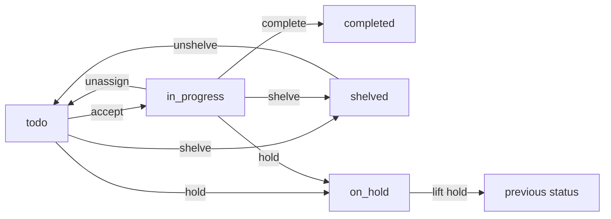

# Quests

A quest is one piece of work in a project: a bug to fix, a feature to build, a
chore to do. It says what has to change, who is on it and how far along it is,
and it keeps the discussion and the commits that went with it.

Quests come with the **Plan** capability, with a list and a board. Estimates,
the timer and reminders are options of it: see
[Capabilities](/lore/docs/project-capabilities).

## The quest list

**Quests** in the sidebar lists the project's quests. Click a row to open the
quest.


The bar above the table searches, and filters by **Status**, **Area**, **Tag**,
**Release** and **Epic**. Two kinds of quests are left out until you ask for
them: shelved quests, which appear when the Status filter names **Shelved**, and
the quests of a draft [epic](/lore/docs/plan-epics), which appear when the Epic
filter names that epic. The Release and Epic filters both start with **None**,
for the quests that belong to no release or no epic.

A row's menu accepts, edits, shelves or deletes the quest, sets its release and
copies its ID. Tick several rows to shelve, unshelve, delete them or add them to
a release in one go.

## Creating a quest

1. On **Quests**, click **New quest**.
2. Give it a **Name** and an **Area**. The area field lists the project's
   areas, and typing a new name creates one.
3. Add what you know: a **Description**, a **Priority**, a **Size**. Under
   **Advanced** are the tags, the due date, the objectives, the quest it
   depends on and its release.
4. Click **Create quest**. The arrow beside it offers **Create and accept**,
   which also assigns the quest to you.

### What a quest carries

| Field                 | What it says                                                                                                     |
| --------------------- | ---------------------------------------------------------------------------------------------------------------- |
| **Number**            | Its ID in the project, written `#Q12`. Numbers are per project, so every project has a `#Q1`.                    |
| **Name**              | What changes, in one line.                                                                                       |
| **Description**       | Why, in Markdown.                                                                                                |
| **Area**              | The part of the system it touches. Required, exactly one.                                                        |
| **Priority**          | How urgent: `optional`, `low`, `medium` or `high`, in that order.                                                |
| **Size**              | How big, on a t-shirt scale: XS, S, M, L, XL. It starts at M, which reads as "nobody sized this".                |
| **Tags**              | The nature of the work: `bug`, `feat`, `chore`, ... Lowercased and deduplicated.                                 |
| **Objectives**        | A checklist of at most 10 steps. More than that is more than one quest.                                          |
| **Depends on**        | Another quest that must be completed before this one can start.                                                  |
| **Due date**          | A deadline, independent of any release's.                                                                        |
| **Epic**, **release** | Where it belongs, when the project uses [epics](/lore/docs/plan-epics) and [releases](/lore/docs/plan-releases). |

Area, tags and epic answer three different questions. The **area** is _where_
(a module, a package, a screen), the **tags** are _what kind_ of work, and the
**epic** is the bounded initiative it belongs to, which can span several areas
and ends.

With the **Estimates** option on, a quest also says how long it should take.
With **Timer**, it records how long it actually took, from a timer you start
and pause on the quest. With **Reminders**, whoever holds the quest can ask for
a daily, weekly or monthly email nudge. All three are switched in
**Settings ▸ Plan ▸ Features**.

### Areas

Areas are the project's map of itself. **Settings ▸ Plan ▸ Areas** lists them
with their open quests, and lets someone whose rank may manage areas describe,
rename, merge and delete them. Renaming an area onto an existing one merges the
two. An area that still holds quests cannot be deleted: merge it into another
one instead. An area's description is worth writing: it is what an agent reads
to decide where a new quest goes.

⚠️ Area names are matched exactly: `Auth` and `auth` are two areas, and filing a
quest under a name nobody used before creates a new area without asking. Reuse
the existing names.

## The quest page

A quest's page has its description and objectives in the middle, the
**Discussion** underneath, and a side rail with its status, assignee, priority,
size, due date, area, epic, release, commits and tags.


The button at the top is the next step: **Accept the quest**, then **Complete
quest**. The rail holds the rest: the **Assigned** row hands the quest to
another member, and its last rows are **Duplicate**, **Put on hold**, **Shelve**
and **Unassign**. **Edit** opens the same form as creation. When a quest depends
on another, or others depend on it, the page shows what it is blocked by and
what it unlocks.

The Discussion mixes the quest's comments with its history (taken, put on hold,
completed, ...). Mention a member with `@` and the comment lands in their inbox.
A comment written by an AI agent carries an **agent** mark.

Anywhere Lore renders Markdown (descriptions, comments, folios), `[[#Q12]]`
links to quest 12 of the same project. The same syntax reaches the other kinds:
`[[#F3]]` a folio, `[[#E4]]` an epic, `[[#R2]]` a release, `[[#P120]]` a
feedback item.

## Statuses

A quest is always in one of five statuses:

| Status          | Meaning                                                                      |
| --------------- | ---------------------------------------------------------------------------- |
| **To do**       | In the backlog, nobody on it.                                                |
| **In progress** | Accepted: someone (a person or an agent) is working on it.                   |
| **On hold**     | Blocked on something outside itself: an answer, a credential, a decision.    |
| **Shelved**     | Set aside as out of scope for now. Kept, but hidden from lists and progress. |
| **Completed**   | Done.                                                                        |

Agents and the command line name them `todo`, `in_progress`, `on_hold`,
`shelved` and `completed`.



- **Accept** assigns the quest to you and moves it to In progress. It is
  refused while the quest it depends on is not completed. Accepting a shelved
  quest takes it off the shelf.
- **Complete** asks for a short summary of what was done, which you may skip.
  Every objective has to be ticked, or skipped with a reason: the dialog asks
  why for each one still unticked. A skipped objective stays unticked and keeps
  its reason, because it records work that was not done. A quest completed with
  no release joins the project's default release, if it has one.
- **Put on hold** needs a reason, posted to the Discussion. Mention whoever you
  are waiting on with `@` and it lands in their inbox. **Lift hold** restores
  the previous status and assignee. While on hold, a quest can be neither
  accepted nor completed.
- **Shelve** works on any quest not completed. An accepted quest is unassigned
  in the same step, its timer stopped and its reminders cleared, and a hold is
  lifted; the history shows each move. Prefer it to deleting when the idea is
  worth keeping.
- **Unassign** sends the quest back to the backlog and stops its reminders.
  Nothing written on it is lost.

A quest waiting on _another quest_ is not on hold: set **Depends on** instead,
which also draws the link between the two.

A completed quest does not reopen. Its name, description and objectives are
frozen, and only its area, tags, release and completion summary can still
change. Follow-up work is a new quest.

Quests inside an epic follow its workflow too: they can be accepted only while
the epic is ready or in progress. See [Epics](/lore/docs/plan-epics).

### Deleting a quest

**Delete quest** is in the row's menu on the Quests page.

⚠️ You can undo a delete for a few seconds, then it is permanent. The quest's
creator can delete it, and so can anyone whose rank may delete quests, which a
**Member** may by default (see [Members](/lore/docs/project-members)). A quest
inside an epic that has started, completed or been shelved cannot be deleted:
shelve the quest instead.

## The board

With the **Board** option on, **Kanban** in the sidebar shows the same quests
as cards in columns.


The board starts with **To do** and **Completed**. Someone whose rank may
change the project's settings (the owner, by default) adds up to five columns
between them, with **Add a column** on the board or in
**Settings ▸ Plan ▸ Board**. A column's menu on the board renames it, colours
it or deletes it once it is empty. The settings page orders the columns and
sets, for each one:

- what a card dropped there means: **To do**, **In progress** (the default) or
  **Done**. When one of your columns means To do or Done, it replaces the
  board's own;
- a **WIP limit**. Going over it shows a warning and blocks nothing.

Dragging a card is the same move as on the quest page. From To do into an
in-progress column accepts the quest, back to To do unassigns it, and into a
completed column completes it. A quest still to do has to be accepted before it
can be completed, and a completed card cannot be moved.

Above the board, a search and the **My cards**, **Overdue** and **Due this
week** filters narrow the cards, and the lanes control groups them **By area**
or **By epic**. **Add a card** in a column creates a quest from its title
alone, in the area the board is filtered on or else the project's first area.

## Commits

Put the quest number in your commit messages (`fix login redirect (#Q12)`) and
record the commits on the quest, so "what shipped for #Q12" is a field rather
than a search through the git log. They show in the quest's side rail, as links
once the project's **Repository** is set in **Settings ▸ General**.

Commits are recorded from the command line or by an agent, one by one or as the
quest is completed. A commit already recorded is not added twice, and one can
still be added to a completed quest, since the final sha is often known only
after the merge.

## From the command line

```bash
lore quest list --status in_progress
lore quest create --title "Add a dark mode toggle" --area web --priority medium --accept
lore quest complete 12 --message "Redirect fixed" --commit 3f9c2a1
```

A quest can be named `12`, `Q12` or `'#Q12'` (quote it, or the shell reads a
comment). `lore project info` lists the project's areas. See
[The lore CLI](/lore/docs/reference-cli#quests) for every command and flag.

## From an agent

An agent connected over MCP works quests under the same rules as a person. It
starts with `project_context` (the areas, the epics, its active quests and the
folio index in one call), accepts a quest with `quest_accept` before its first
commit, ticks objectives with `quest_objective_set` as they are met, and closes
with `quest_complete`, passing a `message` and its `commits`.

The full list is in [MCP tools](/lore/docs/reference-mcp-tools). To hand a
quest to an agent from the browser, see
[Agent prompts](/lore/docs/agents-prompts).

## Next

- [Epics](/lore/docs/plan-epics): group quests into a plan that starts and
  ends.
- [Releases](/lore/docs/plan-releases): say what ships when.
- [Attachments](/lore/docs/remember-attachments): files on a quest.
- [Dashboard](/lore/docs/project-dashboard): see the project's quests at a
  glance.
