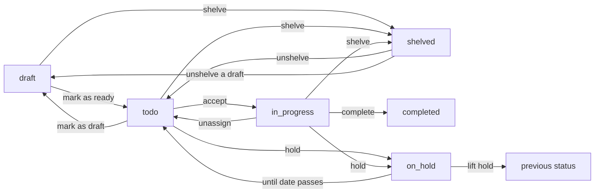

# Quests

A quest is one piece of work in a project: a bug to fix, a feature to build, a
chore to do. It says what has to change, who is on it and how far along it is,
and it keeps the discussion and the commits that went with it.

Quests come with the **Plan** capability, with a list and a board. Estimates,
the timer and reminders are options of it: see
[Capabilities](/lore/docs/project-capabilities).

## The quest list

**Quests** in the sidebar lists the project's quests. Click a row to open the
quest.


The bar above the table searches, and filters by **Status**, **Area**, **Tag**,
**Release**, **Epic** and **Assignee**. Two kinds of quests are left out until you ask for
them: shelved quests, which appear when the Status filter names **Shelved**, and
[drafts](#drafts), which appear when it names **Draft**. Naming an
[epic](/lore/docs/plan-epics) in the Epic filter lists all of its quests,
drafts included. A draft's row wears a dashed ring where the others have a
dot. The Release and Epic filters both start with **None**, for the quests
that belong to no release or no epic.

A row's menu accepts, edits, shelves or deletes the quest, sets its release and
copies its ID. Tick several rows to shelve, unshelve, delete them or add them to
a release in one go.

## Creating a quest

1. On **Quests**, click **New quest**.
2. Give it a **Name** and an **Area**. The area field lists the project's
   areas, and typing a new name creates one.
3. Add what you know: a **Description**, a **Priority**, a **Size**. Under
   **Advanced** are the tags, the due date, the objectives, the quest it
   depends on and its release.
4. Click **Create quest**. The arrow beside it offers **Create and accept**,
   which also assigns the quest to you, and **Create as draft**, which files
   it as a [draft](#drafts) nobody can take yet.

A new quest is **To do**, ready to be taken, unless you created it as a draft.

### What a quest carries

| Field                 | What it says                                                                                                     |
| --------------------- | ---------------------------------------------------------------------------------------------------------------- |
| **Number**            | Its ID in the project, written `#Q12`. Numbers are per project, so every project has a `#Q1`.                    |
| **Name**              | What changes, in one line.                                                                                       |
| **Description**       | Why, in Markdown.                                                                                                |
| **Area**              | The part of the system it touches. Required, exactly one.                                                        |
| **Priority**          | How urgent: `optional`, `low`, `medium` or `high`, in that order.                                                |
| **Size**              | How big, on a t-shirt scale: XS, S, M, L, XL. It starts at M, which reads as "nobody sized this".                |
| **Tags**              | The nature of the work: `bug`, `feat`, `chore`, ... Lowercased and deduplicated.                                 |
| **Objectives**        | A checklist of at most 10 steps. More than that is more than one quest.                                          |
| **Depends on**        | Another quest that must be completed before this one can start.                                                  |
| **Due date**          | A deadline, independent of any release's.                                                                        |
| **Epic**, **release** | Where it belongs, when the project uses [epics](/lore/docs/plan-epics) and [releases](/lore/docs/plan-releases). |

Area, tags and epic answer three different questions. The **area** is _where_
(a module, a package, a screen), the **tags** are _what kind_ of work, and the
**epic** is the bounded initiative it belongs to, which can span several areas
and ends.

With the **Estimates** option on, a quest also says how long it should take.
With **Timer**, it records how long it actually took, from a timer you start
and pause on the quest. With **Reminders**, whoever holds the quest can ask for
a daily, weekly or monthly nudge, which Lore sends at the top of the hour it
falls due (see [Quest reminders](/lore/docs/project-notifications#quest-reminders)).
All three are switched in **Settings ▸ Plan ▸ Quests**, which also holds
**Export quests**: it downloads every quest as a CSV file.

### Areas

Areas are the project's map of itself. **Settings ▸ Plan ▸ Areas** lists them
with their open quests, and lets someone whose rank may manage areas describe,
rename, merge and delete them. Renaming an area onto an existing one merges the
two. An area that still holds quests cannot be deleted: merge it into another
one instead. An area's description is worth writing: it is what an agent reads
to decide where a new quest goes.

⚠️ Area names are matched exactly: `Auth` and `auth` are two areas, and filing a
quest under a name nobody used before creates a new area without asking. Reuse
the existing names.

## The quest page

A quest's page has its description and objectives in the middle, the
**Discussion** underneath, and a side rail with its status, assignee, priority,
size, due date, area, epic, release, commits, pull requests and tags.


The button at the top is the next step: **Accept the quest**, then **Complete
quest**. The rail holds the rest: the **Assigned** row hands the quest to
another member, and its last rows are **Duplicate**, **Mark as ready** or
**Mark as draft**, **Put on hold**, **Shelve** and **Unassign**. **Edit** opens the same form as creation. When a quest depends
on another, or others depend on it, the page shows what it is blocked by and
what it unlocks.

The Discussion mixes the quest's comments with its history (taken, put on hold,
completed, ...). Mention a member with `@` and the comment lands in their inbox.
A comment written by an AI agent carries an **agent** mark.

A quest tagged `needs-answer` waits on you: an agent stopped on a question and
left it in the Discussion. The composer then shows **Answer** beside
**Comment**. Answer posts your comment and removes the tag, so the quest
leaves **Asks** and the next agent run works it. Use Comment for a reply that
is not the answer yet.

Anywhere Lore renders Markdown (descriptions, comments, folios), `[[#Q12]]`
links to quest 12 of the same project. The same syntax reaches the other kinds:
`[[#F3]]` a folio, `[[#E4]]` an epic, `[[#R2]]` a release, `[[#P120]]` a
feedback item.

## Statuses

A quest is always in one of six statuses:

| Status          | Meaning                                                                      |
| --------------- | ---------------------------------------------------------------------------- |
| **Draft**       | Specified, not ready to be taken. Nobody can accept it yet.                  |
| **To do**       | In the backlog, nobody on it.                                                |
| **In progress** | Accepted: someone (a person or an agent) is working on it.                   |
| **On hold**     | Blocked on something outside itself: an answer, a credential, a decision.    |
| **Shelved**     | Set aside as out of scope for now. Kept, but hidden from lists and progress. |
| **Completed**   | Done.                                                                        |

Agents and the command line name them `draft`, `todo`, `in_progress`,
`on_hold`, `shelved` and `completed`.



- **Accept** assigns the quest to you and moves it to In progress. It is
  refused while the quest it depends on is not completed. Accepting a shelved
  quest takes it off the shelf.
- **Complete** asks for a short summary of what was done, which you may skip.
  Every objective has to be ticked, or skipped with a reason: the dialog asks
  why for each one still unticked. A skipped objective stays unticked and keeps
  its reason, because it records work that was not done. A quest completed with
  no release joins the project's default release, if it has one.
- **Put on hold** needs a reason, posted to the Discussion. Mention whoever you
  are waiting on with `@` and it lands in their inbox. **Lift hold** restores
  the previous status and assignee. While on hold, a quest can be neither
  accepted nor completed. The dialog also takes an optional **Until** date,
  with quick picks for one day, one, two and three weeks and one month
  (**1D**, **1W**, **2W**, **3W**, **1M**): the date shows beside On hold, and
  within the hour after it the hold lifts on its own and the quest goes back to
  **To do**, unassigned whatever it was before, with a line in the Discussion.
  Nobody is notified.
- **Shelve** works on any quest not completed. An accepted quest is unassigned
  in the same step, its timer stopped and its reminders cleared, and a hold is
  lifted; the history shows each move. Prefer it to deleting when the idea is
  worth keeping.
- **Unassign** sends the quest back to the backlog and stops its reminders.
  Nothing written on it is lost.

### Drafts

A draft is a quest written down and not ready to be taken: a problem noticed
in passing, a follow-up nobody should pick up before its owner has read it, a
quest whose spec is still being argued. It is listed like any other quest, and
it is left out of what is open: the Quests page's default view, the counts in
the sidebar and on the [dashboard](/lore/docs/project-dashboard), and the
open figures of the [reports](/lore/docs/project-reports).

A quest becomes a draft in one of three ways:

- **Create as draft**, under the arrow of **Create quest**, or **Add a card**
  in the board's **Draft** column;
- **Mark as draft** on the page of a quest still to do that is in no epic;
- its [epic](/lore/docs/plan-epics) is a draft: every quest of a draft epic
  that nobody has taken is one.

**Mark as ready** on a draft's page makes it **To do**, open to anyone. Neither
button asks first, since each undoes the other. A quest in an epic offers
neither: its rail says **Draft until Epic 12 is ready** instead, linked to the
epic, because the epic's status decides for all of its quests at once.

A draft cannot be accepted, assigned or put on hold, and each refusal says how
to make it ready. **Accept the quest** on a draft in no epic asks **Mark this
quest as ready?** first, and **Mark as ready and accept** does both. A draft
can be edited, commented on, shelved and deleted; a shelved draft is still a
draft when it is unshelved. A quest that depends on a draft says **Blocked by
draft**, because nothing moves until someone marks it ready.

### A quest an agent job is working

When an [agent job](/lore/docs/agents-jobs) accepts a quest, the quest records
the job as a second assignee: wherever the quest shows who holds it (its
page, the quest list, the board's cards), the icon of the job's agent (Claude
Code, Gemini CLI, a robot for any other) stands in front of the member it
works for. It links to the job's page, and hovering it opens a card naming
the agent, the job, the member and whether the job is still running. Once the
job has ended the icon turns grey and the card says so: the agent stays on the
quest until it goes back to To do, which is expected. When the job ends, finished or not,
every quest it still holds goes back to **To do**, with a line in its
Discussion saying its job ended. Its comments, commits and pull request stay,
so the next run, or you, can pick it up. Unassigning, completing or shelving
the quest frees it from the job at once. A quest you accept yourself records
no job.

In the quest list, the **Assignee** filter's **An agent** keeps only the
quests a job is working right now.

A quest waiting on _another quest_ is not on hold: set **Depends on** instead,
which also draws the link between the two.

A completed quest does not reopen. Its name, description and objectives are
frozen, and only its area, tags, release and completion summary can still
change. Follow-up work is a new quest.

Quests inside an epic follow its workflow too: they can be accepted only while
the epic is ready or in progress. See [Epics](/lore/docs/plan-epics).

### Deleting a quest

**Delete quest** is in the row's menu on the Quests page.

⚠️ A delete cannot be undone. The quest's
creator can delete it, and so can anyone whose rank may delete quests, which a
**Member** may by default (see [Members](/lore/docs/project-members)). A quest
inside an epic that has started, completed or been shelved cannot be deleted:
shelve the quest instead.

## The board

**Board**, the second tab of **Quests**, shows the same quests as cards in
columns. The page reopens on the tab you used last.


The board starts with **Draft**, **To do** and **Completed**. Someone whose
rank may change the project's settings (the owner, by default) adds up to five
columns between To do and Completed, with **Add a column** on the board or in
**Settings ▸ Plan ▸ Board**. A column's menu on the board renames it, colours
it or deletes it once it is empty. The settings page orders the columns and
sets, for each one:

- what a card dropped there means (**Maps to**): **Draft**, **To do**, **In
  progress** (the default) or **Done**. When one of your columns means Draft,
  To do or Done, it replaces the board's own;
- a **WIP limit**. Going over it shows a warning and blocks nothing.

Dragging a card is the same move as on the quest page. From To do into an
in-progress column accepts the quest, back to To do unassigns it, and into a
completed column completes it. A quest still to do has to be accepted before it
can be completed, and a completed card cannot be moved.

The **Draft** column holds the [drafts](#drafts), held ones included, and its
one door is To do:

- a card in no epic dragged from Draft to To do is marked ready, and from To
  do back to Draft is marked draft;
- a draft of an epic dropped on To do asks **Mark Epic 12 ready?**, naming how
  many quests go with it: confirmed, the epic is marked ready and all of its
  drafts move to To do together;
- any other drop into or out of Draft is refused, and the message says why: a
  draft has to be marked ready before it is taken, and an epic's to-do quest
  goes back to draft only with its epic.

Above the board, a search and the **My cards**, **Overdue** and **Due this
week** filters narrow the cards, and the lanes control groups them **By area**
or **By epic**. **Add a card** in a column creates a quest from its title
alone, in the area the board is filtered on or else the project's first area;
in the Draft column, the quest is a draft.

## Commits

Put the quest number in your commit messages (`fix login redirect (#Q12)`) and
record the commits on the quest, so "what shipped for #Q12" is a field rather
than a search through the git log. They show in the quest's side rail, as links
once the project's **Repository** is set in **Settings ▸ General**.

Commits are recorded from the command line or by an agent, one by one or as the
quest is completed. In a project connected to GitHub, a push to the default
branch records the commits that name the quest by itself. A commit already recorded is not added twice, and one can
still be added to a completed quest, since the final sha is often known only
after the merge.

## Pull requests

A pull request is recorded on a quest the same way: its URL, and its number and
title when you have them. The rail lists them under **Pull requests**, linked to
the URL as recorded. A pull request already recorded is not added twice, and one
can still be added to a completed quest.

A quest in an epic usually has none of its own: an epic lands as one pull
request, recorded once on the epic, and each of its quests shows it in its rail,
marked **From the epic**. A quest that records its own shows that one instead.
In a project connected to GitHub, a pull request whose title, description or
branch names the quest (`#Q12`, or a `lore/q12` branch) is recorded by itself; a
bare `#12` names nothing. Each pull request of the connected repository then
shows its state beside its number: **Open**, **Draft**, **In merge queue**,
**Merged** or **Closed**, and a dot for its checks, kept up to date while one is
open.

```bash
lore quest pull-request add 12 --url https://github.com/acme/crm/pull/118 --pr-number 118
```

## Where a quest is live

In a project that deploys its apps with Lore, a done quest says where it runs.
The quest's rail shows a **Live** row with one chip per deployed copy, such as
`my-app/production · since 2 hours`, linked to that copy.

**Live** means the quest's commit is in the history of the commit the copy runs,
as Lore recorded it when that build was pushed: the push reads the `#Q12`
references in the history, and the commits recorded on quests
([What a push records](/lore/docs/ship-artifacts#what-a-push-records)). It
follows the copy's newest successful deployment, so a rollback takes the quests
it removed off at once, and a redeploy of an older build puts them back.

In a repository holding several apps, every app runs the same history, so a
quest would be live on all of them. Declare the paths each app is built from
and a quest is live only on the apps whose paths its commits changed
([A repository holding several apps](/lore/docs/ship-artifacts#a-repository-holding-several-apps)).

- **unverified** beside a chip: that build was pushed from a working tree with
  uncommitted changes, so the copy may run code no commit names.
- **Unknown** is not "not live". A copy deployed before Lore recorded commits,
  or from a build pushed from a shallow clone, cannot say which quests it runs.
  The rail then shows no chip for it, and nothing claims the quest is missing.

The quest list has a **Live** column, and a **Live** filter whose **Completed,
not live yet** lists the done quests, with at least one recorded commit, that
no copy runs. It lists nothing while any copy Lore deployed is unknown or
partial, rather than claim a quest is missing from it.

## From the command line

```bash
lore quest list --status in_progress
lore quest create --title "Add a dark mode toggle" --area web --priority medium --accept
lore quest create --title "Retry the webhook on 502" --area api --priority low --draft
lore quest ready 14
lore quest complete 12 --message "Redirect fixed" --commit 3f9c2a1
```

A quest can be named `12`, `Q12` or `'#Q12'` (quote it, or the shell reads a
comment). `lore quest get 12` also lists the copies the quest is live on.
`lore project info` lists the project's areas. See
[The lore CLI](/lore/docs/reference-cli#quests) for every command and flag.

## From an agent

An agent connected over MCP works quests under the same rules as a person. It
starts with `project_context` (the areas, the epics, its active quests and the
folio index in one call), accepts a quest with `quest_accept` before its first
commit, ticks objectives with `quest_objective_set` as they are met, and closes
with `quest_complete`, passing a `message` and its `commits`, in the run that
pushes its commit rather than after the merge. It records the
pull request it opened with `quest_pull_request_add`, or with
`epic_pull_request_add` when the quest is part of an epic. `quest_get` carries
`live`, the copies running the quest's commits, as the rail shows them.

`quest_list` leaves drafts out unless `status` names `draft`. Work an agent
finds in passing and will not take in the same run is filed as a draft
(`quest_create` with `draft: true`), for its owner to read and mark ready;
`quest_ready` and `quest_draft` are the page's two buttons, and an agent
refused because a quest is a draft is told which one applies.

The full list is in [MCP tools](/lore/docs/reference-mcp-tools). To hand a
quest to an agent from the browser, see [Prompts](/lore/docs/agents-prompts).

## Next

- [Epics](/lore/docs/plan-epics): group quests into a plan that starts and
  ends.
- [Releases](/lore/docs/plan-releases): say what ships when.
- [Attachments](/lore/docs/remember-attachments): files on a quest.
- [Dashboard](/lore/docs/project-dashboard): see the project's quests at a
  glance.
