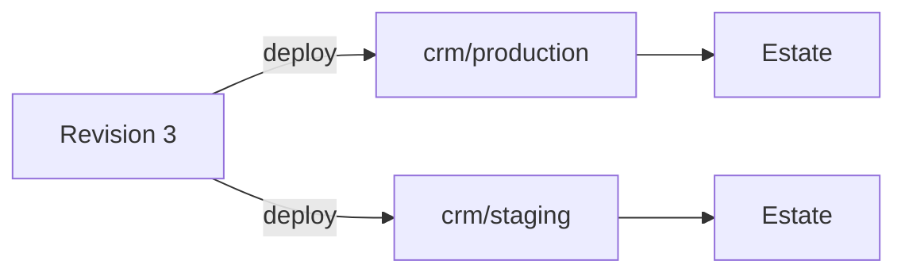

# Stacks

A stack is a group of services deployed together from one `compose.yml` onto a
server running [Bay](/bay/docs/guides-introduction): a database, a queue, an
analytics tool, your own images. Lore stores the file and its revisions, holds
its variables, and tells the server what to run. The services can be built
with anything: nothing in a stack needs Alepha.

This page covers Lore's side. The file's format, and what Bay does with it,
are in [Stacks](/bay/docs/guides-stacks) in the Bay documentation.

## Turning it on

Stacks are the **Stacks** option of the Apps capability, off by default, in
**Settings ▸ General ▸ Capabilities** (see
[Capabilities](/lore/docs/project-capabilities)). It adds **Stacks** to the
sidebar.

A stack needs somewhere to run: a Bay [estate](/lore/docs/apps-estates) lent to
the project, with **Allow deploys** on. Only a Bay estate runs stacks.

Reading takes `app:read`, which the default Member rank holds. Everything that
changes something takes `deploy:manage` and the option on. So does reading a
service's logs, because logs can hold what an app printed. Turn the option off
and your stacks stay, readable, for when it comes back.

⚠️ Two things need the **Deploy apps** option as well, which is off by default:
deploying one app service alone, and storing a registry credential.

## Stacks, environments and revisions

| Word        | What it is                                                                                            |
| ----------- | ----------------------------------------------------------------------------------------------------- |
| Stack       | A name, unique in the project, and a default estate. Lowercase letters, digits and hyphens, up to 64. |
| Environment | One running copy of the stack, such as `production`, addressed as `<stack>/<env>`.                    |
| Revision    | One numbered upload of the Compose file, with the files it references. A stack has many.              |
| Member      | An [app instance](/lore/docs/apps-instances) that runs as one service of an environment.              |



An environment deploys to its own estate if it names one, and otherwise to the
stack's default. A deploy never asks where: that is a property of the
environment.

## Creating a stack

1. Open **Stacks**. In the **New stack** card, type a **Name** (left empty, it
   is the project's slug), choose the **Default estate**, and click
   **Create**.
2. On the stack's card, type an environment name such as `production` and
   click **Add environment**.
3. On the same card, choose the **Compose file or bundle** and click
   **Upload**. That is the stack's first revision.

Each environment on the card is a link to its own page, where the stack is
deployed and watched.

## Uploading a revision

A revision is a `compose.yml`, or a gzip or zstd tar bundle holding one with
the files it mounts. Upload it from the stack's card on the **Stacks** page.

Lore checks the file before storing anything, against every estate the stack
deploys to, so a file the server would refuse is refused at upload. Every
reason is listed at once:

- no `container_name`, no `build`, no `privileged`, no host network, PID, IPC or
  user namespace;
- no `container:` under `network_mode`, `pid`, `ipc` or `volumes_from`, which
  would reach another environment's containers: `service:<name>`, or a plain
  service name under `volumes_from`, names one of the stack's own;
- every plain service needs an `image`;
- no Docker socket;
- no bind mount, `env_file`, or `file:` under `secrets` or `configs` outside the
  bundle, and no variable in an `env_file` path;
- no `include`, and no `extends` from another file: a stack is one Compose
  file;
- no named volume with `driver_opts`, which could bind any host path;
- no named volume or network marked `external`, or with a `name` of its own;
- a plain service cannot depend on an app service.

The **Revisions** tab of an environment lists the stack's revisions, newest
first, and **Compare** shows the difference between any two.

## Deploying

On an environment's page, open the **Deploys** tab and click **Deploy revision
N**: it sends the newest revision.

Lore checks everything before anything reaches the server, and refuses:

- an environment with no estate, or one no longer lent to the project;
- an estate that is not a Bay estate, or that does not accept deploys;
- a revision that cannot run there;
- a Compose file that uses a required variable this environment has not set,
  naming every one.

Then it queues the deploy for the server. The **Deploys** tab follows it: its
status, and how many services it created, changed and removed.

### Rolling back

A rollback deploys an earlier revision again, and it is the same operation as a
deploy: on the **Revisions** tab, click **Deploy this revision** on the one
you want.

⚠️ **The Compose file goes back. Volumes and their data do not.**

### An app as a service of a stack

This part is optional: a stack of plain images needs none of it. A stack can
also run an app deployed through Lore as one of its services, beside the
database it uses. Deploying an app through Lore needs an app built with Alepha
(see [Deploying an app](/lore/docs/apps-deploying)).

Such an app names its stack in `alepha.config.ts`:

```ts
lore({ stack: "crm" });
```

`alepha deploy staging` then puts the app into `crm/staging`, creating the
instance if needed and making it a member. The stack and the environment must
already exist, so deploy the stack there once first.

Once an instance is a member, deploying it sends its stored build into its own
service, blue/green, against the revision the environment already runs. No
other service is touched and nothing of the Compose file is applied.

An instance joins the environment of its own environment name:
`crm-api/staging` can join `crm/staging`, never `crm/production`. It belongs to
one environment at a time, and it takes its estate from that environment, not
from its own **Settings** tab.

## The environment page

Each environment has seven tabs:

| Tab       | What it shows                                                                                |
| --------- | -------------------------------------------------------------------------------------------- |
| Services  | What the revision declares, beside what the server last reported, with restart, stop, start. |
| Deploys   | Its deploys, newest first, with what each changed, and the deploy button.                    |
| Revisions | The stack's revisions and their differences, each with **Deploy this revision**.             |
| Routes    | The full domains it serves.                                                                  |
| Variables | Its variables, never their values.                                                           |
| Volumes   | The named volumes of the running revision, and whether a backup hook covers each.            |
| Settings  | The stack's default estate, this environment's own estate, its base domain, and deleting it. |

⚠️ A stopped service stays stopped, across reboots too. The way back is
**Start**, or a deploy.

**Logs** on a service's row asks the server for its last 200 lines, and shows
them once it has answered. They are kept for 24 hours.

## Variables

Variables fill the `${VAR}` of the Compose file. They are per environment and
write-only: on the **Variables** tab, give a **Name** and a **Value**, or tick
**Generate a random value**, then **Save**.

A value is never shown again, to anybody. Lore keeps it sealed, opens it only
for a deploy, and shows the name and at most a four-character prefix of a long
value. A generated value shows no prefix.

When the newest revision needs a variable the environment lacks, the tab names
it, and a deploy is refused until it is set.

An environment holds up to 200 variables, each up to 5,000 characters. Bay
refuses a deploy with a variable named `COMPOSE_*`, which would configure
Compose itself.

## Routes

A Compose file carries route labels, never full domains, so that production
and staging can use different ones. Labels resolve against the environment's
**Base domain**, set on its **Settings** tab (left empty, the estate's default
is used). How labels and base domains work is Bay's, see
[Routes and domains](/bay/docs/guides-stacks#routes-and-domains).

The **Routes** tab adds a full domain on top, served by one service: pick the
**Service**, type the **Domain**, and click **Add route**.

### A test hostname, with no DNS

A server bought for an hour has an IP and no domain. From the command line,
`--test-hostname <service>` on `lore stack deploy` serves that service on a
name derived from the estate's public IP, before the deploy runs:

```bash
lore stack deploy -e staging --test-hostname web
```

```text
Routing https://staging-crm.203-0-113-10.sslip.io/ to web.
```

The name is `<env>-<stack>.<ip-with-dashes>.sslip.io`. sslip.io answers any
such name with the IP it contains, so it points at the server at once, and Bay
gets a real certificate for it as for any route. Nothing is created in
anyone's DNS, so nothing needs cleaning: the route goes with the environment.
The IP is the one Lore saw when the server connected, so the estate must have
connected once (`lore estate wait`). `lore estate get` shows it.

## Private registries

An image from a private registry needs a credential, stored per project and
pulled by the server for the deploy. It is stored from the command line:

```bash
lore registry add ghcr.io --username bot --password-stdin
```

See [The lore CLI](/lore/docs/reference-cli#container-registries).

## Removing

**Delete environment**, on its **Settings** tab, forgets an environment in
Lore, with its routes and variables. Its member apps stay, as ordinary
instances.

⚠️ **Nothing on the estate is touched**: what runs keeps running. To take the
environment off the server as well, use `lore stack destroy`, below.

A whole stack, with its revisions, is deleted once it has no environment left:
**Delete stack** appears on its card on the Stacks page. Nothing on a server
changes.

## From the command line

From a project directory, `lore stack` covers the same ground:

```bash
lore stack create --estate my-vps --file compose.yml
lore stack deploy -e staging                 # upload ./compose.yml, then deploy
lore stack deploy -e staging --file deploy/compose.yml
lore stack deploy -e staging --revision 4    # a revision already uploaded
lore stack deploy -e staging --dry-run       # say what would happen
lore stack rollback -e production --to 2
lore stack logs web -e production --lines 1000
lore stack route add web --domain app.example.com -e production
```

- The stack's name defaults to the project's slug. `lore stack deploy` uploads
  the Compose file beside the command as a new revision first, and creates the
  environment on its first deploy, on the stack's default estate unless
  `--estate` names another. `-e` defaults to `production`.
- `lore stack logs` takes up to 2,000 lines, as does the `stack_logs` tool.

Variables are set with `lore stack secrets`:

```bash
lore stack secrets set DATABASE_URL=postgres://... -e production
lore stack secrets set APP_SECRET --generate -e production
lore stack secrets list -e production
```

`--generate` makes a random hex value on the server, 64 characters unless
`--length` says otherwise (16 to 256), so it never passes through a terminal.
`-e` is required on these commands: a variable set on the wrong environment is
a production secret in staging.

Removing goes further than the page does:

- `lore stack destroy --env <env>` asks the server to remove the environment
  first, keeping its volumes, variables and registry credentials, then forgets
  it in Lore. On an estate that does not accept deploys, it forgets the
  environment and prints the `bay stack destroy` to run on the server.
- `--purge` asks the server for nothing: Lore never deletes data on a server,
  so it forgets the environment and prints `bay stack destroy --purge`.
- `lore stack delete <name>` deletes a stack with no environment left (`--yes`
  skips the prompt). While one remains, Lore refuses and names each with the
  `lore stack destroy` that forgets it, so nothing still running on a server
  is forgotten by accident.

The full list is in [The lore CLI](/lore/docs/reference-cli#stacks).

## From an agent

| Tool             | What it does                                                                                                                 |
| ---------------- | ---------------------------------------------------------------------------------------------------------------------------- |
| `stack_list`     | Every stack, with its environments, routes, member apps and the revision each runs.                                          |
| `stack_get`      | One stack: each environment's services and newest deploys. Never a variable's value.                                         |
| `stack_deploy`   | Deploy a revision to an environment, the newest by default. With `app`, deploy one app service alone from a stored build.    |
| `stack_rollback` | Deploy an earlier revision again.                                                                                            |
| `stack_logs`     | Two calls: with `service` it asks for the tail and answers a `request`; with that `request` it answers the lines when ready. |

No `stack_*` tool takes an estate. Creating a stack, uploading a revision and
setting variables and routes have no tool: those are for the page and the
command line. See [MCP tools](/lore/docs/reference-mcp-tools).

## Next

- [Estates](/lore/docs/apps-estates): the servers a stack deploys to.
- [Stacks](/bay/docs/guides-stacks) in the Bay documentation: the Compose
  file, `x-lore` fields, backups and volumes.
- [A throwaway server](/bay/docs/tutorials-a-throwaway-server): a server, a
  stack and an app from a shell, in a few minutes.
- [Deploying an app](/lore/docs/apps-deploying): an app on its own, without a
  stack.
